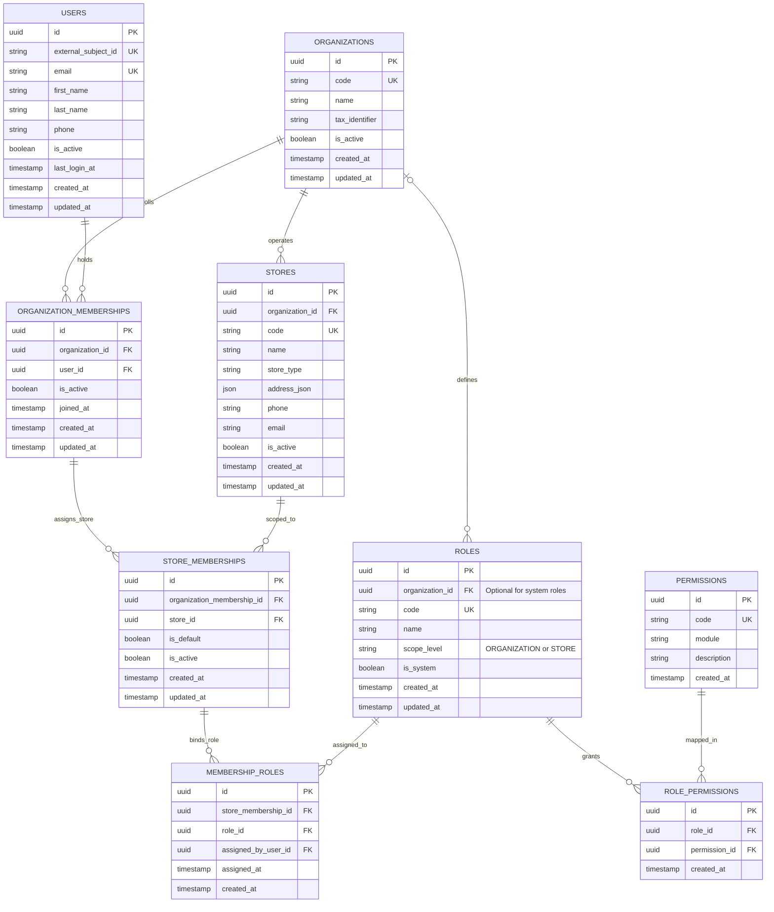
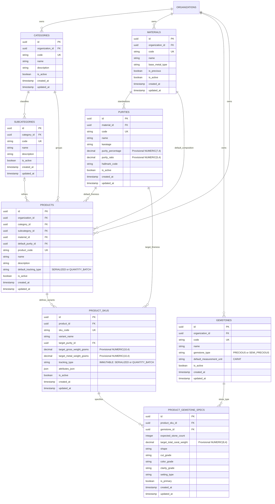
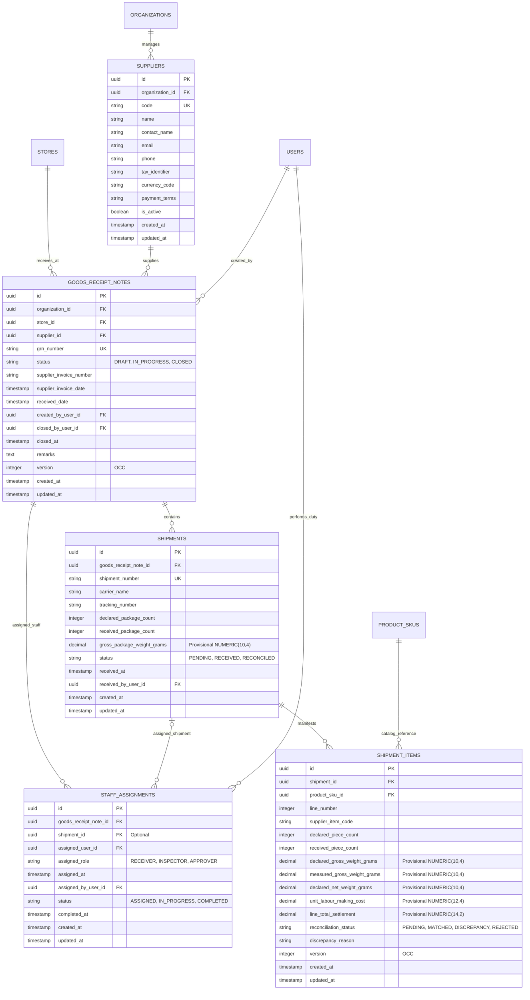
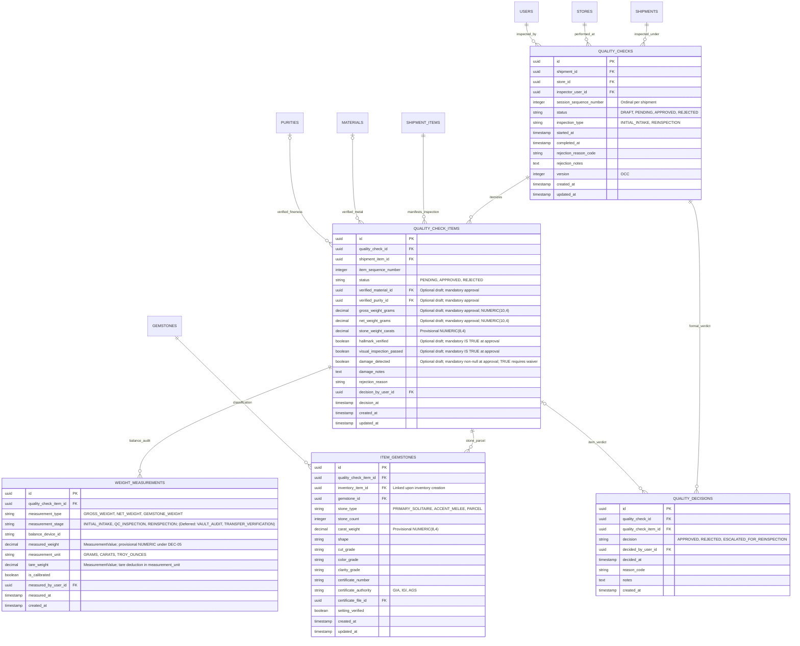
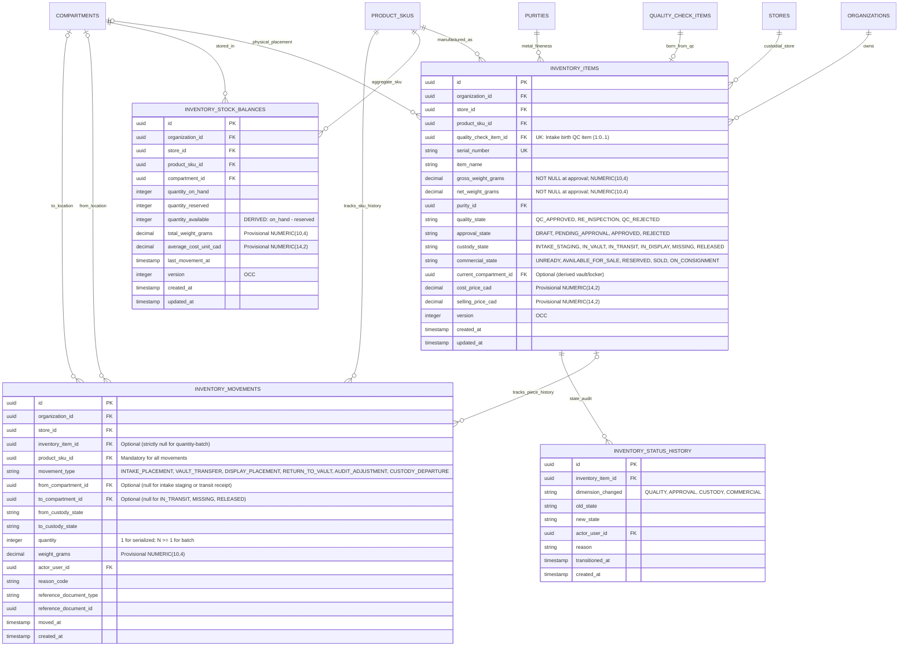
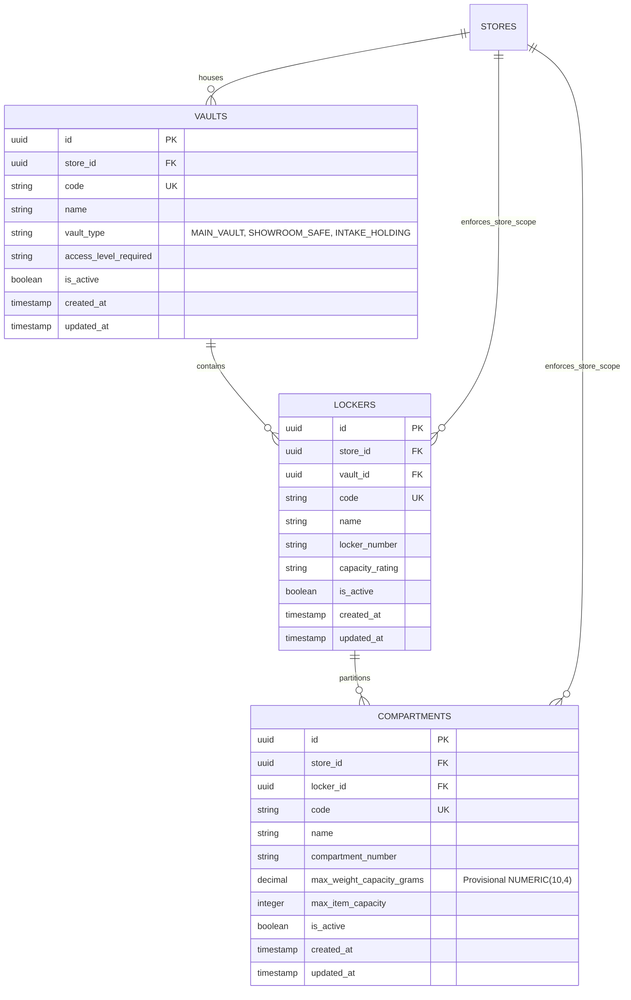
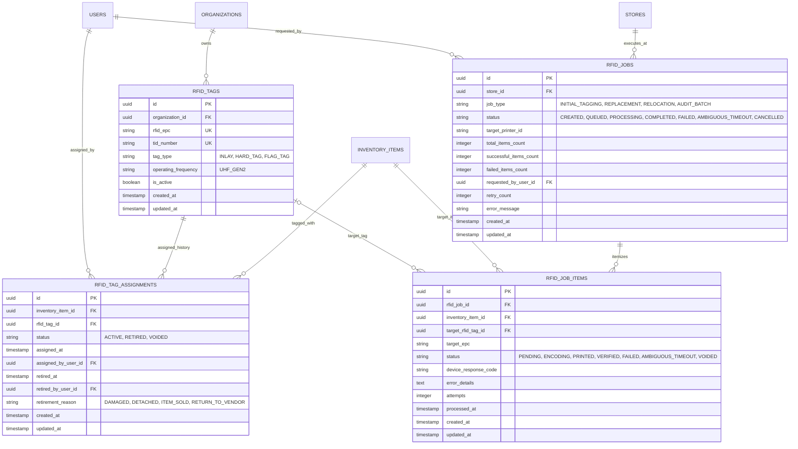
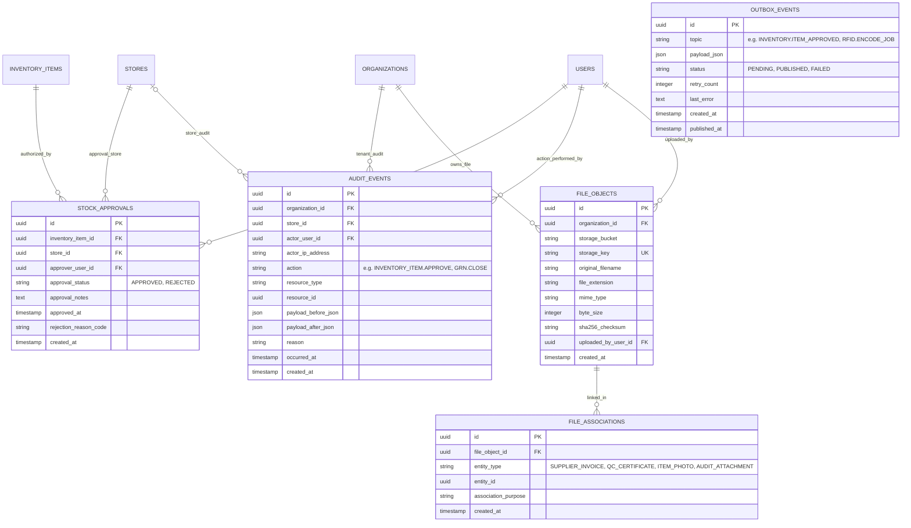

# Jewellery ERP Platform — Core Logical Relational Data Model & Data Dictionary

**Document Version:** 0.3.3  
**Status:** Milestone 0.3 Deliverable — Logical Modeling Specification (Targeted v0.3.3 Three-Valued Logic & Invariant Classification Pass)  
**Date:** 2026-10-27  
**Author:** Principal Software Architect, Senior Data Modeler & PostgreSQL Database Architect  
**Project:** Jewellery ERP Platform  
**Repository:** `jewellery-erp-platform`  
**Target Stack:** Next.js (Web) + Express 5 & TypeScript (API/Worker) + PostgreSQL + Redis/BullMQ  
**Milestone Context:** Milestone 0.3 (Core Logical ERD & Data Dictionary — Technical Reconciliation v0.3.3)  
**Parent Architectural Baseline:** [`docs/architecture/DOMAIN_MODEL_REVIEW.md`](DOMAIN_MODEL_REVIEW.md) (v1.6)

---

## Document Revision History

| Version    | Date       | Author                             | Significant Changes                                                                                                                                                                                                                                                                                                                                                                                                                                                                                                                                                                                                                                                                                                                                                                                                                                                                                                                                                                                                                                                                                                                                                                                                                                                                                                                                                                                                                                                                                                                                                                                                                                                                                                                                                                                                                                                                                                                                                                                                                                                                                                                                                                                                                                                                                                                                                                                                                                                                                                                                                                                                                                                                                                                                                                                                                                                                                                                                                                                                                                                                                                                                                                                                                                                                                                                                                                                                                                                                                                                                                                                                                                                                                                                                                                                                                                                                                                                                                                                                                                                                                                                                                                                                                                                                                                                                                                                                                                                                                                                  |
| ---------- | ---------- | ---------------------------------- | ------------------------------------------------------------------------------------------------------------------------------------------------------------------------------------------------------------------------------------------------------------------------------------------------------------------------------------------------------------------------------------------------------------------------------------------------------------------------------------------------------------------------------------------------------------------------------------------------------------------------------------------------------------------------------------------------------------------------------------------------------------------------------------------------------------------------------------------------------------------------------------------------------------------------------------------------------------------------------------------------------------------------------------------------------------------------------------------------------------------------------------------------------------------------------------------------------------------------------------------------------------------------------------------------------------------------------------------------------------------------------------------------------------------------------------------------------------------------------------------------------------------------------------------------------------------------------------------------------------------------------------------------------------------------------------------------------------------------------------------------------------------------------------------------------------------------------------------------------------------------------------------------------------------------------------------------------------------------------------------------------------------------------------------------------------------------------------------------------------------------------------------------------------------------------------------------------------------------------------------------------------------------------------------------------------------------------------------------------------------------------------------------------------------------------------------------------------------------------------------------------------------------------------------------------------------------------------------------------------------------------------------------------------------------------------------------------------------------------------------------------------------------------------------------------------------------------------------------------------------------------------------------------------------------------------------------------------------------------------------------------------------------------------------------------------------------------------------------------------------------------------------------------------------------------------------------------------------------------------------------------------------------------------------------------------------------------------------------------------------------------------------------------------------------------------------------------------------------------------------------------------------------------------------------------------------------------------------------------------------------------------------------------------------------------------------------------------------------------------------------------------------------------------------------------------------------------------------------------------------------------------------------------------------------------------------------------------------------------------------------------------------------------------------------------------------------------------------------------------------------------------------------------------------------------------------------------------------------------------------------------------------------------------------------------------------------------------------------------------------------------------------------------------------------------------------------------------------------------------------------------------------------------------ |
| **v0.3.3** | 2026-10-27 | Principal Architect & DB Architect | Targeted v0.3.3 consistency and PostgreSQL three-valued logic (3VL) correction pass: (1) Corrected PostgreSQL row-local QC approval CHECK constraint in `quality_check_items` and `INV-18`: replaced equality comparisons (`hallmark_verified = TRUE`, `visual_inspection_passed = TRUE`) with explicit truth predicate tests (`hallmark_verified IS TRUE`, `visual_inspection_passed IS TRUE`), preventing PostgreSQL CHECK constraints from accepting `UNKNOWN` (NULL) inspection outcomes; confirmed `damage_detected IS NOT NULL` and `(damage_detected IS FALSE OR (damage_detected IS TRUE AND damage_notes IS NOT NULL))`; (2) Reconciled `INV-18` classification from `Tier B/C` to `Tier B/C/D` across the invariant summary catalog, detailed descriptions, lifecycle rules, and validation checklist, accurately reflecting its partition across Tier B row-local CHECK constraints, Tier C cross-table laboratory observation validation (`weight_measurements`), and Tier D supervisor-waiver authorization policy (`quality_decisions`); (3) Preserved the 43-entity, 8-domain scope, immutable intake lineage (`inventory_items.quality_check_item_id`), supervisor waiver modeling gap (Gap 3), deferred metrology stages, and all four physical-schema decision gates (`BIZ-Q01`, `BIZ-Q02`, `BIZ-Q03`, `DEC-05`).                                                                                                                                                                                                                                                                                                                                                                                                                                                                                                                                                                                                                                                                                                                                                                                                                                                                                                                                                                                                                                                                                                                                                                                                                                                                                                                                                                                                                                                                                                                                                                                                                                                                                                                                                                                                                                                                                                                                                                                                                                                                                                                                                                                                                                                                                                                                                                                                                                                                                                                                                                                                                                                                                                                                                                                                                                                                                                                                                                                                                                                                                                                                                                                                  |
| **v0.3.2** | 2026-10-27 | Principal Architect & DB Architect | Targeted v0.3.2 verification and QC enforcement semantics correction pass: (1) Independently verified and rendered all 8 Mermaid domain ER diagrams using official Mermaid CLI (`mmdc` v12.0.0 via Google Chrome headless 156.0.8078.47), confirming 100% successful syntax validation and SVG generation with reproducible evidence; (2) Made `INV-18` enforcement semantics precise by explicitly distinguishing Tier B row-local database CHECK constraints (enforcing intra-row status-dependent nullability, weight physics `gross_weight_grams >= net_weight_grams > 0`, `hallmark_verified = TRUE`, `visual_inspection_passed = TRUE`, `damage_detected IS NOT NULL`, and `damage_notes IS NOT NULL` when damaged) from Tier C cross-table validation (verifying existence of `GROSS_WEIGHT` reading in `weight_measurements` via Express 5 `QcService`) and Tier D authorization; (3) Clarified supervisor-waiver representation within the existing schema via piece-level `quality_decisions` records (`decision = 'APPROVED'`, `reason_code = 'DAMAGE_WAIVER'`, `quality_check_item_id` set, `notes` documenting waiver justification) and explicitly disclosed the schema representation limitation (absence of dedicated `waiver_decision_id` FK on `quality_check_items` or separate `WAIVED` enum, relying on application-level RBAC for supervisor credential verification) as an architectural modeling gap (Gap 3); (4) Preserved normalized 43-entity scope, immutable intake birth lineage (`inventory_items.quality_check_item_id`), and all four physical-schema decision gates (`BIZ-Q01`, `BIZ-Q02`, `BIZ-Q03`, `DEC-05`).                                                                                                                                                                                                                                                                                                                                                                                                                                                                                                                                                                                                                                                                                                                                                                                                                                                                                                                                                                                                                                                                                                                                                                                                                                                                                                                                                                                                                                                                                                                                                                                                                                                                                                                                                                                                                                                                                                                                                                                                                                                                                                                                                                                                                                                                                                                                                                                                                                                                                                                                                                                                                                                                                                                                                                                                                                                                                   |
| **v0.3.1** | 2026-10-27 | Principal Architect & DB Architect | Targeted v0.3.1 consistency and metrology correction pass resolving three remaining logical-model issues: (1) Reconciled QC cross-parent integrity (`INV-15`): retained logical attributes on `quality_check_items` (declining redundant `shipment_id` denormalization), eliminated invalid composite foreign-key proposals referencing non-declared attributes, and formalized cross-parent shipment match (`quality_checks.shipment_id == shipment_items.shipment_id`) as a Tier A logical invariant, Tier C transactional application invariant in Express 5, and an optional future Tier B database trigger in PostgreSQL, explicitly reiterating that ordinary row-local CHECK constraints cannot perform cross-table validation; (2) Corrected draft QC inspection outcomes (`INV-18`): reclassified `hallmark_verified`, `visual_inspection_passed`, and `damage_detected` from mandatory `[M]` to optional `[O]` (nullable Boolean) during draft/pending inspection, establishing explicit tri-state semantics (`NULL` = inspection not yet performed, `TRUE` = verified/passed, `FALSE` = failed/clean structural pass for damage); established a strict pre-approval completeness gate requiring all checks to be performed (`NOT NULL`), with hallmarks verified (`TRUE`), visual inspection passed (`TRUE`), and damage assessed (with `TRUE` strictly requiring an authorized supervisor waiver), guaranteeing unperformed checks cannot be interpreted as successful; updated Section 6.4 Mermaid diagram, Section 7.4 dictionary, Section 10.1 `INV-18`, and Section 11.2 lifecycle; (3) Reconciled measurement stages with deferred workflows: reconciled `weight_measurements.measurement_stage` enumeration with architectural design gaps, formally classifying `VAULT_AUDIT` and `TRANSFER_VERIFICATION` as proposed/deferred forward-looking stages pending post-birth vault reassessment (Gap 1) and transfer order orchestration (Gap 2) models; clarified that the active Phase 0 schema binds `weight_measurements` exclusively to intake `quality_check_items` via mandatory `quality_check_item_id`, forbidding claims that vault audit or transfer weighing are fully modeled without their required associations, and strictly protecting immutable intake birth lineage (`inventory_items.quality_check_item_id`).                                                                                                                                                                                                                                                                                                                                                                                                                                                                                                                                                                                                                                                                                                                                                                                                                                                                                                                                                                                                                                                                                                                                                                                                                                                                                                                                                                                                                                                                                                                                                                                                                                                                                                                                                                                                                                                                                                                                                                                                                                                                                                                                                                                     |
| **v0.3**   | 2026-10-27 | Principal Architect & DB Architect | Targeted v0.3 consistency, metrology, and lineage correction pass: (1) Reconciled QC reinspection lifecycle and inventory lineage: clearly distinguished the intake QC item authorizing asset creation (`inventory_items.quality_check_item_id`, strictly 1:0..1), shipment-line intake inspection (`quality_check_items.shipment_item_id`), and formally identified the architectural design gap for non-shipment / vault-audit reassessment of existing inventory assets; (2) Formalized QC cross-parent integrity rule (`quality_check_items.shipment_item_id.shipment_id == quality_check_items.quality_check_id.shipment_id`) and cross-table contextual invariants (store placement, movement SKU coherence), classifying enforcement across logical rules, candidate composite database constraints/triggers, and transactional application invariants, explicitly noting the impossibility of ordinary row-local CHECK constraints for multi-table validation; (3) Fixed candidate keys and sequence definitions: defined `session_sequence_number` on `quality_checks` (scoped to `shipment_id`, immutable ordinal); re-scoped `quality_check_items` candidate key to `(quality_check_id, shipment_item_id, item_sequence_number)` ensuring pieces across different shipment lines within the same QC session do not collide; reconciled `staff_assignments` candidate key to `(goods_receipt_note_id, assigned_user_id, assigned_role)`; verified all 43 entities in Section 9 candidate keys against Section 7; harmonized `rfid_tag_assignments` active partial unique keys; (4) Corrected QC draft nullability and observation integrity: marked `verified_material_id`, `verified_purity_id`, `gross_weight_grams`, and `net_weight_grams` optional `[O]` during draft/pending inspection; established lifecycle-dependent completeness rules requiring NOT NULL at approval; established `weight_measurements` as the authoritative immutable observation log and summary fields on `quality_check_items` as finalized derived values; reconciled relationship register parent participation to Optional initially ($0..N$) and Mandatory at approval ($1..N$); (5) Clarified inter-store movement representation: documented the book-end movement ledger model for intra-store vs transit departure/receipt; retained mandatory SKU, optional inventory item for batch, positive quantity, and source/dest compartment nullability rules; explicitly identified multi-branch transfer request/order entity absence as an unresolved requirement / proposed extension; (6) Corrected tenancy-dependent uniqueness under unresolved `BIZ-Q01`: reconciled `product_skus.sku_code` and `shipments.shipment_number` uniqueness, clarifying that their organization context is inherited through parent relationships (`products.organization_id`, `goods_receipt_notes.organization_id`), distinguishing platform-wide keys from prospective composite tenant unique constraints, and forbidding assumptions of physical constraints on non-declared attributes; (7) Corrected weight-measurement semantics: eliminated `TARE_DEDUCTION` from `measurement_type` enum to avoid duplicate sources of truth; established tare as an associated deduction attribute (`tare_weight`) on the measurement observation event in the declared unit; distinguished physical quantity measured (`measurement_type`) from lifecycle stage (`measurement_stage`); retained provisional numeric scales under `DEC-05`; (8) Restored business-question ID traceability: corrected descriptions of `BIZ-Q04` (GRN closure rules with unresolved/rejected shipment lines), `BIZ-Q05` (Segregation of Duties between QC inspection and stock approval), and `BIZ-Q08` (Customer invoice rounding rules deferred to commercial/POS phase) in Section 15.1 and throughout; confirmed the four physical-schema gates (`BIZ-Q01`, `BIZ-Q02`, `BIZ-Q03`, `DEC-05`); (9) Performed complete document-wide consistency audit across all 8 Mermaid diagrams (reconciled nullable child participation), dictionary entries, relationship register (canonical entity/column names, 0 mismatches against Section 7 FKs), invariants (INV-14 through INV-19), state lifecycles, and checklist (items 1-15); (10) Converted machine-specific absolute file links to portable repository-relative links; (11) Disclosed explicit architectural design gaps in Section 15.1 for post-birth vault-audit QC reassessment and inter-store transfer orders. |
| **v0.2**   | 2026-10-27 | Principal Architect & DB Architect | Targeted consistency correction pass across 11 key areas: (1) Reconciled QC aggregate structure (`Shipment                                                                                                                                                                                                                                                                                                                                                                                                                                                                                                                                                                                                                                                                                                                                                                                                                                                                                                                                                                                                                                                                                                                                                                                                                                                                                                                                                                                                                                                                                                                                                                                                                                                                                                                                                                                                                                                                                                                                                                                                                                                                                                                                                                                                                                                                                                                                                                                                                                                                                                                                                                                                                                                                                                                                                                                                                                                                                                                                                                                                                                                                                                                                                                                                                                                                                                                                                                                                                                                                                                                                                                                                                                                                                                                                                                                                                                                                                                                                                                                                                                                                                                                                                                                                                                                                                                                                                                                                                           |     | --o{ QualityCheck`, `QualityCheck |     | --o{ QualityCheckItem`, `ShipmentItem |     | --o{ QualityCheckItem`); (2) Corrected inventory movement relationships (`product_sku_id`mandatory`[M]`, `inventory_item_id`optional`[O]`for quantity-batch movements,`to_compartment_id`optional`[O]`to permit custody departures to`IN_TRANSIT`, `MISSING`, `RELEASED`); (3) Reconciled QC-to-inventory cardinality to `1:0..1`(only approved QC items produce inventory; unapproved/rejected items do not;`inventory_items.quality_check_item_id`mandatory and unique`UK`); (4) Reconciled inventory quality states (inventory created strictly upon QC approval with initial state `QC_APPROVED`; removed `QC_PENDING`from intake creation; added`REINSPECTION_PENDING`for vault audit re-assay); (5) Added`AMBIGUOUS_TIMEOUT`operator reconciliation gate to`rfid_jobs.status`and`rfid_job_items.status` (`DEC-08`); (6) Normalized storage location on `inventory_items`by eliminating redundant`current_vault_id`and`current_locker_id`in favor of single canonical`current_compartment_id`with hierarchical derivation and store scoping invariant; (7) Split`weight_measurements`into`measurement_type`and`measurement_stage`with generic`MeasurementValue`interpreted via`measurement_unit`; designated `purity_percentage`on`purities`as canonical source of truth with`purity_ratio`derived, preserving provisional status under`DEC-05`; (8) Corrected `outbox_events.created_at`from commit timestamp to row insertion/recording timestamp within active transaction; (9) Expanded relationship register to exhaustive catalog of all foreign keys (user references, storage containment, product taxonomy, polymorphic file associations, etc.); (10) Removed unassisted timestamps from candidate keys and marked enterprise business keys provisional pending`BIZ-Q01`; (11) Distinguished mutable QC draft session workflow vs immutable observations/decisions, sealed finalized results, and reinspection creating new sessions; (12) Replaced absolute 100% completion claim with defensible Milestone 0.3 v0.2 status. |
| **v0.1**   | 2026-10-27 | Principal Architect & DB Architect | Initial authoritative logical data model and data dictionary for Milestone 0.3. Models 43 logical entities across 8 core domains. Establishes normalized relations, business keys, cardinalities, four-tier asset hierarchy, and state dimensions. Retains physical-schema gates (`BIZ-Q01`, `BIZ-Q02`, `BIZ-Q03`, `DEC-05`) without generating physical DDL or migrations.                                                                                                                                                                                                                                                                                                                                                                                                                                                                                                                                                                                                                                                                                                                                                                                                                                                                                                                                                                                                                                                                                                                                                                                                                                                                                                                                                                                                                                                                                                                                                                                                                                                                                                                                                                                                                                                                                                                                                                                                                                                                                                                                                                                                                                                                                                                                                                                                                                                                                                                                                                                                                                                                                                                                                                                                                                                                                                                                                                                                                                                                                                                                                                                                                                                                                                                                                                                                                                                                                                                                                                                                                                                                                                                                                                                                                                                                                                                                                                                                                                                                                                                                                          |

---

## 1. Document Purpose, Scope, Version, and Status

### 1.1 Purpose

This document establishes the authoritative **Logical Relational Data Model and Data Dictionary** for the **Jewellery ERP Platform** (`jewellery-erp-platform`). It formalizes the conceptual boundaries and architectural decisions approved in [`docs/architecture/DOMAIN_MODEL_REVIEW.md`](DOMAIN_MODEL_REVIEW.md) v1.6 into a normalized, domain-driven logical relational schema.

The logical model defines:

- The complete inventory of 43 logical entities across 8 core domains.
- Attribute definitions, logical nullability, and business meanings.
- Candidate business keys, surrogate logical identifiers, and uniqueness constraints.
- Foreign key relationships, parent/child cardinalities, and optionality.
- Multi-dimensional inventory lifecycles and business invariants.
- Organizational and store custody isolation rules.
- Traceability mapping for high-value precious jewellery assets.

### 1.2 Strict Scope Boundaries

- **Logical Modeling Scope Only:** This specification defines relational entities, attributes, cardinalities, and business rules independently of physical storage mechanics.
- **No Physical DDL or Migrations:** This milestone does **NOT** generate executable PostgreSQL `CREATE TABLE` DDL, SQL migration scripts, or index creation scripts. Physical storage parameters (such as PostgreSQL column types, storage layouts, declarative partitioning, and physical index tuning) remain conditionally paused under Milestone 0.4.
- **No Application Code:** No Express 5 controllers, TypeORM entities, repositories, services, or Next.js components are created in this milestone.
- **Provisional Status of Numeric Scales:** Precision and scale recommendations (e.g., precious metal weights in grams, gemstone weights in carats, spot rates, and procurement totals) are recorded as provisional logical specifications under `DEC-05` and require formal client sign-off before physical DDL generation.

---

## 2. Source Documents and Modeling Authority

### 2.1 Authoritative Precedence Hierarchy

Modeling decisions in this specification are governed by the following strict order of precedence:

1. **Primary Authoritative Baseline:** [`docs/architecture/DOMAIN_MODEL_REVIEW.md`](DOMAIN_MODEL_REVIEW.md) (v1.6, dated 2026-10-27). This quality-audited architectural review established the verified verdict `READY_FOR_LOGICAL_ERD`, resolved concurrency protocols, unified outbox delivery semantics, and defined the non-blocking nature of application workflow rules.
2. **Current Design Proposal Baseline:** [`docs/JEWELLERY_ERP_PHASE_0_BASELINE_v0.2.md`](../JEWELLERY_ERP_PHASE_0_BASELINE_v0.2.md). Establishes Core Asset Lifecycle MVP boundaries, engineering exit criteria, and open decisions.
3. **Current Domain Model Proposal:** [`docs/JEWELLERY_ERP_DOMAIN_MODEL_v0.2.md`](../JEWELLERY_ERP_DOMAIN_MODEL_v0.2.md). Proposes entity hierarchies, orthogonal state machines, and relational cardinalities.
4. **Historical Reference Specification:** [`JEWELLERY_ERP_PROJECT_OVERVIEW.md`](../../JEWELLERY_ERP_PROJECT_OVERVIEW.md). Serves strictly as a neutral reference for observed business workflows, UAT staging data, and jewellery terminology. Historical references to NestJS modules, guards, or decorators are rejected in favor of Express 5 modular monolith patterns.

### 2.2 Traceability Register to Prior Findings and Decisions

Every domain entity, relationship, and invariant in this document maps directly to the findings and decisions formulated in `DOMAIN_MODEL_REVIEW.md` v1.6:

- **`FIND-01` / `DEC-01` / `TECH-DEC-02`:** Four-tier decoupling (`Product` $\rightarrow$ `ProductSku` $\rightarrow$ `InventoryItem` $\rightarrow$ `RFIDTag`).
- **`FIND-02` / `DEC-03` / `TECH-DEC-04`:** Store custody isolation via composite foreign keys `(id, store_id)`.
- **`FIND-03` / `DEC-06` / `TECH-DEC-03`:** Decoupled `rfid_tags` and `rfid_tag_assignments` ledger with bi-directional partial unique indexes.
- **`FIND-04` / `DEC-05` / `TECH-DEC-07`:** Decoupling precious metal gram weights from gemstone carat weights, with provisional status pending physical DDL sign-off.
- **`FIND-05` / `DEC-07` / `TECH-DEC-05`:** Transactional `outbox_events` table for reliable asynchronous BullMQ dispatch without dual-write hazards.
- **`FIND-06`:** Gemstone progressive enrichment lifecycle from QC parcel inspection to certified catalog grading.
- **`FIND-07` / `DEC-08`:** 4-scenario RFID failure handling and job state machine.
- **`FIND-08` / `DEC-09`:** Consolidated procurement hierarchy (`GRN` $\rightarrow$ `Shipment` $\rightarrow$ `ShipmentItem` $\rightarrow$ `QCItem`).
- **`DEC-02` / `BIZ-Q01`:** Prospective tenant isolation via `organization_id` on all root aggregates.
- **`DEC-04` / `TECH-DEC-06`:** Application-generated UUIDv7 surrogate primary keys without database default clauses.
- **`DEC-10` / `TECH-DEC-08`:** Four orthogonal inventory state dimensions coordinated via parent root aggregate locking.

---

## 3. Modeling Conventions and Terminology

### 3.1 Logical Typing Conventions

To prevent confusion between conceptual business attributes and physical PostgreSQL DDL types, attributes in this logical model are typed using technology-agnostic logical primitives:

| Logical Type             | Description                                                                      | Provisional Physical Mapping (Milestone 0.4 Target)                    |
| ------------------------ | -------------------------------------------------------------------------------- | ---------------------------------------------------------------------- |
| **Identifier (UUIDv7)**  | 128-bit time-ordered unique identifier, generated by application.                | PostgreSQL `UUID` (`id UUID PRIMARY KEY`, no default clause).          |
| **Code / ShortString**   | Human-readable identifier, acronym, or unique business code ($\le 50$ chars).    | PostgreSQL `VARCHAR(50)` with unique index where applicable.           |
| **String**               | General text string ($\le 255$ chars).                                           | PostgreSQL `VARCHAR(255)`.                                             |
| **Text**                 | Unbounded descriptive notes, remarks, or serializations.                         | PostgreSQL `TEXT`.                                                     |
| **WeightDecimal(Gram)**  | Precious metal measurement in grams; resolution to 0.1 mg ($0.0001\text{g}$).    | Provisional `NUMERIC(10, 4)` (under `DEC-05`).                         |
| **WeightDecimal(Carat)** | Gemstone weight measurement in carats; resolution to 0.1 pt ($0.0001\text{ct}$). | Provisional `NUMERIC(8, 4)` (under `DEC-05`).                          |
| **PurityDecimal(Pct)**   | Metal fineness percentage ($0.0000\%$ to $100.0000\%$).                          | Provisional `NUMERIC(7, 4)` (correcting `NUMERIC(6,4)` overflow).      |
| **RateDecimal**          | Currency rate per gram or troy ounce ($0.0001$ precision).                       | Provisional `NUMERIC(14, 4)` (spot rates) / `NUMERIC(12, 4)` (labour). |
| **CurrencyAmount**       | Financial settlement totals in legal currency subunits ($0.01$ precision).       | Provisional `NUMERIC(14, 2)` (CAD/USD supplier line totals).           |
| **Integer**              | Whole count or sequence index.                                                   | PostgreSQL `INTEGER` or `BIGINT`.                                      |
| **Boolean**              | Logical true/false flag.                                                         | PostgreSQL `BOOLEAN`.                                                  |
| **Timestamp**            | Precise point in time with timezone.                                             | PostgreSQL `TIMESTAMPTZ` (`TIMESTAMP WITH TIME ZONE`).                 |
| **JSONDocument**         | Structured metadata, attributes, or before/after payloads.                       | PostgreSQL `JSONB`.                                                    |
| **Enum**                 | Restricted set of domain state codes or categories.                              | PostgreSQL `VARCHAR(50)` with `CHECK (col IN (...))` or enum type.     |

### 3.2 Notational Conventions in Diagrams and Dictionary

- **PK (Primary Key):** Surrogate logical identifier for the entity (Application-Generated UUIDv7).
- **FK (Foreign Key):** Relational pointer to a parent entity's primary key.
- **UK (Unique Key):** Candidate natural or business key enforcing uniqueness across the tenant/store scope.
- **Mandatory (`[M]`):** Attribute must contain a valid value upon record insertion.
- **Optional (`[O]`):** Attribute may be null initially or is conditionally populated during lifecycle advancement.
- **Derived (`[D]`):** Attribute value is mathematically or logically computed from child/parent records.
- **Immutable (`[I]`):** Attribute value cannot be modified after initial creation (e.g., `ProductSku.tracking_type`, movement records, audit logs).
- **Historical (`[H]`):** Attribute captures point-in-time snapshot data preserved for audit compliance.

---

## 4. Confirmed Requirements, Proposed Designs, and Assumptions

To maintain architectural integrity, requirements and design proposals are strictly categorized:

### 4.1 Confirmed Requirements (From Source Documents)

1. **Four-Tier Asset Decoupling:** Physical high-value jewellery pieces must be tracked as individual assets (`InventoryItem`) linked to commercial catalog variants (`ProductSku`), master styles (`Product`), and physical RFID tags (`RFIDTag`).
2. **Store Custody Isolation:** High-value inventory must be physically and logically assigned to an exact store location (`Store -> Vault -> Locker -> Compartment`).
3. **Immutability of Audit Trails:** Stock movements, QC inspection results, and audit events must be append-only ledgers; records are never deleted or mutated.
4. **Decoupled RFID Lifecycle:** A damaged or detached RFID tag must be replaceable without erasing the physical item's serial identity or historical scan logs.
5. **Separation of Quality Approval from Stock Approval:** A QC pass confirms physical authenticity and weight; a subsequent managerial Stock Approval authorizes commercial availability.

### 4.2 Proposed Designs (From Authoritative Architecture Review)

1. **Application-Generated UUIDv7:** Standardize on application-level generation and validation in Express 5 entity factories, stored in native `uuid` columns without default clauses.
2. **Four Orthogonal State Dimensions:** Model item state as Quality (`quality_state`), Custody (`custody_state`), Approval (`approval_state`), and Commercial Availability (`commercial_state`), eliminating monolithic enum explosions.
3. **Transactional Outbox Hand-Off:** Atomically persist events in PostgreSQL `outbox_events` within the business transaction; a dedicated dispatcher publishes to BullMQ.
4. **Root Aggregate Locking Protocol:** Coordinate all 5 state-changing paths on `inventory_items FOR UPDATE` to enforce multi-table prerequisites.
5. **Consolidated Intake Hierarchy:** Unify receipt lines into `ShipmentItem` directly linked to `QualityCheckItem`.

### 4.3 Material Assumptions (Used to Keep Logical Modeling Moving)

```
+-----------------------------------------------------------------------------------------------------------------------------------------+
| Assumption ID | Area              | Documented Baseline Assumption                               | Decision That Would Revisit It       |
+-----------------------------------------------------------------------------------------------------------------------------------------+
| ASSUMP-01     | Tenancy Model     | Logical model includes `organization_id` on all root         | BIZ-Q01: If strictly single-branch, |
|               |                   | entities to ensure SaaS portability without early lock-in.   | tenant keys can be omitted in DDL.   |
+-----------------------------------------------------------------------------------------------------------------------------------------+
| ASSUMP-02     | Tracking Scope    | Logical model represents both serialized assets and batch    | BIZ-Q02: If Phase 0 is 100% serial,  |
|               |                   | balances via immutable `ProductSku.tracking_type`.           | stock balance DDL is deferred.       |
+-----------------------------------------------------------------------------------------------------------------------------------------+
| ASSUMP-03     | Tolerance Policy  | Logical model captures declared vs. measured gross weights;   | BIZ-Q03: Client defines numeric tol   |
|               |                   | discrepancy checking is an application policy.               | (e.g. ±0.01g vs ±0.05g).             |
+-----------------------------------------------------------------------------------------------------------------------------------------+
| ASSUMP-04     | Metrology Scales  | Logical model records units (grams, carats, %, ratios);      | DEC-05: Client signs off on physical |
|               |                   | numeric scales are provisional engineering recommendations.  | column precision before migrations.  |
+-----------------------------------------------------------------------------------------------------------------------------------------+
```

---

## 5. Domain Boundaries and Logical Entity Inventory

The logical data model spans **8 major operational domains** comprising **43 logical entities**:

```
+-------------------------------------------------------------------------------------------------------------------+
| Domain Context              | Entity Count | Primary Business Responsibility                                      |
+-------------------------------------------------------------------------------------------------------------------+
| 1. Identity & Access (IAM)  | 9 Entities   | Multi-tenant organization, store branches, users, RBAC, permissions. |
| 2. Master Data Taxonomy     | 8 Entities   | Categories, materials, purities, gemstones, products, and SKUs.      |
| 3. Procurement & Intake     | 5 Entities   | Suppliers, Goods Receipt Notes (GRN), shipments, shipment items.     |
| 4. Quality Control (QC)     | 5 Entities   | Intake inspection, balance weight audit, gemstone parcel grading.    |
| 5. Physical Inventory       | 4 Entities   | Serialized item tracking, quantity-batch balances, movement ledgers. |
| 6. Storage & Custody        | 3 Entities   | Store storage hierarchy (Vault -> Locker -> Compartment).            |
| 7. RFID Tag Infrastructure  | 4 Entities   | EPC tags, assignment history, encoding/print jobs, and job items.    |
| 8. Governance & Outbox      | 5 Entities   | Stock approval, compliance audit events, file storage, outbox events.|
+-------------------------------------------------------------------------------------------------------------------+
| Total Logical Entities      | 43 Entities  | Comprehensive Enterprise Jewellery ERP Domain Model                  |
+-------------------------------------------------------------------------------------------------------------------+
```

---

## 6. Domain-Specific Mermaid ER Diagrams

To preserve visual clarity and diagram readability, the relational model is organized into eight domain-specific Entity-Relationship diagrams:

### 6.1 Domain 1: Identity & Access Management (IAM) and Tenancy



---

### 6.2 Domain 2: Product Catalog & Master Data Taxonomy



---

### 6.3 Domain 3: Supplier Procurement & Goods Receipt (GRN)



---

### 6.4 Domain 4: Quality Control (QC) & Metrology



---

### 6.5 Domain 5: Physical Inventory Identity, Stock Balances & Movements



---

### 6.6 Domain 6: Physical Storage Hierarchy & Location Isolation



---

### 6.7 Domain 7: RFID Tag Identity, Assignment & Job Infrastructure



---

### 6.8 Domain 8: Stock Approval, Audit, Files & Outbox Infrastructure



---

## 7. Entity and Attribute Dictionary

This section details the business definition, logical typing, keys, nullability, immutability, and invariants for every entity across the 8 domains.

### 7.1 Domain 1: Identity & Access Management (IAM) and Tenancy

#### 1. `organizations`

- **Business Purpose:** The apex legal entity or corporate tenant account operating jewellery retail and manufacturing operations.
- **Source Classification:** Confirmed Requirement (`DOC-01` Sec 4; `DOC-02` Sec 2.1).
- **Attributes:**
  - `id` (`[M]`, `[I]`, UUIDv7): Primary surrogate key.
  - `code` (`[M]`, ShortString, UK): Unique enterprise identifier (e.g., `ORG-JEWEL-01`).
  - `name` (`[M]`, String): Legal business name of the jewellery organization.
  - `tax_identifier` (`[O]`, ShortString): National business/tax registration number.
  - `is_active` (`[M]`, Boolean): Soft deactivation toggle.
  - `created_at` (`[M]`, `[I]`, Timestamp): Record audit creation timestamp.
  - `updated_at` (`[M]`, Timestamp): Record mutation timestamp.
- **Candidate Business Keys:** `code` (Unique across platform).
- **Invariants:** Cannot be deactivated if active inventory items or open GRNs exist.

#### 2. `stores`

- **Business Purpose:** A physical branch location, retail showroom, or centralized distribution warehouse operated by an organization.
- **Source Classification:** Confirmed Requirement (`DOC-01` Sec 1; `DOC-03` Sec 15, 68).
- **Attributes:**
  - `id` (`[M]`, `[I]`, UUIDv7): Primary surrogate key.
  - `organization_id` (`[M]`, `[I]`, UUIDv7, FK): Parent organization reference.
  - `code` (`[M]`, ShortString, UK): Branch code (e.g., `STORE001`, `STORE002`). Unique per organization.
  - `name` (`[M]`, String): Operational name (e.g., `Downtown Flagship Showroom`).
  - `store_type` (`[M]`, Enum): `HEAD_OFFICE`, `RETAIL_STORE`, `CENTRAL_WAREHOUSE`, `VAULT_FACILITY`.
  - `address_json` (`[M]`, JSONDocument): Structured physical address and jurisdiction.
  - `phone` (`[O]`, String): Contact telephone.
  - `email` (`[O]`, String): Store operational email.
  - `is_active` (`[M]`, Boolean): Store operational status flag.
  - `created_at` (`[M]`, `[I]`, Timestamp): Audit creation timestamp.
  - `updated_at` (`[M]`, Timestamp): Record update timestamp.
- **Candidate Business Keys:** `(organization_id, code)`.
- **Invariants:** Physical storage structures and inventory items must belong to an active store.

#### 3. `users`

- **Business Purpose:** Authenticated system operator or staff member whose identity is verified via an external OIDC/SSO Identity Provider.
- **Source Classification:** Confirmed Requirement (`DOC-01` Sec 4; `DOC-02` Sec 2.1).
- **Attributes:**
  - `id` (`[M]`, `[I]`, UUIDv7): Primary surrogate key.
  - `external_subject_id` (`[M]`, String, UK): External IdP Subject ID (`sub` claim in JWT).
  - `email` (`[M]`, String, UK): Normalized corporate email address.
  - `first_name` (`[M]`, String): Given name.
  - `last_name` (`[M]`, String): Family name.
  - `phone` (`[O]`, String): Direct contact telephone.
  - `is_active` (`[M]`, Boolean): Global user active status.
  - `last_login_at` (`[O]`, Timestamp): Audit record of latest successful session establishment.
  - `created_at` (`[M]`, `[I]`, Timestamp): Audit creation timestamp.
  - `updated_at` (`[M]`, Timestamp): Record update timestamp.
- **Candidate Business Keys:** `external_subject_id`, `email`.
- **Invariants:** Deactivated users cannot authenticate or execute state transitions.

#### 4. `organization_memberships`

- **Business Purpose:** Establishes a user's formal affiliation with an organization.
- **Source Classification:** Confirmed Requirement (`DOC-02` Sec 2.1).
- **Attributes:**
  - `id` (`[M]`, `[I]`, UUIDv7): Primary surrogate key.
  - `organization_id` (`[M]`, `[I]`, UUIDv7, FK): Affiliated organization.
  - `user_id` (`[M]`, `[I]`, UUIDv7, FK): User identity.
  - `is_active` (`[M]`, Boolean): Membership activation flag.
  - `joined_at` (`[M]`, Timestamp): Timestamp of organizational enrollment.
  - `created_at` (`[M]`, `[I]`, Timestamp): Audit creation timestamp.
  - `updated_at` (`[M]`, Timestamp): Record update timestamp.
- **Candidate Business Keys:** `(organization_id, user_id)`.

#### 5. `store_memberships`

- **Business Purpose:** Scopes an organization member's operational authorization to a specific store branch.
- **Source Classification:** Confirmed Requirement (`DOC-02` Sec 2.1; `DOC-03` Sec 15).
- **Attributes:**
  - `id` (`[M]`, `[I]`, UUIDv7): Primary surrogate key.
  - `organization_membership_id` (`[M]`, `[I]`, UUIDv7, FK): Parent organization membership.
  - `store_id` (`[M]`, `[I]`, UUIDv7, FK): Scoped store location.
  - `is_default` (`[M]`, Boolean): True if this is the staff member's primary home store.
  - `is_active` (`[M]`, Boolean): Store assignment status.
  - `created_at` (`[M]`, `[I]`, Timestamp): Audit creation timestamp.
  - `updated_at` (`[M]`, Timestamp): Record update timestamp.
- **Candidate Business Keys:** `(organization_membership_id, store_id)`.
- **Invariants:** A user can only possess one `is_default = true` store membership per organization.

#### 6. `roles`

- **Business Purpose:** Named collection of granular domain permissions representing an organizational function (e.g., `STORE_MANAGER`, `INVENTORY_CONTROLLER`, `QC_INSPECTOR`).
- **Source Classification:** Confirmed Requirement (`DOC-01` Sec 4; `DOC-02` Sec 2.1).
- **Attributes:**
  - `id` (`[M]`, `[I]`, UUIDv7): Primary surrogate key.
  - `organization_id` (`[O]`, `[I]`, UUIDv7, FK): Scoped organization (null for immutable system roles).
  - `code` (`[M]`, ShortString, UK): Unique machine-readable role identifier.
  - `name` (`[M]`, String): Human-readable display name.
  - `scope_level` (`[M]`, Enum): `ORGANIZATION` or `STORE`.
  - `is_system` (`[M]`, Boolean): True for built-in immutable system roles.
  - `created_at` (`[M]`, `[I]`, Timestamp): Audit creation timestamp.
  - `updated_at` (`[M]`, Timestamp): Record update timestamp.
- **Candidate Business Keys:** `(organization_id, code)` or `code` for system roles.

#### 7. `permissions`

- **Business Purpose:** Fine-grained atomic capability granting access to an API action or domain mutation (e.g., `inventory:stock_approve`, `qc:inspect`, `grn:close`).
- **Source Classification:** Confirmed Requirement (`DOC-01` Sec 4; `DOC-02` Sec 2.1).
- **Attributes:**
  - `id` (`[M]`, `[I]`, UUIDv7): Primary surrogate key.
  - `code` (`[M]`, ShortString, UK): Colon-delimited permission code (e.g., `inventory:approve`).
  - `module` (`[M]`, ShortString): Owning domain module (e.g., `INVENTORY`, `PROCUREMENT`, `QC`).
  - `description` (`[M]`, String): Operational capability description.
  - `created_at` (`[M]`, `[I]`, Timestamp): Audit creation timestamp.
- **Candidate Business Keys:** `code`.

#### 8. `role_permissions`

- **Business Purpose:** Many-to-many junction mapping permissions into roles.
- **Source Classification:** Confirmed Requirement (`DOC-02` Sec 2.1).
- **Attributes:**
  - `id` (`[M]`, `[I]`, UUIDv7): Primary surrogate key.
  - `role_id` (`[M]`, `[I]`, UUIDv7, FK): Parent role reference.
  - `permission_id` (`[M]`, `[I]`, UUIDv7, FK): Granted permission reference.
  - `created_at` (`[M]`, `[I]`, Timestamp): Association timestamp.
- **Candidate Business Keys:** `(role_id, permission_id)`.

#### 9. `membership_roles`

- **Business Purpose:** Assigns a role to a user within their store membership context.
- **Source Classification:** Confirmed Requirement (`DOC-02` Sec 2.1).
- **Attributes:**
  - `id` (`[M]`, `[I]`, UUIDv7): Primary surrogate key.
  - `store_membership_id` (`[M]`, `[I]`, UUIDv7, FK): Staff store membership context.
  - `role_id` (`[M]`, `[I]`, UUIDv7, FK): Assigned role.
  - `assigned_by_user_id` (`[M]`, UUIDv7, FK): User ID of administrator performing assignment.
  - `assigned_at` (`[M]`, Timestamp): Timestamp of role assignment.
  - `created_at` (`[M]`, `[I]`, Timestamp): Audit creation timestamp.
- **Candidate Business Keys:** `(store_membership_id, role_id)`.

---

### 7.2 Domain 2: Product Catalog & Master Data Taxonomy

#### 10. `categories`

- **Business Purpose:** High-level jewellery classification grouping styles and inventory items (e.g., Rings, Bangles, Necklaces, Earrings, Findings).
- **Source Classification:** Confirmed Requirement (`DOC-01` Sec 5; `DOC-02` Sec 2.2).
- **Attributes:**
  - `id` (`[M]`, `[I]`, UUIDv7): Primary surrogate key.
  - `organization_id` (`[M]`, `[I]`, UUIDv7, FK): Owning organization.
  - `code` (`[M]`, ShortString): Machine code (e.g., `CAT-RNG`, `CAT-BNG`). Unique per org.
  - `name` (`[M]`, String): Display name (e.g., `Rings`, `Bangles`).
  - `description` (`[O]`, Text): Category description and guidelines.
  - `is_active` (`[M]`, Boolean): Active status.
  - `created_at` (`[M]`, `[I]`, Timestamp): Audit creation timestamp.
  - `updated_at` (`[M]`, Timestamp): Record update timestamp.
- **Candidate Business Keys:** `(organization_id, code)`.

#### 11. `subcategories`

- **Business Purpose:** Granular styling sub-classification (e.g., Solitaire Rings, Eternity Bands, Chokers).
- **Source Classification:** Confirmed Requirement (`DOC-01` Sec 5; `DOC-02` Sec 2.2).
- **Attributes:**
  - `id` (`[M]`, `[I]`, UUIDv7): Primary surrogate key.
  - `category_id` (`[M]`, `[I]`, UUIDv7, FK): Parent category reference.
  - `code` (`[M]`, ShortString): Subcategory code (e.g., `SUBCAT-SOL`). Unique per category.
  - `name` (`[M]`, String): Display name (e.g., `Solitaire Rings`).
  - `description` (`[O]`, Text): Subcategory description.
  - `is_active` (`[M]`, Boolean): Active status.
  - `created_at` (`[M]`, `[I]`, Timestamp): Audit creation timestamp.
  - `updated_at` (`[M]`, Timestamp): Record update timestamp.
- **Candidate Business Keys:** `(category_id, code)`.

#### 12. `materials`

- **Business Purpose:** Base precious and non-precious metals used in jewellery construction (e.g., Gold, Platinum, Silver, Titanium).
- **Source Classification:** Confirmed Requirement (`DOC-01` Sec 5; `DOC-02` Sec 2.2).
- **Attributes:**
  - `id` (`[M]`, `[I]`, UUIDv7): Primary surrogate key.
  - `organization_id` (`[M]`, `[I]`, UUIDv7, FK): Owning organization.
  - `code` (`[M]`, ShortString): Metal code (e.g., `AU`, `PT`, `AG`). Unique per org.
  - `name` (`[M]`, String): Display name (e.g., `Yellow Gold`, `Platinum`).
  - `base_metal_type` (`[M]`, ShortString): Standard element symbol (e.g., `AU`, `PT`).
  - `is_precious` (`[M]`, Boolean): True if legally classified as precious metal.
  - `is_active` (`[M]`, Boolean): Master active toggle.
  - `created_at` (`[M]`, `[I]`, Timestamp): Audit creation timestamp.
  - `updated_at` (`[M]`, Timestamp): Record update timestamp.
- **Candidate Business Keys:** `(organization_id, code)`.

#### 13. `purities`

- **Business Purpose:** Standardized metal alloy fineness levels (e.g., 24K, 22K, 18K, 14K, 925 Silver).
- **Source Classification:** Confirmed Requirement (`DOC-01` Sec 5; `DOC-02` Sec 2.2; `DOC-03` Sec 45).
- **Attributes:**
  - `id` (`[M]`, `[I]`, UUIDv7): Primary surrogate key.
  - `material_id` (`[M]`, `[I]`, UUIDv7, FK): Base metal reference.
  - `code` (`[M]`, ShortString): Purity code (e.g., `22K`, `18K-W`, `925`). Unique per material.
  - `name` (`[M]`, String): Commercial name (e.g., `22 Karat Standard Yellow Gold`).
  - `karatage` (`[O]`, ShortString): Traditional karat label (e.g., `22K`, `18K`).
  - `purity_percentage` (`[M]`, PurityDecimal(Pct)): Canonical logical source of truth for alloy fineness ($0.0000\%$ to $100.0000\%$, provisional `NUMERIC(7,4)` under `DEC-05`).
  - `purity_ratio` (`[M]`, `[D]`, RateDecimal): Derived fineness ratio ($0.0000$ to $1.0000$, defined as `purity_percentage / 100.0000`, provisional `NUMERIC(5,4)` under `DEC-05`).
  - `hallmark_code` (`[O]`, ShortString): Official assay hallmark stamp identifier (e.g., `916`, `750`).
  - `is_active` (`[M]`, Boolean): Master active toggle.
  - `created_at` (`[M]`, `[I]`, Timestamp): Audit creation timestamp.
  - `updated_at` (`[M]`, Timestamp): Record update timestamp.
- **Candidate Business Keys:** `(material_id, code)`.
- **Invariants:** `purity_percentage` is the authoritative source of truth; `purity_ratio = purity_percentage / 100.0000`. Physical precision remains provisional under `DEC-05`.

#### 14. `gemstones`

- **Business Purpose:** Classification master for precious and semi-precious stones (e.g., Natural Diamond, Lab Diamond, Ruby, Emerald, Sapphire, Pearl).
- **Source Classification:** Confirmed Requirement (`DOC-01` Sec 5; `DOC-02` Sec 2.2).
- **Attributes:**
  - `id` (`[M]`, `[I]`, UUIDv7): Primary surrogate key.
  - `organization_id` (`[M]`, `[I]`, UUIDv7, FK): Owning organization.
  - `code` (`[M]`, ShortString): Stone code (e.g., `GEM-DIA`, `GEM-RUB`). Unique per org.
  - `name` (`[M]`, String): Display name (e.g., `Natural Diamond`, `Burmese Ruby`).
  - `gemstone_type` (`[M]`, Enum): `PRECIOUS`, `SEMI_PRECIOUS`, `ORGANIC_PEARL`.
  - `default_measurement_unit` (`[M]`, ShortString): Standard measurement unit (default `CARAT`).
  - `is_active` (`[M]`, Boolean): Master active toggle.
  - `created_at` (`[M]`, `[I]`, Timestamp): Audit creation timestamp.
  - `updated_at` (`[M]`, Timestamp): Record update timestamp.
- **Candidate Business Keys:** `(organization_id, code)`.

#### 15. `products`

- **Business Purpose:** Master product style or design model (Four-tier Tier 1). Represents reusable design specifications, not individual physical pieces.
- **Source Classification:** Confirmed Requirement (`DOC-01` Sec 5; `DOC-02` Sec 2.2; `DOC-03` Sec 61).
- **Attributes:**
  - `id` (`[M]`, `[I]`, UUIDv7): Primary surrogate key.
  - `organization_id` (`[M]`, `[I]`, UUIDv7, FK): Owning organization.
  - `category_id` (`[M]`, UUIDv7, FK): Primary category.
  - `subcategory_id` (`[O]`, UUIDv7, FK): Subcategory refinement.
  - `material_id` (`[M]`, UUIDv7, FK): Base metal specification.
  - `default_purity_id` (`[M]`, UUIDv7, FK): Standard baseline purity.
  - `product_code` (`[M]`, ShortString): Master design code (e.g., `PRD-SOL-001`). Unique per org.
  - `name` (`[M]`, String): Commercial design name (e.g., `Classic Royal Solitaire Ring`).
  - `description` (`[O]`, Text): Design specifications and styling notes.
  - `default_tracking_type` (`[M]`, Enum): Default tracking mode: `SERIALIZED` or `QUANTITY_BATCH`.
  - `is_active` (`[M]`, Boolean): Catalog active flag.
  - `created_at` (`[M]`, `[I]`, Timestamp): Audit creation timestamp.
  - `updated_at` (`[M]`, Timestamp): Record update timestamp.
- **Candidate Business Keys:** `(organization_id, product_code)`.

#### 16. `product_skus`

- **Business Purpose:** Commercial Stock-Keeping Unit / Variant (Four-tier Tier 2). Represents a specific marketable variation (size, metal fineness, weight class) of a product design.
- **Source Classification:** Confirmed Requirement (`DOC-01` D-02; `DOC-02` Sec 2.5; `DOC-03` Sec 42, 61).
- **Attributes:**
  - `id` (`[M]`, `[I]`, UUIDv7): Primary surrogate key.
  - `product_id` (`[M]`, `[I]`, UUIDv7, FK): Master design parent.
  - `sku_code` (`[M]`, ShortString, UK): Unique commercial SKU identifier (e.g., `B10000C2`, `RNG-SOL-18KW-07`). Unique across platform/tenant.
  - `variant_name` (`[M]`, String): Display variant name (e.g., `18K White Gold Size 7 Solitaire`).
  - `target_purity_id` (`[M]`, UUIDv7, FK): Exact alloy purity for this variant.
  - `target_gross_weight_grams` (`[M]`, WeightDecimal(Gram)): Theoretical target gross weight (provisional `NUMERIC(10,4)`).
  - `target_metal_weight_grams` (`[M]`, WeightDecimal(Gram)): Theoretical net metal weight (provisional `NUMERIC(10,4)`).
  - `tracking_type` (`[M]`, `[I]`, Enum): `SERIALIZED` (individual piece tracking) vs `QUANTITY_BATCH` (aggregate balance tracking). Populated from `Product.default_tracking_type` at creation and **strictly immutable thereafter**.
  - `attributes_json` (`[O]`, JSONDocument): Variant attributes (e.g., `{"ring_size": 7, "finish": "high_polish"}`).
  - `is_active` (`[M]`, Boolean): Commercial availability toggle.
  - `created_at` (`[M]`, `[I]`, Timestamp): Audit creation timestamp.
  - `updated_at` (`[M]`, Timestamp): Record update timestamp.
- **Candidate Business Keys:** `sku_code` (Commercial variant SKU; globally unique enterprise key. Under shared-schema multi-tenancy `BIZ-Q01`, organization context is inherited through parent `products.organization_id`; a physical composite unique constraint `(organization_id, sku_code)` would require explicit denormalization of `organization_id` onto `product_skus` or transactional application-level enforcement).
- **Invariants:** `tracking_type` cannot be changed after creation. All physical items or stock balances referencing this SKU inherit this tracking mode.

#### 17. `product_gemstone_specs`

- **Business Purpose:** Design bill-of-materials specification for gemstones expected on a commercial SKU variant.
- **Source Classification:** Proposed Design (`DOC-02` Sec 2.2; `DOC-03` Sec 55, 108).
- **Attributes:**
  - `id` (`[M]`, `[I]`, UUIDv7): Primary surrogate key.
  - `product_sku_id` (`[M]`, `[I]`, UUIDv7, FK): Parent SKU variant.
  - `gemstone_id` (`[M]`, UUIDv7, FK): Stone classification.
  - `expected_stone_count` (`[M]`, Integer): Expected number of stones of this type.
  - `target_total_carat_weight` (`[M]`, WeightDecimal(Carat)): Target cumulative weight (provisional `NUMERIC(8,4)`).
  - `shape` (`[O]`, ShortString): Gemstone shape (e.g., `ROUND_BRILLIANT`, `PRINCESS`, `OVAL`).
  - `cut_grade` (`[O]`, ShortString): Target cut grade (e.g., `EXCELLENT`, `VERY_GOOD`).
  - `color_grade` (`[O]`, ShortString): Target diamond color (e.g., `D`, `E`, `F`, `G`).
  - `clarity_grade` (`[O]`, ShortString): Target diamond clarity (e.g., `VVS1`, `VS2`).
  - `setting_type` (`[O]`, ShortString): Setting style (e.g., `PRONG`, `BEZEL`, `PAVE`, `CHANNEL`).
  - `is_primary` (`[M]`, Boolean): True if this represents the center/solitaire stone.
  - `created_at` (`[M]`, `[I]`, Timestamp): Audit creation timestamp.
  - `updated_at` (`[M]`, Timestamp): Record update timestamp.
- **Candidate Business Keys:** `(product_sku_id, gemstone_id, shape)`.

---

### 7.3 Domain 3: Supplier Procurement & Goods Receipt (GRN)

#### 18. `suppliers`

- **Business Purpose:** External jewellery manufacturer, casting house, artisan karigar, or bullion dealer providing physical goods.
- **Source Classification:** Confirmed Requirement (`DOC-01` Sec 5; `DOC-02` Sec 2.3; `DOC-03` Sec 38).
- **Attributes:**
  - `id` (`[M]`, `[I]`, UUIDv7): Primary surrogate key.
  - `organization_id` (`[M]`, `[I]`, UUIDv7, FK): Owning organization.
  - `code` (`[M]`, ShortString): Supplier code (e.g., `SUP-MUM-01`). Unique per org.
  - `name` (`[M]`, String): Registered business name.
  - `contact_name` (`[O]`, String): Primary sales representative.
  - `email` (`[O]`, String): Procurement email address.
  - `phone` (`[O]`, String): Telephone contact.
  - `tax_identifier` (`[O]`, ShortString): Supplier VAT/GST/Tax ID.
  - `currency_code` (`[M]`, ShortString): Settlement currency (default `CAD` or `USD`).
  - `payment_terms` (`[O]`, ShortString): Agreed commercial terms (e.g., `NET_30`, `CONSIGNMENT`).
  - `is_active` (`[M]`, Boolean): Vendor active status.
  - `created_at` (`[M]`, `[I]`, Timestamp): Audit creation timestamp.
  - `updated_at` (`[M]`, Timestamp): Record update timestamp.
- **Candidate Business Keys:** `(organization_id, code)`.

#### 19. `goods_receipt_notes`

- **Business Purpose:** Formal legal and operational document recording physical delivery of procured goods at a specific store intake facility.
- **Source Classification:** Confirmed Requirement (`DOC-01` Sec 5; `DOC-02` Sec 2.3; `DOC-03` Sec 38, 39).
- **Attributes:**
  - `id` (`[M]`, `[I]`, UUIDv7): Primary surrogate key.
  - `organization_id` (`[M]`, `[I]`, UUIDv7, FK): Owning organization.
  - `store_id` (`[M]`, `[I]`, UUIDv7, FK): Receiving branch store.
  - `supplier_id` (`[M]`, UUIDv7, FK): Delivering vendor.
  - `grn_number` (`[M]`, ShortString, UK): Unique document number (e.g., `GRN-2026-00841`).
  - `status` (`[M]`, Enum): Lifecycle state: `DRAFT`, `IN_PROGRESS`, `CLOSED`.
  - `supplier_invoice_number` (`[O]`, String): Vendor's commercial invoice reference.
  - `supplier_invoice_date` (`[O]`, Timestamp): Date of vendor's commercial invoice.
  - `received_date` (`[M]`, Timestamp): Physical intake date.
  - `created_by_user_id` (`[M]`, UUIDv7, FK): Intake officer creating record.
  - `closed_by_user_id` (`[O]`, UUIDv7, FK): Authorizing manager closing GRN.
  - `closed_at` (`[O]`, Timestamp): Timestamp of formal closure.
  - `remarks` (`[O]`, Text): Operational intake observations.
  - `version` (`[M]`, Integer): Optimistic Concurrency Control counter.
  - `created_at` (`[M]`, `[I]`, Timestamp): Audit creation timestamp.
  - `updated_at` (`[M]`, Timestamp): Record update timestamp.
- **Candidate Business Keys:** `grn_number`.
- **Invariants:** A `CLOSED` GRN is strictly immutable and cannot be deleted, amended, or reopened.

#### 20. `shipments`

- **Business Purpose:** A distinct physical package, consignment box, or courier parcel delivered under a GRN.
- **Source Classification:** Confirmed Requirement (`DOC-02` Sec 2.3; `DOC-03` Sec 38).
- **Attributes:**
  - `id` (`[M]`, `[I]`, UUIDv7): Primary surrogate key.
  - `goods_receipt_note_id` (`[M]`, `[I]`, UUIDv7, FK): Parent GRN document.
  - `shipment_number` (`[M]`, ShortString, UK): Shipment identifier (e.g., `SHP-00841-A`). Note: `shipments` does not directly declare `organization_id`; its organization context is inherited through parent `goods_receipt_notes.organization_id`.
  - `carrier_name` (`[O]`, String): Armoured transport or courier service name (e.g., `Brinks`, `FedEx Secure`).
  - `tracking_number` (`[O]`, String): Courier waybill or consignment number.
  - `declared_package_count` (`[M]`, Integer): Number of individual sealed packets declared by vendor.
  - `received_package_count` (`[M]`, Integer): Verified physical packet count received.
  - `gross_package_weight_grams` (`[O]`, WeightDecimal(Gram)): Total package weight on intake balance.
  - `status` (`[M]`, Enum): `PENDING`, `RECEIVED`, `RECONCILED`.
  - `received_at` (`[M]`, Timestamp): Time package seal was examined.
  - `received_by_user_id` (`[M]`, UUIDv7, FK): Staff member receiving shipment.
  - `created_at` (`[M]`, `[I]`, Timestamp): Audit creation timestamp.
  - `updated_at` (`[M]`, Timestamp): Record update timestamp.
- **Candidate Business Keys:** `shipment_number` (globally unique enterprise consignment number; under tenant-scoped multi-tenancy `BIZ-Q01`, operational key is `(goods_receipt_note_id, shipment_number)` or requires explicit denormalization of `organization_id` onto `shipments`).

#### 21. `shipment_items`

- **Business Purpose:** Individual manifested line item within a shipment representing a procured catalogue SKU.
- **Source Classification:** Confirmed Requirement (`DOC-02` Sec 2.3; `DOC-03` Sec 38, 39; `FIND-08` / `DEC-09`).
- **Attributes:**
  - `id` (`[M]`, `[I]`, UUIDv7): Primary surrogate key.
  - `shipment_id` (`[M]`, `[I]`, UUIDv7, FK): Parent shipment container.
  - `product_sku_id` (`[M]`, UUIDv7, FK): Catalog variant identified for this line.
  - `line_number` (`[M]`, Integer): Ordinal line sequence (1, 2, 3...).
  - `supplier_item_code` (`[O]`, String): Vendor's internal style/item reference.
  - `declared_piece_count` (`[M]`, Integer): Vendor's invoiced quantity.
  - `received_piece_count` (`[M]`, Integer): Physical quantity unboxed and verified.
  - `declared_gross_weight_grams` (`[M]`, WeightDecimal(Gram)): Vendor's invoiced gross weight (provisional `NUMERIC(10,4)`).
  - `measured_gross_weight_grams` (`[O]`, WeightDecimal(Gram)): Intake balance measured gross weight (provisional `NUMERIC(10,4)`).
  - `declared_net_weight_grams` (`[O]`, WeightDecimal(Gram)): Vendor's invoiced net gold weight.
  - `unit_labour_making_cost` (`[O]`, RateDecimal): Agreed making/labour charge per unit or per gram (provisional `NUMERIC(12,4)` under `DEC-05`).
  - `line_total_settlement` (`[O]`, CurrencyAmount): Line item total invoiced cost in CAD/USD (provisional `NUMERIC(14,2)` under `DEC-05`).
  - `reconciliation_status` (`[M]`, Enum): `PENDING`, `MATCHED`, `DISCREPANCY`, `REJECTED`.
  - `discrepancy_reason` (`[O]`, Text): Reason recorded if declared vs measured variance exceeds `BIZ-Q03` threshold.
  - `version` (`[M]`, Integer): Optimistic Concurrency Control counter.
  - `created_at` (`[M]`, `[I]`, Timestamp): Audit creation timestamp.
  - `updated_at` (`[M]`, Timestamp): Record update timestamp.
- **Candidate Business Keys:** `(shipment_id, line_number)`.
- **Invariants:** `received_piece_count >= 0`. Measured weights must be populated before line reconciliation can transition to `MATCHED`.

#### 22. `staff_assignments`

- **Business Purpose:** Records operational staff assigned to execute intake, inspection, or verification duties on a GRN or shipment.
- **Source Classification:** Confirmed Requirement (`DOC-01` Sec 5; `DOC-02` Sec 2.3).
- **Attributes:**
  - `id` (`[M]`, `[I]`, UUIDv7): Primary surrogate key.
  - `goods_receipt_note_id` (`[M]`, `[I]`, UUIDv7, FK): Parent GRN reference.
  - `shipment_id` (`[O]`, `[I]`, UUIDv7, FK): Optional specific shipment reference.
  - `assigned_user_id` (`[M]`, UUIDv7, FK): Staff member assigned.
  - `assigned_role` (`[M]`, Enum): Duty assigned: `RECEIVER`, `INSPECTOR`, `APPROVER`.
  - `assigned_at` (`[M]`, Timestamp): Assignment timestamp.
  - `assigned_by_user_id` (`[M]`, UUIDv7, FK): Manager delegating duty.
  - `status` (`[M]`, Enum): `ASSIGNED`, `IN_PROGRESS`, `COMPLETED`.
  - `completed_at` (`[O]`, Timestamp): Completion timestamp.
  - `created_at` (`[M]`, `[I]`, Timestamp): Audit creation timestamp.
  - `updated_at` (`[M]`, Timestamp): Record update timestamp.
- **Candidate Business Keys:** `(goods_receipt_note_id, assigned_user_id, assigned_role)`.

---

### 7.4 Domain 4: Quality Control (QC) & Metrology

#### 23. `quality_checks`

- **Business Purpose:** Inspection session header coordinating technical verification of items manifested on a shipment (`shipments`).
- **Source Classification:** Confirmed Requirement (`DOC-01` Sec 5; `DOC-02` Sec 2.4; `DOC-03` Sec 45).
- **Attributes:**
  - `id` (`[M]`, `[I]`, UUIDv7): Primary surrogate key.
  - `shipment_id` (`[M]`, `[I]`, UUIDv7, FK): Shipment manifest under inspection.
  - `store_id` (`[M]`, `[I]`, UUIDv7, FK): Branch laboratory/intake location.
  - `inspector_user_id` (`[M]`, UUIDv7, FK): Certified gemmologist or QC technician.
  - `session_sequence_number` (`[M]`, `[I]`, Integer): 1-indexed ordinal inspection session number scoped strictly to `shipment_id` (1 for initial intake inspection, incremented monotonically for each subsequent reinspection session on that shipment). Strictly immutable once created.
  - `status` (`[M]`, Enum): `DRAFT`, `PENDING`, `APPROVED`, `REJECTED`.
  - `inspection_type` (`[M]`, Enum): `INITIAL_INTAKE` or `REINSPECTION`.
  - `started_at` (`[M]`, Timestamp): Inspection session start time.
  - `completed_at` (`[O]`, Timestamp): Inspection session conclusion time.
  - `rejection_reason_code` (`[O]`, ShortString): Code if overall check is rejected (e.g., `PURITY_FAIL`, `DAMAGE`).
  - `rejection_notes` (`[O]`, Text): Detailed defect report.
  - `version` (`[M]`, Integer): Optimistic Concurrency Control counter.
  - `created_at` (`[M]`, `[I]`, Timestamp): Audit creation timestamp.
  - `updated_at` (`[M]`, Timestamp): Record update timestamp.
- **Candidate Business Keys:** `(shipment_id, session_sequence_number)` (deterministic 1-indexed ordinal session sequence scoped strictly per parent shipment manifest).
- **Invariants, Mutability Boundaries & Scope Limitations:**
  - While `status = 'DRAFT'`, session-level working notes and metadata are mutable by the assigned inspector; OCC `version` protects concurrent editing.
  - A quality check cannot transition to `APPROVED` if any child `quality_check_items` remain `PENDING` or `REJECTED`.
  - Once transitioned to `APPROVED` or `REJECTED`, the inspection session is sealed and immutable. Results cannot be overwritten.
  - If pieces require re-evaluation (e.g. after vendor dispute or rework), a new `quality_checks` session record with `inspection_type = 'REINSPECTION'` must be created with an incremented `session_sequence_number`, preserving full audit history.
  - **Intake-Bound QC Limitation & Reinspection Gap:** The logical entity `quality_checks` requires `shipment_id` (`[M]`). The approved source documents authorize QC sessions solely for technical intake inspection of manifested shipments under a GRN. Modeling periodic vault-audit re-assay or dispute reassessment of existing inventory items through `quality_checks` without a new shipment is an **unresolved design gap** in the source architecture; the logical schema does not invent a non-shipment QC aggregate.

#### 24. `quality_check_items`

- **Business Purpose:** Piece-level technical inspection record verifying weight physics, alloy fineness, and structural integrity for an item on a shipment line.
- **Source Classification:** Confirmed Requirement (`DOC-01` Sec 5; `DOC-02` Sec 2.4; `DOC-03` Sec 45, 108).
- **Attributes:**
  - `id` (`[M]`, `[I]`, UUIDv7): Primary surrogate key.
  - `quality_check_id` (`[M]`, `[I]`, UUIDv7, FK): Parent QC inspection session.
  - `shipment_item_id` (`[M]`, `[I]`, UUIDv7, FK): Manifested shipment item line being inspected.
  - `item_sequence_number` (`[M]`, Integer): Ordinal piece index within the shipment line (e.g., Piece 1 of 5).
  - `status` (`[M]`, Enum): `PENDING`, `APPROVED`, `REJECTED`.
  - `verified_material_id` (`[O]`, UUIDv7, FK): Confirmed metal type. Optional during `DRAFT`/`PENDING` inspection; strictly mandatory before transition to `APPROVED`.
  - `verified_purity_id` (`[O]`, UUIDv7, FK): Confirmed alloy purity. Optional during `DRAFT`/`PENDING` inspection; strictly mandatory before transition to `APPROVED`.
  - `gross_weight_grams` (`[O]`, WeightDecimal(Gram)): Measured gross weight on analytical balance (provisional `NUMERIC(10,4)`). Optional during `DRAFT`/`PENDING` inspection; strictly mandatory before transition to `APPROVED`. Derived authoritatively from `weight_measurements` observation where `measurement_type = 'GROSS_WEIGHT'`.
  - `net_weight_grams` (`[O]`, WeightDecimal(Gram)): Calculated net precious metal weight (gross weight minus total stone weight). Optional during `DRAFT`/`PENDING` inspection; strictly mandatory before transition to `APPROVED`. Derived authoritatively from gross weight and stone measurements.
  - `stone_weight_carats` (`[O]`, WeightDecimal(Carat)): Total calculated gemstone weight in carats (provisional `NUMERIC(8,4)`).
  - `hallmark_verified` (`[O]`, Boolean): Optional during `DRAFT`/`PENDING` inspection (`NULL` indicates inspection not yet performed); strictly mandatory before transition to `APPROVED`. Tri-state inspection outcome: `NULL` = unperformed / pending; `TRUE` = hallmark stamp physically verified and legally compliant (passing result); `FALSE` = hallmark stamp missing, illegible, or counterfeit (failing result). An unperformed check (`NULL`) CANNOT be interpreted as verified; enforced in PostgreSQL via `hallmark_verified IS TRUE` (equality comparison `hallmark_verified = TRUE` evaluates to `UNKNOWN` when null, which CHECK constraints accept).
  - `visual_inspection_passed` (`[O]`, Boolean): Optional during `DRAFT`/`PENDING` inspection (`NULL` indicates inspection not yet performed); strictly mandatory before transition to `APPROVED`. Tri-state inspection outcome: `NULL` = unperformed / pending; `TRUE` = stone settings, clasps, mountings, and surface finish pass visual inspection (passing result); `FALSE` = defects or setting flaws detected (failing result). An unperformed check (`NULL`) CANNOT be interpreted as passed; enforced in PostgreSQL via `visual_inspection_passed IS TRUE`.
  - `damage_detected` (`[O]`, Boolean): Optional during `DRAFT`/`PENDING` inspection (`NULL` indicates structural inspection not yet performed); strictly mandatory before transition to `APPROVED`. Tri-state inspection outcome: `NULL` = unperformed / assessment pending; `FALSE` = inspection performed and zero structural damage or porosity detected (passing result); `TRUE` = scratches, casting porosity, deformities, or loose stones detected (failing result). An unperformed check (`NULL`) CANNOT be interpreted as absence of damage. If `damage_detected IS TRUE`, `damage_notes` is strictly mandatory and the item CANNOT be marked `APPROVED` without an explicit supervisor waiver.
  - `damage_notes` (`[O]`, Text): Description of structural defects, porosity, or damage. Mandatory when `damage_detected = TRUE`.
  - `rejection_reason` (`[O]`, Text): Specific rejection justification.
  - `decision_by_user_id` (`[O]`, UUIDv7, FK): Staff member approving or rejecting piece.
  - `decision_at` (`[O]`, Timestamp): Timestamp of decision.
  - `created_at` (`[M]`, `[I]`, Timestamp): Audit creation timestamp.
  - `updated_at` (`[M]`, Timestamp): Record update timestamp.
- **Candidate Business Keys:** `(quality_check_id, shipment_item_id, item_sequence_number)`.
  - _Key Scope Rationale:_ Scoping the piece sequence by both `quality_check_id` and `shipment_item_id` guarantees that multiple shipment lines (each containing pieces 1, 2, 3...) can be inspected within the same QC session without uniqueness collisions.
- **Cross-Parent Integrity & QC-to-Inventory Invariants:**
  - **Cross-Parent Shipment Consistency:** The referenced shipment item MUST belong to the same parent shipment as the QC session: `quality_check_items.shipment_item_id.shipment_id == quality_check_items.quality_check_id.shipment_id`. Because `shipment_id` is intentionally omitted from `quality_check_items` (retaining normalized entity boundaries without redundant denormalization), composite foreign keys on `quality_check_items` involving `shipment_id` cannot be defined. Furthermore, ordinary row-local PostgreSQL CHECK constraints cannot join tables or execute subqueries to validate cross-table relationships. Therefore, same-shipment integrity is enforced as a Tier A logical relational rule, a Tier C transactional application invariant in Express 5 intake inspection services prior to persistence, and an optional future Tier B database trigger in PostgreSQL (`BEFORE INSERT OR UPDATE` verifying `(SELECT shipment_id FROM quality_checks WHERE id = NEW.quality_check_id) = (SELECT shipment_id FROM shipment_items WHERE id = NEW.shipment_item_id)`).
  - **Pre-Approval Completeness Gate & Explicit Enforcement Boundaries:** A QC item CANNOT transition to `APPROVED` while any inspection remains unperformed (`NULL`) or failed (`FALSE`). An unperformed check must NEVER be interpreted as a passing result. Approval prerequisites are partitioned across three distinct enforcement boundaries:
    1. _Tier B (Row-Local Database CHECK Constraints):_ In PostgreSQL, table-local integrity rules on `quality_check_items` enforce intra-row attribute completeness and physics without querying other tables:
       ```sql
       CHECK (
           status != 'APPROVED' OR (
               verified_material_id IS NOT NULL AND
               verified_purity_id IS NOT NULL AND
               gross_weight_grams IS NOT NULL AND
               net_weight_grams IS NOT NULL AND
               gross_weight_grams > 0 AND
               net_weight_grams > 0 AND
               gross_weight_grams >= net_weight_grams AND
               hallmark_verified IS TRUE AND
               visual_inspection_passed IS TRUE AND
               damage_detected IS NOT NULL AND
               (damage_detected IS FALSE OR (damage_detected IS TRUE AND damage_notes IS NOT NULL))
           )
       )
       ```
       Row-local CHECK constraints validate only the current tuple: they strictly guarantee that unperformed checks (`NULL`), invalid weights, unverified hallmarks (`FALSE` or `NULL`), failed visual inspections (`FALSE` or `NULL`), unassessed structural integrity (`damage_detected IS NULL`), or unannotated defects (`damage_detected IS TRUE AND damage_notes IS NULL`) cannot be committed with `status = 'APPROVED'`. Crucially, under PostgreSQL Three-Valued Logic (3VL), CHECK constraints accept expressions that evaluate to either `TRUE` or `UNKNOWN` (NULL), rejecting only `FALSE`; equality comparisons against `TRUE` (e.g. `hallmark_verified = TRUE`) evaluate to `UNKNOWN` when the column is `NULL`, which PostgreSQL would accept. Replacing equality with predicate syntax (`hallmark_verified IS TRUE` and `visual_inspection_passed IS TRUE`) guarantees that `NULL` evaluates strictly to `FALSE`, ensuring unperformed inspections are rejected. Row-local checks CANNOT query related tables or verify user authorization.
    2. _Tier C (Transactional Application Invariants at Service Boundary):_ In Express 5 `QcService`, transactional aggregate root logic validates cross-table entity existence before persisting an approval transition:
       - Cross-table observation verification: At least one immutable laboratory observation must exist in `weight_measurements` with `measurement_type = 'GROSS_WEIGHT'` for this piece.
    3. _Tier D (Operational / RBAC Authorization Policy & Supervisor-Waiver Representation):_
       - When `damage_detected = TRUE`, approval is strictly prohibited unless an authorized supervisor waiver is granted.
       - _Existing Model Representation:_ The damage waiver is captured within the existing schema by logging an immutable piece-level audit record in `quality_decisions` with `decision = 'APPROVED'`, `reason_code = 'DAMAGE_WAIVER'`, `quality_check_item_id = quality_check_items.id`, `notes = <waiver justification>`, and `decided_by_user_id = <authorizing_supervisor_id>`.
       - _Explicit Supervisor-Waiver Representation Limitation:_ The Phase 0 43-entity logical model does not define a dedicated `waiver_decision_id` foreign key on `quality_check_items`, does not include a dedicated `WAIVED` enum value in `quality_decisions.decision` (it records `decision = 'APPROVED'`), and does not contain a declarative database constraint establishing that `decided_by_user_id` possesses a supervisor role. Verification of supervisor credentials relies entirely on application-level RBAC enforcement in Express 5 rather than database-level relational constraints. This limitation is explicitly disclosed as an architectural modeling gap (Section 15.1 Gap 3).
  - **Authoritative Source of Truth:** `weight_measurements` records are the immutable raw balance readings. Summary weight columns on `quality_check_items` are finalized derived values populated from these raw readings at sign-off. Once approved or rejected, summary fields are sealed and immutable.
  - **Three Distinct QC & Inventory Relationships:**
    1. _Intake QC Birth Authorization (Relationship 1):_ Strictly `1:0..1`. Only an approved intake QC item (`status = 'APPROVED'`) is eligible to authorize the creation of a physical inventory piece. Unapproved or rejected QC items do NOT produce an `inventory_items` row. The created `inventory_items` record permanently references its originating `quality_check_item_id` as its immutable birth certificate.
    2. _Post-Birth Reassessment (Relationship 2):_ Reassessing an existing post-birth inventory item (e.g. during vault audits or dispute resolution) requires an explicit association to `inventory_items.id`. Because the source documents mandate `shipment_id` on all QC sessions and omit `inventory_item_id` on `quality_check_items`, non-shipment reassessment is an **explicit unresolved design gap**. Under no circumstances may the immutable birth certificate (`inventory_items.quality_check_item_id`) be overwritten to represent later inspections.
    3. _Shipment Line Intake Reference (Relationship 3):_ `quality_check_items.shipment_item_id` links the piece being inspected to its manifested consignment line.

#### 25. `weight_measurements`

- **Business Purpose:** Audit log recording readings taken from certified analytical laboratory balances.
- **Source Classification:** Confirmed Requirement (`DOC-01` Sec 5; `DOC-02` Sec 2.4).
- **Attributes:**
  - `id` (`[M]`, `[I]`, UUIDv7): Primary surrogate key.
  - `quality_check_item_id` (`[M]`, `[I]`, UUIDv7, FK): Inspected piece reference.
  - `measurement_type` (`[M]`, `[I]`, Enum): Physical quantity measured: `GROSS_WEIGHT`, `NET_WEIGHT`, `GEMSTONE_WEIGHT`.
  - `measurement_stage` (`[M]`, Enum): Operational lifecycle stage.
    - _Active Intake Stages (Supported by Current Schema):_ `INITIAL_INTAKE` (first-time weighing of unboxed piece), `QC_INSPECTION` (laboratory assay verification during initial intake session), `REINSPECTION` (intake re-weighing during a vendor rework/dispute session on manifested shipment item).
    - _Proposed / Deferred Stages (Pending Relational Model Resolution):_ `VAULT_AUDIT` (periodic vault stock re-weighing; deferred pending resolution of Architectural Design Gap 1 for post-birth inventory reassessment entities/relations), `TRANSFER_VERIFICATION` (in-transit/receipt transfer weighing; deferred pending resolution of Architectural Design Gap 2 for inter-store transfer orchestration and movement-linked weighing). In the current logical schema, `weight_measurements` is bound exclusively to intake `quality_check_items` via mandatory `quality_check_item_id` (`[M]`) and lacks foreign keys to `inventory_items` or `inventory_movements`. The model explicitly does NOT claim that vault audits or transfer verification workflows are fully modeled; these stages are forward-looking reserved values that cannot be utilized without future relational extensions, and under no circumstances may an existing item's immutable intake birth certificate (`inventory_items.quality_check_item_id`) be overwritten to record a subsequent measurement.
  - `balance_device_id` (`[M]`, String): Identifier/Serial of analytical balance.
  - `measured_weight` (`[M]`, `[I]`, MeasurementValue): Observed balance reading. Provisional physical `NUMERIC` governed by `DEC-05`, interpreted strictly in conjunction with `measurement_unit`.
  - `measurement_unit` (`[M]`, `[I]`, Enum): Unit of measure: `GRAMS`, `CARATS`, `TROY_OUNCES`.
  - `tare_weight` (`[O]`, `[I]`, MeasurementValue): Container/packaging tare deduction in the same `measurement_unit` deducted from `measured_weight` during this weighing event. Defaults to 0. Both `measured_weight` and `tare_weight` are interpreted in `measurement_unit`.
  - `is_calibrated` (`[M]`, `[I]`, Boolean): True if device calibration was valid at time of measurement.
  - `measured_by_user_id` (`[M]`, `[I]`, UUIDv7, FK): Operating technician.
  - `measured_at` (`[M]`, `[I]`, Timestamp): Balance capture timestamp.
  - `created_at` (`[M]`, `[I]`, Timestamp): Audit creation timestamp.
- **Candidate Business Keys:** Primary surrogate UUIDv7 `id`. Unassisted timestamps do not guarantee uniqueness; records are append-only physical observation events.
- **Invariants & Metrology Semantics:**
  - **Classification of Measurement Stages & Architectural Gaps:** The enum values `VAULT_AUDIT` and `TRANSFER_VERIFICATION` are retained strictly as proposed/deferred forward-looking stages. Because the platform architecture explicitly identifies post-birth vault-audit reassessment (Section 15.1 Gap 1) and inter-store transfer orchestration (Section 15.1 Gap 2) as unresolved architectural design gaps, the current schema does not provide direct relationships from `weight_measurements` to `inventory_items` or `inventory_movements`. These workflows cannot be executed within the active model without future entity/relationship extensions. Immutable intake QC lineage (`INV-14`) is strictly protected: an inventory item's intake birth certificate (`inventory_items.quality_check_item_id`) must never be overwritten or repurposed to record a vault audit or transfer measurement.
  - **Single Authoritative Tare Representation:** Tare deduction is captured exclusively as an associated attribute on the weighing event record (`tare_weight`), eliminating duplicate sources of truth. The previous enum value `TARE_DEDUCTION` in `measurement_type` is eliminated; `measurement_type` specifies the jewellery component being measured, while `tare_weight` captures container deduction within the same measurement.
  - **Measurement Stage vs Physical Quantity:** `measurement_type` specifies the physical asset component; `measurement_stage` specifies the operational inspection milestone.
  - **Immutable Observations:** Weight measurement records are strictly immutable observations. Physical numeric precision remains provisional under `DEC-05`.
  - **Parent Participation Lifecycle:** A `quality_check_items` record initially has 0 measurement records during drafting ($0..N$). Prior to transition to `APPROVED`, at least one verified `GROSS_WEIGHT` observation is mandatory ($1..N$).

#### 26. `item_gemstones`

- **Business Purpose:** Granular record of individual stones or stone parcels mounted on an inspected jewellery piece.
- **Source Classification:** Confirmed Requirement (`DOC-01` Sec 5; `DOC-02` Sec 2.4; `DOC-03` Sec 55, 108; `FIND-06`).
- **Attributes:**
  - `id` (`[M]`, `[I]`, UUIDv7): Primary surrogate key.
  - `quality_check_item_id` (`[M]`, `[I]`, UUIDv7, FK): QC inspection piece where stone was verified.
  - `inventory_item_id` (`[O]`, UUIDv7, FK): Bound to physical asset once `InventoryItem` is created.
  - `gemstone_id` (`[M]`, UUIDv7, FK): Stone classification.
  - `stone_type` (`[M]`, Enum): `PRIMARY_SOLITAIRE`, `ACCENT_MELEE`, `PARCEL`.
  - `stone_count` (`[M]`, Integer): Number of stones in this group (e.g., 1 for solitaire, 24 for halo).
  - `carat_weight` (`[M]`, WeightDecimal(Carat)): Total weight in carats (provisional `NUMERIC(8,4)`).
  - `shape` (`[O]`, ShortString): Cut shape (e.g., `ROUND_BRILLIANT`, `PRINCESS`).
  - `cut_grade` (`[O]`, ShortString): Cut quality grade (e.g., `EXCELLENT`, `VERY_GOOD`).
  - `color_grade` (`[O]`, ShortString): Color grading (e.g., `D`, `E`, `F`, `G`).
  - `clarity_grade` (`[O]`, ShortString): Clarity grading (e.g., `FL`, `IF`, `VVS1`, `VS1`).
  - `certificate_number` (`[O]`, String): Laboratory grading certificate ID (e.g., GIA certificate number).
  - `certificate_authority` (`[O]`, Enum): `GIA`, `IGI`, `AGS`, `HRD`, `IN_HOUSE`.
  - `certificate_file_id` (`[O]`, UUIDv7, FK): Link to scanned PDF certificate in object storage.
  - `setting_verified` (`[M]`, Boolean): True if stone mount is physically secure.
  - `created_at` (`[M]`, `[I]`, Timestamp): Audit creation timestamp.
  - `updated_at` (`[M]`, Timestamp): Record update timestamp.
- **Candidate Business Keys:** Primary surrogate UUIDv7 `id`. Mounted stone observation log; unassisted certificate numbers are nullable for melee stones, precluding a universal natural key (operational lookup composite: `(quality_check_item_id, gemstone_id, stone_type)`).
- **Invariants:** Solitaire stones must possess `stone_count = 1`. Accent stone parcels aggregate weight across multiple stones.

#### 27. `quality_decisions`

- **Business Purpose:** Immutable regulatory audit record capturing a formal QC decision or supervisor waiver override.
- **Source Classification:** Confirmed Requirement (`DOC-02` Sec 2.4).
- **Attributes:**
  - `id` (`[M]`, `[I]`, UUIDv7): Primary surrogate key.
  - `quality_check_id` (`[M]`, `[I]`, UUIDv7, FK): Parent QC session.
  - `quality_check_item_id` (`[O]`, `[I]`, UUIDv7, FK): Specific piece evaluated (if piece-level).
  - `decision` (`[M]`, `[I]`, Enum): `APPROVED`, `REJECTED`, `ESCALATED_FOR_REINSPECTION`.
  - `decided_by_user_id` (`[M]`, `[I]`, UUIDv7, FK): Authorizing technician or manager.
  - `decided_at` (`[M]`, `[I]`, Timestamp): Timestamp of sign-off.
  - `reason_code` (`[O]`, `[I]`, ShortString): Decision categorization code. When documenting a supervisor waiver for a damaged piece (`damage_detected = TRUE`), recorded as `DAMAGE_WAIVER`.
  - `notes` (`[O]`, `[I]`, Text): Justification remarks. Mandatory when recording a supervisor damage waiver override.
  - `created_at` (`[M]`, `[I]`, Timestamp): Audit creation timestamp.
- **Candidate Business Keys:** Primary surrogate UUIDv7 `id`. Unassisted timestamps do not guarantee uniqueness; append-only formal decision audit log (operational lookup: `(quality_check_id, decided_at)`).
- **Invariants & Supervisor-Waiver Audit Representation:**
  - **Decision Audit Immutability:** Decision records are strictly append-only and cannot be mutated or deleted.
  - **Supervisor Damage-Waiver Audit Representation:** A damage waiver override is formally documented by creating a record with `decision = 'APPROVED'`, `reason_code = 'DAMAGE_WAIVER'`, referencing `quality_check_item_id`, with justification in `notes`.
  - **Representation Limitation Disclosure:** The current logical model does not define a separate `WAIVED` enum value or a back-reference FK on `quality_check_items` (`waiver_decision_id`), and relies on Express 5 RBAC to verify that `decided_by_user_id` holds supervisor privileges.

---

### 7.5 Domain 5: Physical Inventory Identity, Stock Balances & Movements

#### 28. `inventory_items`

- **Business Purpose:** Individually serialized physical jewellery piece (Four-tier Tier 3). Root aggregate for physical asset custody, commercial availability, and RFID binding.
- **Source Classification:** Confirmed Requirement (`DOC-01` Sec 5; `DOC-02` Sec 2.5; `DOC-03` Sec 42, 61; `FIND-01` / `DEC-01`).
- **Attributes:**
  - `id` (`[M]`, `[I]`, UUIDv7): Primary surrogate key.
  - `organization_id` (`[M]`, `[I]`, UUIDv7, FK): Owning enterprise organization.
  - `store_id` (`[M]`, UUIDv7, FK): Current operational store branch holding custody.
  - `product_sku_id` (`[M]`, `[I]`, UUIDv7, FK): Commercial catalog SKU variant.
  - `quality_check_item_id` (`[M]`, `[I]`, UUIDv7, FK, UK): Intake birth QC item reference authorizing asset creation (strictly mandatory and unique).
  - `serial_number` (`[M]`, `[I]`, ShortString, UK): Unique enterprise asset serial number (e.g., `SN-2026-0001928`).
  - `item_name` (`[M]`, String): Display title.
  - `gross_weight_grams` (`[M]`, WeightDecimal(Gram)): Verified physical gross weight (provisional `NUMERIC(10,4)`). Mandatory and strictly non-null at approval.
  - `net_weight_grams` (`[M]`, WeightDecimal(Gram)): Verified physical net metal weight (provisional `NUMERIC(10,4)`). Mandatory and strictly non-null at approval.
  - `purity_id` (`[M]`, UUIDv7, FK): Verified metal alloy fineness.
  - `quality_state` (`[M]`, Enum): Orthogonal Dimension 1: `QC_APPROVED` (initial state upon creation), `RE_INSPECTION` (existing vault item flagged for re-assay during audit/dispute; canonical value from `DOMAIN_MODEL_REVIEW.md` v1.6 Section 8.1.D), `QC_REJECTED`.
  - `approval_state` (`[M]`, Enum): Orthogonal Dimension 2: `DRAFT`, `PENDING_APPROVAL`, `APPROVED`, `REJECTED`.
  - `custody_state` (`[M]`, Enum): Orthogonal Dimension 3: `INTAKE_STAGING`, `IN_VAULT`, `IN_TRANSIT`, `IN_DISPLAY`, `MISSING`, `RELEASED`.
  - `commercial_state` (`[M]`, Enum): Orthogonal Dimension 4: `UNREADY`, `AVAILABLE_FOR_SALE`, `RESERVED`, `SOLD`, `ON_CONSIGNMENT`.
  - `current_compartment_id` (`[O]`, UUIDv7, FK): Current physical compartment placement (FK to `compartments.id`). Nullable when item is in `INTAKE_STAGING`, `IN_TRANSIT`, `MISSING`, or `RELEASED`.
  - `cost_price_cad` (`[O]`, CurrencyAmount): Inventory asset cost basis (provisional `NUMERIC(14,2)`).
  - `selling_price_cad` (`[O]`, CurrencyAmount): Retail price (provisional `NUMERIC(14,2)`).
  - `version` (`[M]`, Integer): Optimistic Concurrency Control counter.
  - `created_at` (`[M]`, `[I]`, Timestamp): Audit creation timestamp.
  - `updated_at` (`[M]`, Timestamp): Record update timestamp.
- **Candidate Business Keys:** `serial_number` (globally unique enterprise serial number; under shared-schema multi-tenancy `BIZ-Q01`, operational candidate key is `(organization_id, serial_number)` because `organization_id` is explicitly declared on this entity), `quality_check_item_id` (enforcing 1:0..1 QC birth constraint).
- **Invariants, Storage Derivation & Lineage Integrity:**
  - **Birth Lifecycle & Lineage Invariant:** An inventory item is born strictly upon QC approval. `quality_state` initializes to `QC_APPROVED`. `quality_check_item_id` serves permanently as the item's immutable birth certificate. Subsequent reassessment of an existing piece in the vault (e.g. during periodic audit or re-assay) does NOT overwrite `quality_check_item_id`.
  - **Vault-Audit Reassessment Limitation:** The source documents do not authorize non-shipment QC sessions. Reassessment of an existing inventory item in the vault is an **unresolved design gap** in the architectural sources.
  - **Normalized Storage Hierarchy:** Current vault and locker are derived through normalized foreign key traversal (`compartments.locker_id -> lockers.vault_id`). Redundant vault and locker foreign keys are eliminated.
  - **Store Isolation Invariant:** When `current_compartment_id IS NOT NULL`, the compartment's store (`compartments.store_id`) MUST match `inventory_items.store_id`.
  - `gross_weight_grams > 0`, `net_weight_grams > 0`, `gross_weight_grams >= net_weight_grams`.
  - Must reference a `ProductSku` with `tracking_type = 'SERIALIZED'`.
  - Cannot transition `commercial_state` to `AVAILABLE_FOR_SALE` unless: `quality_state = 'QC_APPROVED'`, `approval_state = 'APPROVED'`, `custody_state IN ('IN_VAULT', 'IN_DISPLAY')`, and an active RFID tag is bound.
  - Root aggregate row locking (`FOR UPDATE`) is mandatory on all 5 state-changing paths.

#### 29. `inventory_stock_balances`

- **Business Purpose:** Tracks on-hand, reserved, and available quantity balances for non-serialized inventory (e.g., clasps, findings, beads, loose packaging).
- **Source Classification:** Proposed Design (`DOC-01` D-02; `DOC-02` Sec 2.5; `BIZ-Q02`).
- **Attributes:**
  - `id` (`[M]`, `[I]`, UUIDv7): Primary surrogate key.
  - `organization_id` (`[M]`, `[I]`, UUIDv7, FK): Owning organization.
  - `store_id` (`[M]`, `[I]`, UUIDv7, FK): Store branch holding stock.
  - `product_sku_id` (`[M]`, `[I]`, UUIDv7, FK): Non-serialized SKU variant.
  - `compartment_id` (`[M]`, `[I]`, UUIDv7, FK): Storage compartment holding bulk balance.
  - `quantity_on_hand` (`[M]`, Integer): Physical quantity present.
  - `quantity_reserved` (`[M]`, Integer): Quantity committed to work orders or orders.
  - `quantity_available` (`[M]`, `[D]`, Integer): Derived: `quantity_on_hand - quantity_reserved`.
  - `total_weight_grams` (`[M]`, WeightDecimal(Gram)): Total cumulative weight of batch.
  - `average_cost_unit_cad` (`[O]`, CurrencyAmount): Weighted average unit cost.
  - `last_movement_at` (`[M]`, Timestamp): Timestamp of most recent stock adjustment.
  - `version` (`[M]`, Integer): Optimistic Concurrency Control counter.
  - `created_at` (`[M]`, `[I]`, Timestamp): Audit creation timestamp.
  - `updated_at` (`[M]`, Timestamp): Record update timestamp.
- **Candidate Business Keys:** `(store_id, product_sku_id, compartment_id)`.
- **Invariants:**
  - Must reference a `ProductSku` with `tracking_type = 'QUANTITY_BATCH'`.
  - `quantity_on_hand >= 0`
  - `quantity_reserved >= 0`
  - `quantity_on_hand >= quantity_reserved`

#### 30. `inventory_movements`

- **Business Purpose:** Immutable, append-only physical custody movement ledger tracking every transfer between compartments, custody states, and operational staging.
- **Source Classification:** Confirmed Requirement (`DOC-01` Sec 5; `DOC-02` Sec 2.5, 2.7; `DOC-03` Sec 57).
- **Attributes:**
  - `id` (`[M]`, `[I]`, UUIDv7): Primary surrogate key.
  - `organization_id` (`[M]`, `[I]`, UUIDv7, FK): Owning organization.
  - `store_id` (`[M]`, `[I]`, UUIDv7, FK): Store location where movement step occurred.
  - `inventory_item_id` (`[O]`, `[I]`, UUIDv7, FK): Moved serialized piece. Mandatory when `ProductSku.tracking_type = 'SERIALIZED'`; strictly NULL for quantity-batch movements (`tracking_type = 'QUANTITY_BATCH'`).
  - `product_sku_id` (`[M]`, `[I]`, UUIDv7, FK): SKU identifier for moved goods (mandatory for all movements).
  - `movement_type` (`[M]`, `[I]`, Enum): `INTAKE_PLACEMENT`, `VAULT_TRANSFER`, `DISPLAY_PLACEMENT`, `RETURN_TO_VAULT`, `AUDIT_ADJUSTMENT`, `CUSTODY_DEPARTURE`.
  - `from_compartment_id` (`[O]`, `[I]`, UUIDv7, FK): Source compartment (null for initial intake staging placement or transit receipt).
  - `to_compartment_id` (`[O]`, `[I]`, UUIDv7, FK): Destination compartment. Mandatory when `to_custody_state IN ('IN_VAULT', 'IN_DISPLAY')`; strictly NULL when moving to non-compartment states (`IN_TRANSIT`, `MISSING`, `RELEASED`).
  - `from_custody_state` (`[O]`, `[I]`, ShortString): Prior custody state.
  - `to_custody_state` (`[M]`, `[I]`, ShortString): Resulting custody state.
  - `quantity` (`[M]`, `[I]`, Integer): Quantity moved (strictly 1 for serialized items; positive integer $N \ge 1$ for quantity-batch movements).
  - `weight_grams` (`[O]`, `[I]`, WeightDecimal(Gram)): Gross weight transferred.
  - `actor_user_id` (`[M]`, `[I]`, UUIDv7, FK): Staff member physically moving asset.
  - `reason_code` (`[O]`, `[I]`, ShortString): Transfer justification code.
  - `reference_document_type` (`[O]`, `[I]`, ShortString): Operational trigger (e.g., `STOCK_APPROVAL`, `VAULT_TRANSFER_ORDER`, `CYCLE_COUNT`, `TRANSFER_MANIFEST`).
  - `reference_document_id` (`[O]`, `[I]`, UUIDv7): Primary key of operational trigger document.
  - `moved_at` (`[M]`, `[I]`, Timestamp): Physical execution timestamp.
  - `created_at` (`[M]`, `[I]`, Timestamp): Audit creation timestamp.
- **Candidate Business Keys:** Primary surrogate UUIDv7 `id`. Unassisted timestamps do not guarantee uniqueness; movements are append-only custody ledger entries.
- **Invariants, Ledger Scope & Inter-Store Transfer Semantics:**
  - **SKU and Item Coherence:** When `inventory_item_id IS NOT NULL`, the referenced piece's SKU (`inventory_items.product_sku_id`) MUST strictly match `inventory_movements.product_sku_id`. Ordinary row-local CHECK constraints cannot join tables; enforced as Tier A logical integrity, Tier C application invariant, and candidate Tier B composite FK / trigger.
  - **Inter-Store Movement Representation:** Inter-store branch transfers are modeled as two discrete store-level events:
    (1) Transit Departure from Origin Store: `store_id = Store_A`, `from_compartment_id = Comp_A`, `to_compartment_id = NULL`, `from_custody_state = 'IN_VAULT'`, `to_custody_state = 'IN_TRANSIT'`.
    (2) Transit Receipt at Destination Store: `store_id = Store_B`, `from_compartment_id = NULL`, `to_compartment_id = Comp_B`, `from_custody_state = 'IN_TRANSIT'`, `to_custody_state = 'IN_VAULT'`.
    Both events share the same common transfer document identifier via `(reference_document_type, reference_document_id)` (e.g. `reference_document_type = 'TRANSFER_MANIFEST'`).
  - **Architectural Gap Notice on Transfer Orders:** While the movement ledger models the physical departure and receipt events, the approved source documents do NOT establish a formal relational aggregate for transfer orders, approval workflows, transit escrows, or multi-item transit manifests (`InventoryTransferRequest` / `InventoryTransferItem`, as flagged in `DOMAIN_MODEL_REVIEW.md` Section 14.1). Asserting that inter-store transfer workflows are fully modeled within the current 43 entities is inaccurate; full multi-branch transfer orchestration remains an explicit unresolved requirement.
  - Movement rows are strictly append-only and cannot be altered or deleted.
  - When `from_compartment_id` or `to_compartment_id` is populated, the compartment must belong to `store_id`.

#### 31. `inventory_status_history`

- **Business Purpose:** Append-only transition audit log recording historical shifts across the 4 orthogonal state dimensions.
- **Source Classification:** Confirmed Requirement (`DOC-02` Sec 2.5; `DEC-10`).
- **Attributes:**
  - `id` (`[M]`, `[I]`, UUIDv7): Primary surrogate key.
  - `inventory_item_id` (`[M]`, `[I]`, UUIDv7, FK): Inspected asset.
  - `dimension_changed` (`[M]`, `[I]`, Enum): `QUALITY`, `APPROVAL`, `CUSTODY`, `COMMERCIAL`.
  - `old_state` (`[M]`, `[I]`, ShortString): State prior to transition.
  - `new_state` (`[M]`, `[I]`, ShortString): Resulting state.
  - `actor_user_id` (`[M]`, `[I]`, UUIDv7, FK): Staff member initiating transition.
  - `reason` (`[O]`, `[I]`, Text): State transition justification.
  - `transitioned_at` (`[M]`, `[I]`, Timestamp): Transition timestamp.
  - `created_at` (`[M]`, `[I]`, Timestamp): Audit creation timestamp.
- **Candidate Business Keys:** Primary surrogate UUIDv7 `id`. Unassisted timestamps do not guarantee uniqueness; append-only 4-D state audit trail (operational lookup: `(inventory_item_id, dimension_changed, transitioned_at)`).
- **Invariants:** State history rows are strictly immutable.

---

### 7.6 Domain 6: Physical Storage Hierarchy & Location Isolation

#### 32. `vaults`

- **Business Purpose:** High-security physical reinforced room or walk-in safe located within a store branch.
- **Source Classification:** Confirmed Requirement (`DOC-01` Sec 5; `DOC-02` Sec 2.7; `DOC-03` Sec 57; `FIND-02` / `DEC-03`).
- **Attributes:**
  - `id` (`[M]`, `[I]`, UUIDv7): Primary surrogate key.
  - `store_id` (`[M]`, `[I]`, UUIDv7, FK): Owning store branch.
  - `code` (`[M]`, ShortString): Vault code (e.g., `VLT-MAIN-01`). Unique per store.
  - `name` (`[M]`, String): Descriptive name (e.g., `Main Treasury Vault`).
  - `vault_type` (`[M]`, Enum): `MAIN_VAULT`, `SHOWROOM_SAFE`, `INTAKE_HOLDING`.
  - `access_level_required` (`[M]`, ShortString): Required security clearance.
  - `is_active` (`[M]`, Boolean): Active status toggle.
  - `created_at` (`[M]`, `[I]`, Timestamp): Audit creation timestamp.
  - `updated_at` (`[M]`, Timestamp): Record update timestamp.
- **Candidate Business Keys:** `(store_id, code)`.

#### 33. `lockers`

- **Business Purpose:** Intermediate reinforced cabinet, safe, or shelf unit located inside a vault.
- **Source Classification:** Confirmed Requirement (`DOC-01` Sec 5; `DOC-02` Sec 2.7; `DOC-03` Sec 57).
- **Attributes:**
  - `id` (`[M]`, `[I]`, UUIDv7): Primary surrogate key.
  - `store_id` (`[M]`, `[I]`, UUIDv7, FK): Store branch enforcing physical isolation.
  - `vault_id` (`[M]`, `[I]`, UUIDv7, FK): Parent vault enclosure.
  - `code` (`[M]`, ShortString): Locker code (e.g., `LCK-01`). Unique per vault.
  - `name` (`[M]`, String): Locker display title.
  - `locker_number` (`[M]`, ShortString): Physical cabinet identifier stamped on door.
  - `capacity_rating` (`[O]`, ShortString): Weight or tray volume capacity rating.
  - `is_active` (`[M]`, Boolean): Active status toggle.
  - `created_at` (`[M]`, `[I]`, Timestamp): Audit creation timestamp.
  - `updated_at` (`[M]`, Timestamp): Record update timestamp.
- **Candidate Business Keys:** `(vault_id, code)`.
- **Invariants:** Locker's `store_id` must match parent vault's `store_id`.

#### 34. `compartments`

- **Business Purpose:** The atomic physical storage slot, tray divider, or lockable drawer where jewellery items reside.
- **Source Classification:** Confirmed Requirement (`DOC-01` Sec 5; `DOC-02` Sec 2.7; `DOC-03` Sec 57).
- **Attributes:**
  - `id` (`[M]`, `[I]`, UUIDv7): Primary surrogate key.
  - `store_id` (`[M]`, `[I]`, UUIDv7, FK): Store branch enforcing physical isolation.
  - `locker_id` (`[M]`, `[I]`, UUIDv7, FK): Parent locker enclosure.
  - `code` (`[M]`, ShortString): Compartment code (e.g., `COMP-01A`). Unique per locker.
  - `name` (`[M]`, String): Tray or drawer label.
  - `compartment_number` (`[M]`, ShortString): Number stamped on physical tray.
  - `max_weight_capacity_grams` (`[O]`, WeightDecimal(Gram)): Physical weight rating limit.
  - `max_item_capacity` (`[O]`, Integer): Physical tray piece limit.
  - `is_active` (`[M]`, Boolean): Operational slot toggle.
  - `created_at` (`[M]`, `[I]`, Timestamp): Audit creation timestamp.
  - `updated_at` (`[M]`, Timestamp): Record update timestamp.
- **Candidate Business Keys:** `(locker_id, code)`.
- **Invariants:** Compartment's `store_id` must match parent locker's `store_id`.

---

### 7.7 Domain 7: RFID Tag Identity, Assignment & Job Infrastructure

#### 35. `rfid_tags`

- **Business Purpose:** Physical RFID electronic product code (EPC) transponder hardware asset (Four-tier Tier 4).
- **Source Classification:** Confirmed Requirement (`DOC-01` Sec 5; `DOC-02` Sec 2.6; `DOC-03` Sec 60; `FIND-03` / `DEC-06`).
- **Attributes:**
  - `id` (`[M]`, `[I]`, UUIDv7): Primary surrogate key.
  - `organization_id` (`[M]`, `[I]`, UUIDv7, FK): Owning enterprise organization.
  - `rfid_epc` (`[M]`, ShortString, UK): 96-bit or 128-bit hexadecimal Electronic Product Code. Unique across platform.
  - `tid_number` (`[O]`, ShortString, UK): Factory-burned silicon Tag Identifier (TID).
  - `tag_type` (`[M]`, Enum): `INLAY`, `HARD_TAG`, `FLAG_TAG`, `JEWELLERY_TAIL_TAG`.
  - `operating_frequency` (`[M]`, ShortString): Radio protocol (e.g., `UHF_GEN2_860_960MHZ`).
  - `is_active` (`[M]`, Boolean): Transponder functional status.
  - `created_at` (`[M]`, `[I]`, Timestamp): Audit creation timestamp.
  - `updated_at` (`[M]`, Timestamp): Record update timestamp.
- **Candidate Business Keys:** `rfid_epc`, `tid_number`.

#### 36. `rfid_tag_assignments`

- **Business Purpose:** Auditable ledger recording the lifecycle binding of an RFID tag to an inventory item, preserving history across replacements.
- **Source Classification:** Confirmed Requirement (`DOC-01` Rule 6; `DOC-02` Sec 2.6; `DOC-03` Sec 60; `FIND-03` / `DEC-06`).
- **Attributes:**
  - `id` (`[M]`, `[I]`, UUIDv7): Primary surrogate key.
  - `inventory_item_id` (`[M]`, `[I]`, UUIDv7, FK): Physical jewellery asset tagged.
  - `rfid_tag_id` (`[M]`, `[I]`, UUIDv7, FK): Transponder attached.
  - `status` (`[M]`, Enum): `ACTIVE`, `RETIRED`, `VOIDED`.
  - `assigned_at` (`[M]`, Timestamp): Binding timestamp.
  - `assigned_by_user_id` (`[M]`, UUIDv7, FK): Staff member attaching tag.
  - `retired_at` (`[O]`, Timestamp): Timestamp tag was unlinked or replaced.
  - `retired_by_user_id` (`[O]`, UUIDv7, FK): Staff member unlinking tag.
  - `retirement_reason` (`[O]`, Enum): `DAMAGED`, `DETACHED`, `ITEM_SOLD`, `RETURN_TO_VENDOR`.
  - `created_at` (`[M]`, `[I]`, Timestamp): Audit creation timestamp.
  - `updated_at` (`[M]`, Timestamp): Record update timestamp.
- **Candidate Business Keys:** Operational active partial unique keys: `(inventory_item_id) WHERE status = 'ACTIVE'` and `(rfid_tag_id) WHERE status = 'ACTIVE'`; historical binding ledger key: `(inventory_item_id, rfid_tag_id, assigned_at)` (or primary surrogate `id`).
- **Invariants:**
  - At most one active tag per item: `UNIQUE(inventory_item_id) WHERE status = 'ACTIVE'`.
  - At most one active item per tag: `UNIQUE(rfid_tag_id) WHERE status = 'ACTIVE'`.
  - Retiring an active tag transitions a sellable item to `commercial_state = 'UNREADY'`.

#### 37. `rfid_jobs`

- **Business Purpose:** Asynchronous batch encoding, printing, or commissioning job header dispatched to a local RFID printer client.
- **Source Classification:** Confirmed Requirement (`DOC-01` Sec 5; `DOC-02` Sec 2.6; `DOC-03` Sec 52; `FIND-07` / `DEC-08`).
- **Attributes:**
  - `id` (`[M]`, `[I]`, UUIDv7): Primary surrogate key.
  - `store_id` (`[M]`, `[I]`, UUIDv7, FK): Branch location where printer resides.
  - `job_type` (`[M]`, Enum): `INITIAL_TAGGING`, `REPLACEMENT`, `RELOCATION`, `AUDIT_BATCH`.
  - `status` (`[M]`, Enum): `CREATED`, `QUEUED`, `PROCESSING`, `COMPLETED`, `FAILED`, `AMBIGUOUS_TIMEOUT`, `CANCELLED`.
  - `target_printer_id` (`[M]`, String): Local printer hardware identifier.
  - `total_items_count` (`[M]`, Integer): Count of tags requested in batch.
  - `successful_items_count` (`[M]`, Integer): Count of tags verified printed.
  - `failed_items_count` (`[M]`, Integer): Count of defective/failed encodes.
  - `requested_by_user_id` (`[M]`, UUIDv7, FK): Operating staff member.
  - `retry_count` (`[M]`, Integer): Number of execution attempts.
  - `error_message` (`[O]`, Text): Device failure diagnostic message.
  - `created_at` (`[M]`, `[I]`, Timestamp): Audit creation timestamp.
  - `updated_at` (`[M]`, Timestamp): Record update timestamp.
- **Candidate Business Keys:** Primary surrogate UUIDv7 `id`.
- **Invariants & Failure Recovery:** Follows the 4-scenario failure model (`DEC-08`). `AMBIGUOUS_TIMEOUT` represents an in-flight hardware communication timeout where tag state is uncertain. Automatic BullMQ retries are strictly HALTED for this job; physical inspection and manual operator reconciliation are required before retrying or re-encoding.

#### 38. `rfid_job_items`

- **Business Purpose:** Individual tag encode, print, and verification instruction within an RFID job.
- **Source Classification:** Confirmed Requirement (`DOC-02` Sec 2.6).
- **Attributes:**
  - `id` (`[M]`, `[I]`, UUIDv7): Primary surrogate key.
  - `rfid_job_id` (`[M]`, `[I]`, UUIDv7, FK): Parent batch job.
  - `inventory_item_id` (`[M]`, `[I]`, UUIDv7, FK): Physical item being tagged.
  - `target_rfid_tag_id` (`[O]`, UUIDv7, FK): Tag hardware record created/encoded.
  - `target_epc` (`[M]`, ShortString): Hexadecimal EPC payload generated for encoding.
  - `status` (`[M]`, Enum): `PENDING`, `ENCODING`, `PRINTED`, `VERIFIED`, `FAILED`, `AMBIGUOUS_TIMEOUT`, `VOIDED`.
  - `device_response_code` (`[O]`, ShortString): Hardware return code from Zebra/RFID engine.
  - `error_details` (`[O]`, Text): Diagnostic message on failure.
  - `attempts` (`[M]`, Integer): Attempt counter.
  - `processed_at` (`[O]`, Timestamp): Device execution timestamp.
  - `created_at` (`[M]`, `[I]`, Timestamp): Audit creation timestamp.
  - `updated_at` (`[M]`, Timestamp): Record update timestamp.
- **Candidate Business Keys:** `(rfid_job_id, inventory_item_id)`.
- **Invariants:** `AMBIGUOUS_TIMEOUT` halts automated processing on this item and flags it for physical operator verification.

---

### 7.8 Domain 8: Stock Approval, Audit, Files & Outbox Infrastructure

#### 39. `stock_approvals`

- **Business Purpose:** Formal managerial sign-off authorizing a QC-approved jewellery piece to be commercially sellable and placed in active inventory.
- **Source Classification:** Confirmed Requirement (`DOC-01` Sec 5; `DOC-02` Sec 2.5, 2.7; `DOC-03` Sec 57; `DEC-10`).
- **Attributes:**
  - `id` (`[M]`, `[I]`, UUIDv7): Primary surrogate key.
  - `inventory_item_id` (`[M]`, `[I]`, UUIDv7, FK): Inspected jewellery piece.
  - `store_id` (`[M]`, `[I]`, UUIDv7, FK): Authorizing store location.
  - `approver_user_id` (`[M]`, UUIDv7, FK): Store manager or inventory controller granting approval.
  - `approval_status` (`[M]`, Enum): `APPROVED`, `REJECTED`.
  - `approval_notes` (`[O]`, Text): Managerial remarks.
  - `approved_at` (`[M]`, Timestamp): Sign-off timestamp.
  - `rejection_reason_code` (`[O]`, ShortString): Code if approval is denied.
  - `created_at` (`[M]`, `[I]`, Timestamp): Audit creation timestamp.
- **Candidate Business Keys:** Primary surrogate UUIDv7 `id`. Unassisted timestamps do not guarantee uniqueness; append-only managerial approval record (operational lookup: `(inventory_item_id, approved_at)`).
- **Invariants:** Cannot approve an item unless `quality_state = 'QC_APPROVED'`, physical placement in vault/display is confirmed, and active RFID tag exists.

#### 40. `audit_events`

- **Business Purpose:** Enterprise compliance and security audit log recording every state-changing operational action across the platform.
- **Source Classification:** Confirmed Requirement (`DOC-01` Sec 10, 12; `DOC-02` Sec 2.8).
- **Attributes:**
  - `id` (`[M]`, `[I]`, UUIDv7): Primary surrogate key.
  - `organization_id` (`[M]`, `[I]`, UUIDv7, FK): Tenant context.
  - `store_id` (`[O]`, `[I]`, UUIDv7, FK): Branch context (if store-scoped).
  - `actor_user_id` (`[M]`, `[I]`, UUIDv7, FK): Operator performing mutation.
  - `actor_ip_address` (`[O]`, `[I]`, String): Network IP address of caller.
  - `action` (`[M]`, `[I]`, ShortString): Dotted action verb (e.g., `INVENTORY_ITEM.APPROVE`, `GRN.CLOSE`).
  - `resource_type` (`[M]`, `[I]`, ShortString): Domain entity affected (e.g., `INVENTORY_ITEM`, `GOODS_RECEIPT_NOTE`).
  - `resource_id` (`[M]`, `[I]`, UUIDv7): Primary key of affected resource.
  - `payload_before_json` (`[O]`, `[I]`, JSONDocument): Prior state representation (redacted of credentials).
  - `payload_after_json` (`[O]`, `[I]`, JSONDocument): Resulting state representation.
  - `reason` (`[O]`, `[I]`, Text): User-provided reason.
  - `occurred_at` (`[M]`, `[I]`, Timestamp): Timestamp of event occurrence.
  - `created_at` (`[M]`, `[I]`, Timestamp): Audit insertion timestamp.
- **Candidate Business Keys:** Primary surrogate UUIDv7 `id`. Unassisted timestamps do not guarantee uniqueness; append-only regulatory compliance log (operational query index: `(resource_type, resource_id, occurred_at)`).
- **Invariants:** Audit events are strictly append-only, tamper-evident, and immutable. No update or delete operations are permitted.

#### 41. `file_objects`

- **Business Purpose:** Metadata registry for binary objects (scanned invoices, certificates, inspection photos) stored in S3-compatible storage.
- **Source Classification:** Confirmed Requirement (`DOC-01` Sec 5; `DOC-02` Sec 2.8).
- **Attributes:**
  - `id` (`[M]`, `[I]`, UUIDv7): Primary surrogate key.
  - `organization_id` (`[M]`, `[I]`, UUIDv7, FK): Owning tenant.
  - `storage_bucket` (`[M]`, String): S3 bucket identifier.
  - `storage_key` (`[M]`, String, UK): Unique object storage path key.
  - `original_filename` (`[M]`, String): Client upload filename.
  - `file_extension` (`[M]`, ShortString): Extension (e.g., `pdf`, `jpg`).
  - `mime_type` (`[M]`, String): IANA media type (e.g., `application/pdf`, `image/jpeg`).
  - `byte_size` (`[M]`, Integer): Content length in bytes.
  - `sha256_checksum` (`[M]`, ShortString): Cryptographic integrity digest.
  - `uploaded_by_user_id` (`[M]`, UUIDv7, FK): Staff member uploading file.
  - `created_at` (`[M]`, `[I]`, Timestamp): Upload registration timestamp.
- **Candidate Business Keys:** `storage_key`, `(storage_bucket, sha256_checksum)`.
- **Invariants:** Uploaded binaries are never stored in PostgreSQL; only metadata is persisted.

#### 42. `file_associations`

- **Business Purpose:** Relational linkage connecting a generic `file_object` to specific business records (e.g., linking a lab certificate to an `item_gemstone`).
- **Source Classification:** Confirmed Requirement (`DOC-02` Sec 2.8).
- **Attributes:**
  - `id` (`[M]`, `[I]`, UUIDv7): Primary surrogate key.
  - `file_object_id` (`[M]`, `[I]`, UUIDv7, FK): Stored file metadata.
  - `entity_type` (`[M]`, ShortString): Associated domain record type (e.g., `SUPPLIER_INVOICE`, `QC_CERTIFICATE`, `ITEM_PHOTO`).
  - `entity_id` (`[M]`, UUIDv7): Primary key of associated business entity.
  - `association_purpose` (`[M]`, ShortString): Purpose description (e.g., `GIA_CERTIFICATE_SCAN`, `INTAKE_DEFECT_PHOTO`).
  - `created_at` (`[M]`, `[I]`, Timestamp): Linkage timestamp.
- **Candidate Business Keys:** `(file_object_id, entity_type, entity_id)`.

#### 43. `outbox_events`

- **Business Purpose:** Transactional outbox table ensuring atomic database mutations alongside asynchronous BullMQ queue dispatch without dual-write hazards.
- **Source Classification:** Confirmed Requirement (`DOC-01` Sec 11; `DOC-02` Sec 6.3; `FIND-05` / `DEC-07` / `TECH-DEC-05`).
- **Attributes:**
  - `id` (`[M]`, `[I]`, UUIDv7): Primary surrogate key.
  - `topic` (`[M]`, `[I]`, ShortString): Event topic name (e.g., `INVENTORY.ITEM_APPROVED`, `RFID.ENCODE_JOB`).
  - `payload_json` (`[M]`, `[I]`, JSONDocument): Event payload serialized at mutation time.
  - `status` (`[M]`, Enum): Dispatch state: `PENDING`, `PUBLISHED`, `FAILED`.
  - `retry_count` (`[M]`, Integer): Number of BullMQ dispatch attempts.
  - `last_error` (`[O]`, Text): Diagnostic message if dispatch encounters failure.
  - `created_at` (`[M]`, `[I]`, Timestamp): Row recording timestamp captured within the local active database transaction (PostgreSQL `clock_timestamp()` / `now()`).
  - `published_at` (`[O]`, Timestamp): BullMQ acknowledgment timestamp.
- **Candidate Business Keys:** Primary surrogate UUIDv7 `id`.
- **Invariants & Transactional Delivery Guarantees:**
  - Business-state mutations and outbox event row insertion commit atomically within a single local PostgreSQL database transaction.
  - A background dispatcher process polls or streams committed `PENDING` outbox records and publishes them to Redis/BullMQ.
  - BullMQ delivers jobs to workers with at-least-once delivery semantics; network partitions and worker restarts can cause redelivery.
  - Downstream consumers must implement idempotency (using event `id` or business deduplication keys) to safely tolerate at-least-once delivery.
  - No distributed two-phase commit (2PC) or unsupported commit-time tracking mechanisms are assumed.

---

## 8. Relationship and Cardinality Register

This register specifies the exhaustive catalog of foreign-key relationships and logical associations across all 43 entities, detailing exact relational cardinalities, participation optionality, foreign-key ownership, deletion rules, and isolation scopes.

- **Parent Participation:** Indicates whether the parent entity requires at least one child (`Mandatory` = $1..N$, `Optional` = $0..N$).
- **Child Participation:** Indicates whether the foreign key attribute in the child entity is mandatory (`Mandatory` = $1..1$, `[M]`) or nullable (`Optional` = $0..1$, `[O]`).

```
+--------------------------+--------------------------+----------------------------------------------+--------+-----------+-----------+-----------------------------------------------------------------------------+
| Parent Entity            | Child Entity             | Relationship / FK Attribute                  | Card   |Parent Part| Child Part| Ownership, Deletion & Isolation Rule                                        |
+--------------------------+--------------------------+----------------------------------------------+--------+-----------+-----------+-----------------------------------------------------------------------------+
| organizations            | stores                   | stores.organization_id                       | 1:N    | Optional  | Mandatory | Org owns Store. RESTRICT. Tenant root.                                      |
| organizations            | organization_memberships | organization_memberships.organization_id     | 1:N    | Optional  | Mandatory | Org enrolls Memberships. RESTRICT.                                          |
| organizations            | roles                    | roles.organization_id                        | 1:N    | Optional  | Optional  | Custom tenant roles (NULL for system). RESTRICT.                            |
| organizations            | categories               | categories.organization_id                   | 1:N    | Optional  | Mandatory | Org master taxonomy. RESTRICT.                                              |
| organizations            | materials                | materials.organization_id                    | 1:N    | Optional  | Mandatory | Org master metal standards. RESTRICT.                                       |
| organizations            | gemstones                | gemstones.organization_id                    | 1:N    | Optional  | Mandatory | Org master gemstone classifications. RESTRICT.                              |
| organizations            | products                 | products.organization_id                     | 1:N    | Optional  | Mandatory | Org design catalog. RESTRICT.                                               |
| organizations            | suppliers                | suppliers.organization_id                    | 1:N    | Optional  | Mandatory | Org vendor master. RESTRICT.                                                |
| organizations            | goods_receipt_notes      | goods_receipt_notes.organization_id          | 1:N    | Optional  | Mandatory | Org intake documents. RESTRICT.                                             |
| organizations            | inventory_items          | inventory_items.organization_id              | 1:N    | Optional  | Mandatory | Org asset ownership. RESTRICT.                                              |
| organizations            | inventory_stock_balances | inventory_stock_balances.organization_id     | 1:N    | Optional  | Mandatory | Org bulk stock ownership. RESTRICT.                                         |
| organizations            | inventory_movements      | inventory_movements.organization_id          | 1:N    | Optional  | Mandatory | Org ledger ownership. IMMUTABLE.                                            |
| organizations            | rfid_tags                | rfid_tags.organization_id                    | 1:N    | Optional  | Mandatory | Org transponder pool. RESTRICT.                                             |
| organizations            | audit_events             | audit_events.organization_id                 | 1:N    | Optional  | Mandatory | Org audit trail. IMMUTABLE.                                                 |
| organizations            | file_objects             | file_objects.organization_id                 | 1:N    | Optional  | Mandatory | Org binary asset repository. RESTRICT.                                      |
| users                    | organization_memberships | organization_memberships.user_id             | 1:N    | Optional  | Mandatory | User holds Org Memberships. RESTRICT.                                       |
| organization_memberships | store_memberships        | store_memberships.organization_membership_id | 1:N    | Optional  | Mandatory | Org Member assigned to Store. CASCADE on member.                            |
| stores                   | store_memberships        | store_memberships.store_id                   | 1:N    | Optional  | Mandatory | Store scopes Member access. RESTRICT.                                       |
| roles                    | role_permissions         | role_permissions.role_id                     | 1:N    | Optional  | Mandatory | Role grants Permissions. CASCADE on role.                                   |
| permissions              | role_permissions         | role_permissions.permission_id               | 1:N    | Optional  | Mandatory | Permission mapped to Roles. RESTRICT.                                       |
| store_memberships        | membership_roles         | membership_roles.store_membership_id         | 1:N    | Optional  | Mandatory | Member assigned Roles. CASCADE on membership.                               |
| roles                    | membership_roles         | membership_roles.role_id                     | 1:N    | Optional  | Mandatory | Role bound to Store Staff. RESTRICT.                                        |
| users                    | membership_roles         | membership_roles.assigned_by_user_id         | 1:N    | Optional  | Mandatory | Admin assigning role to member. RESTRICT.                                   |
| categories               | subcategories            | subcategories.category_id                    | 1:N    | Optional  | Mandatory | Category partitions Subcategories. RESTRICT.                                |
| categories               | products                 | products.category_id                         | 1:N    | Optional  | Mandatory | Category classifies Products. RESTRICT.                                     |
| subcategories            | products                 | products.subcategory_id                      | 1:N    | Optional  | Optional  | Subcategory refines Product line. RESTRICT.                                 |
| materials                | purities                 | purities.material_id                         | 1:N    | Optional  | Mandatory | Base metal defines Purities. RESTRICT.                                      |
| materials                | products                 | products.material_id                         | 1:N    | Optional  | Mandatory | Base metal defines Product design. RESTRICT.                                |
| purities                 | products                 | products.default_purity_id                   | 1:N    | Optional  | Mandatory | Default alloy fineness for design. RESTRICT.                                |
| products                 | product_skus             | product_skus.product_id                      | 1:N    | Optional  | Mandatory | Master design defines SKUs (Tier 1->2). RESTRICT.                           |
| purities                 | product_skus             | product_skus.target_purity_id                | 1:N    | Optional  | Mandatory | Target purity for variant. RESTRICT.                                        |
| product_skus             | product_gemstone_specs   | product_gemstone_specs.product_sku_id        | 1:N    | Optional  | Mandatory | SKU specifies Stone Layout. CASCADE on draft SKU.                           |
| gemstones                | product_gemstone_specs   | product_gemstone_specs.gemstone_id           | 1:N    | Optional  | Mandatory | Gemstone classification for SKU. RESTRICT.                                  |
| stores                   | goods_receipt_notes      | goods_receipt_notes.store_id                 | 1:N    | Optional  | Mandatory | Receiving store branch. RESTRICT.                                           |
| suppliers                | goods_receipt_notes      | goods_receipt_notes.supplier_id              | 1:N    | Optional  | Mandatory | Delivering vendor. RESTRICT.                                                |
| users                    | goods_receipt_notes      | goods_receipt_notes.created_by_user_id       | 1:N    | Optional  | Mandatory | Intake officer creating GRN. RESTRICT.                                      |
| users                    | goods_receipt_notes      | goods_receipt_notes.closed_by_user_id        | 1:N    | Optional  | Optional  | Authorizing manager closing GRN. RESTRICT.                                  |
| goods_receipt_notes      | shipments                | shipments.goods_receipt_note_id              | 1:N    | Mandatory | Mandatory | GRN contains Shipments. RESTRICT.                                           |
| users                    | shipments                | shipments.received_by_user_id                | 1:N    | Optional  | Mandatory | Staff member receiving container. RESTRICT.                                 |
| shipments                | shipment_items           | shipment_items.shipment_id                   | 1:N    | Mandatory | Mandatory | Shipment manifests item lines. RESTRICT.                                    |
| product_skus             | shipment_items           | shipment_items.product_sku_id                | 1:N    | Optional  | Mandatory | Catalog variant reference for line. RESTRICT.                               |
| goods_receipt_notes      | staff_assignments        | staff_assignments.goods_receipt_note_id      | 1:N    | Optional  | Mandatory | GRN staff allocation. RESTRICT.                                             |
| shipments                | staff_assignments        | staff_assignments.shipment_id                | 1:N    | Optional  | Optional  | Specific shipment assignment. RESTRICT.                                     |
| users                    | staff_assignments        | staff_assignments.assigned_user_id           | 1:N    | Optional  | Mandatory | Staff member assigned duty. RESTRICT.                                       |
| users                    | staff_assignments        | staff_assignments.assigned_by_user_id        | 1:N    | Optional  | Mandatory | Supervisor assigning duty. RESTRICT.                                        |
| shipments                | quality_checks           | quality_checks.shipment_id                   | 1:N    | Optional  | Mandatory | Shipment inspected under QC session. RESTRICT.                              |
| stores                   | quality_checks           | quality_checks.store_id                      | 1:N    | Optional  | Mandatory | Store laboratory housing inspection. RESTRICT.                              |
| users                    | quality_checks           | quality_checks.inspector_user_id             | 1:N    | Optional  | Mandatory | Certified gemmologist/inspector. RESTRICT.                                  |
| quality_checks           | quality_check_items      | quality_check_items.quality_check_id         | 1:N    | Mandatory | Mandatory | QC session itemizes piece lines. RESTRICT.                                  |
| shipment_items           | quality_check_items      | quality_check_items.shipment_item_id         | 1:N    | Optional  | Mandatory | Manifest line being inspected; must match QC shipment (INV-15). RESTRICT.   |
| materials                | quality_check_items      | quality_check_items.verified_material_id     | 1:N    | Optional  | Optional  | Confirmed metal alloy type ([O] draft, [M] approval). RESTRICT.             |
| purities                 | quality_check_items      | quality_check_items.verified_purity_id       | 1:N    | Optional  | Optional  | Confirmed alloy fineness ([O] draft, [M] approval). RESTRICT.               |
| users                    | quality_check_items      | quality_check_items.decision_by_user_id      | 1:N    | Optional  | Optional  | Technician signing off item. RESTRICT.                                      |
| quality_check_items      | weight_measurements      | weight_measurements.quality_check_item_id    | 1:N    | Optional  | Mandatory | Scale readings ([O] 0..N draft, [M] 1..N approval; deferred stages). IMMUT. |
| users                    | weight_measurements      | weight_measurements.measured_by_user_id      | 1:N    | Optional  | Mandatory | Operating technician on scale. IMMUTABLE.                                   |
| quality_check_items      | item_gemstones           | item_gemstones.quality_check_item_id         | 1:N    | Optional  | Mandatory | QC item identifies mounted stones. RESTRICT.                                |
| inventory_items          | item_gemstones           | item_gemstones.inventory_item_id             | 1:N    | Optional  | Optional  | Physical asset bound to stone specs. RESTRICT.                              |
| gemstones                | item_gemstones           | item_gemstones.gemstone_id                   | 1:N    | Optional  | Mandatory | Gemstone mineral classification. RESTRICT.                                  |
| file_objects             | item_gemstones           | item_gemstones.certificate_file_id           | 1:N    | Optional  | Optional  | Gemmological lab certificate PDF. RESTRICT.                                 |
| quality_checks           | quality_decisions        | quality_decisions.quality_check_id           | 1:N    | Optional  | Mandatory | QC session records formal verdict. IMMUTABLE.                               |
| quality_check_items      | quality_decisions        | quality_decisions.quality_check_item_id      | 1:N    | Optional  | Optional  | Piece-level verdict or supervisor damage waiver audit. IMMUTABLE.           |
| users                    | quality_decisions        | quality_decisions.decided_by_user_id         | 1:N    | Optional  | Mandatory | Certified user executing verdict. IMMUTABLE.                                |
| quality_check_items      | inventory_items          | inventory_items.quality_check_item_id        | 1:0..1 | Optional  | Mandatory | Approved intake QC item births piece (1:0..1 birth certificate). RESTRICT.  |
| product_skus             | inventory_items          | inventory_items.product_sku_id               | 1:N    | Optional  | Mandatory | Catalog variant serialized (Tier 2->3). RESTRICT.                           |
| stores                   | inventory_items          | inventory_items.store_id                     | 1:N    | Optional  | Mandatory | Store holding physical asset custody. RESTRICT.                             |
| purities                 | inventory_items          | inventory_items.purity_id                    | 1:N    | Optional  | Mandatory | Confirmed fineness on physical piece. RESTRICT.                             |
| compartments             | inventory_items          | inventory_items.current_compartment_id       | 1:N    | Optional  | Optional  | Physical placement (NULL in transit). RESTRICT.                             |
| product_skus             | inventory_stock_balances | inventory_stock_balances.product_sku_id      | 1:N    | Optional  | Mandatory | Batch SKU balance aggregation. RESTRICT.                                    |
| stores                   | inventory_stock_balances | inventory_stock_balances.store_id            | 1:N    | Optional  | Mandatory | Store holding bulk batch stock. RESTRICT.                                   |
| compartments             | inventory_stock_balances | inventory_stock_balances.compartment_id      | 1:N    | Optional  | Mandatory | Compartment housing bulk batch stock. RESTRICT.                             |
| product_skus             | inventory_movements      | inventory_movements.product_sku_id           | 1:N    | Optional  | Mandatory | SKU reference for all movements. IMMUTABLE.                                 |
| inventory_items          | inventory_movements      | inventory_movements.inventory_item_id        | 1:N    | Optional  | Optional  | Piece reference (NULL for batch). IMMUTABLE.                                |
| stores                   | inventory_movements      | inventory_movements.store_id                 | 1:N    | Optional  | Mandatory | Store location of movement execution. IMMUTABLE.                            |
| compartments             | inventory_movements      | inventory_movements.from_compartment_id      | 1:N    | Optional  | Optional  | Source compartment (NULL for intake staging or transit receipt). IMMUTABLE. |
| compartments             | inventory_movements      | inventory_movements.to_compartment_id        | 1:N    | Optional  | Optional  | Target compartment (NULL for transit, missing, released). IMMUTABLE.        |
| users                    | inventory_movements      | inventory_movements.actor_user_id            | 1:N    | Optional  | Mandatory | Staff member executing transfer. IMMUTABLE.                                 |
| inventory_items          | inventory_status_history | inventory_status_history.inventory_item_id   | 1:N    | Optional  | Mandatory | Asset tracks 4-D state shifts. IMMUTABLE.                                   |
| users                    | inventory_status_history | inventory_status_history.actor_user_id       | 1:N    | Optional  | Mandatory | Operator initiating transition. IMMUTABLE.                                  |
| stores                   | vaults                   | vaults.store_id                              | 1:N    | Optional  | Mandatory | Store houses Vaults. RESTRICT.                                              |
| vaults                   | lockers                  | lockers.vault_id                             | 1:N    | Optional  | Mandatory | Vault contains Lockers. RESTRICT.                                           |
| stores                   | lockers                  | lockers.store_id                             | 1:N    | Optional  | Mandatory | Store scopes Locker isolation. RESTRICT.                                    |
| lockers                  | compartments             | compartments.locker_id                       | 1:N    | Optional  | Mandatory | Locker partitions Compartments. RESTRICT.                                   |
| stores                   | compartments             | compartments.store_id                        | 1:N    | Optional  | Mandatory | Store scopes Compartment isolation. RESTRICT.                               |
| inventory_items          | rfid_tag_assignments     | rfid_tag_assignments.inventory_item_id       | 1:N    | Optional  | Mandatory | Item tracks tag binding history. IMMUTABLE.                                 |
| rfid_tags                | rfid_tag_assignments     | rfid_tag_assignments.rfid_tag_id             | 1:N    | Optional  | Mandatory | Tag tracks piece binding history. IMMUTABLE.                                |
| users                    | rfid_tag_assignments     | rfid_tag_assignments.assigned_by_user_id     | 1:N    | Optional  | Mandatory | Staff member attaching tag. IMMUTABLE.                                      |
| users                    | rfid_tag_assignments     | rfid_tag_assignments.retired_by_user_id      | 1:N    | Optional  | Optional  | Staff member retiring tag. IMMUTABLE.                                       |
| stores                   | rfid_jobs                | rfid_jobs.store_id                           | 1:N    | Optional  | Mandatory | Store branch executing print job. RESTRICT.                                 |
| users                    | rfid_jobs                | rfid_jobs.requested_by_user_id               | 1:N    | Optional  | Mandatory | Staff member initiating job. RESTRICT.                                      |
| rfid_jobs                | rfid_job_items           | rfid_job_items.rfid_job_id                   | 1:N    | Mandatory | Mandatory | Job itemizes print/encode instructions. RESTRICT.                           |
| inventory_items          | rfid_job_items           | rfid_job_items.inventory_item_id             | 1:N    | Optional  | Mandatory | Target inventory piece for tagging. RESTRICT.                               |
| rfid_tags                | rfid_job_items           | rfid_job_items.target_rfid_tag_id            | 1:N    | Optional  | Optional  | Commissioned transponder record. RESTRICT.                                  |
| inventory_items          | stock_approvals          | stock_approvals.inventory_item_id            | 1:N    | Optional  | Mandatory | Asset records managerial sign-off. IMMUTABLE.                               |
| stores                   | stock_approvals          | stock_approvals.store_id                     | 1:N    | Optional  | Mandatory | Authorizing store branch. IMMUTABLE.                                        |
| users                    | stock_approvals          | stock_approvals.approver_user_id             | 1:N    | Optional  | Mandatory | Authorizing manager. IMMUTABLE.                                             |
| stores                   | audit_events             | audit_events.store_id                        | 1:N    | Optional  | Optional  | Store context for audit event. IMMUTABLE.                                   |
| users                    | audit_events             | audit_events.actor_user_id                   | 1:N    | Optional  | Mandatory | Operating actor initiating audit event. IMMUTABLE.                          |
| users                    | file_objects             | file_objects.uploaded_by_user_id             | 1:N    | Optional  | Mandatory | Staff member uploading binary file. RESTRICT.                               |
| file_objects             | file_associations        | file_associations.file_object_id             | 1:N    | Optional  | Mandatory | S3 object metadata linked to entity. CASCADE.                               |
+--------------------------+--------------------------+----------------------------------------------+--------+-----------+-----------+-----------------------------------------------------------------------------+
```

> [!NOTE]
> **Polymorphic Associations Notice:** Two architectural entities utilize polymorphic target referencing rather than physical foreign keys:
>
> 1. `file_associations` (`entity_type`, `entity_id`): References invoices, certificates, or audit logs dynamically.
> 2. `audit_events` (`resource_type`, `resource_id`): Captures point-in-time snapshots across any aggregate root.
>    These associations are maintained at the application service boundary and validated via domain logic rather than database-level referential CASCADE constraints.

---

## 9. Candidate Business Keys and Uniqueness Rules

Every entity possesses an Application-Generated UUIDv7 primary surrogate key (`id`). The table below records candidate business keys and logical uniqueness constraints enforcing real-world domain rules.

> [!IMPORTANT]
> **Provisional Tenancy Uniqueness Scopes (`BIZ-Q01` Gate) & Context Inheritance:**  
> Where business keys (`sku_code`, `grn_number`, `shipment_number`, `serial_number`) are designated as _globally unique_, this assumes a dedicated database per enterprise. If stakeholder decision `BIZ-Q01` resolves in favor of shared-schema multi-tenancy:
>
> - For entities directly declaring `organization_id` (`goods_receipt_notes`, `inventory_items`), physical composite unique indexes `(organization_id, grn_number)` and `(organization_id, serial_number)` are directly supported.
> - For entities lacking a direct `organization_id` column (`product_skus`, `shipments`), organization context is inherited through parent relationships (`products.organization_id`, `goods_receipt_notes.organization_id`). A database-level unique constraint cannot reference non-declared attributes without either (a) denormalizing `organization_id` onto the child table in physical DDL, (b) scoping uniqueness to the immediate parent (`(goods_receipt_note_id, shipment_number)`), or (c) enforcing uniqueness transactionally at the application service boundary.

```
+--------------------------+--------------------------------------------------------------+-------------------------------------------------------------------------+
| Entity                   | Candidate Business Key / Unique Scope                        | Enforcement Level & Business Meaning                                    |
+--------------------------+--------------------------------------------------------------+-------------------------------------------------------------------------+
| organizations            | `code`                                                       | Global unique tenant identifier.                                        |
| stores                   | `(organization_id, code)`                                    | Store code unique per organization.                                     |
| users                    | `external_subject_id`                                        | 1:1 mapping with Identity Provider `sub` claim.                         |
| users                    | `email`                                                      | Case-insensitive global unique email.                                   |
| organization_memberships | `(organization_id, user_id)`                                 | User enrolled once per organization.                                    |
| store_memberships        | `(organization_membership_id, store_id)`                     | User membership unique per store branch.                                |
| roles                    | `(organization_id, code)`                                    | Role code unique within tenant context (NULL org for system roles).     |
| permissions              | `code`                                                       | Atomic capability code globally unique.                                 |
| role_permissions         | `(role_id, permission_id)`                                   | Permission granted to a role exactly once.                              |
| membership_roles         | `(store_membership_id, role_id)`                             | Role assigned to a store membership exactly once.                       |
| categories               | `(organization_id, code)`                                    | Category code unique within organization.                               |
| subcategories            | `(category_id, code)`                                        | Subcategory code unique within parent category (inherits org).          |
| materials                | `(organization_id, code)`                                    | Base metal code unique within organization.                             |
| purities                 | `(material_id, code)`                                        | Purity code unique per base metal (inherits org).                       |
| gemstones                | `(organization_id, code)`                                    | Gemstone code unique within organization.                               |
| products                 | `(organization_id, product_code)`                            | Master design model code unique within organization.                    |
| product_skus             | `sku_code`                                                   | Commercial SKU (global key; inherits org from product; BIZ-Q01 gate)    |
| product_gemstone_specs   | `(product_sku_id, gemstone_id, shape)`                       | Gemstone layout specification unique per SKU variant.                   |
| suppliers                | `(organization_id, code)`                                    | Supplier vendor code unique within organization.                        |
| goods_receipt_notes      | `grn_number`                                                 | Intake doc number (provisional global; `(org_id, grn_number)`).         |
| shipments                | `shipment_number`                                            | Manifest number (provisional global vs `(grn_id, shipment_number)`).    |
| shipment_items           | `(shipment_id, line_number)`                                 | Manifest line number unique within parent shipment.                     |
| staff_assignments        | `(goods_receipt_note_id, assigned_user_id, assigned_role)`   | User assigned duty per role once per GRN.                               |
| quality_checks           | `(shipment_id, session_sequence_number)`                     | Ordinal inspection session unique per parent shipment manifest.         |
| quality_check_items      | `(quality_check_id, shipment_item_id, item_sequence_number)` | Scoped piece sequence: prevents cross-line piece collisions.            |
| weight_measurements      | `id` (Surrogate UUIDv7 Primary)                              | Append-only physical balance log; no unassisted timestamp key.          |
| item_gemstones           | `id` (Surrogate UUIDv7 Primary)                              | Mounted stone log; no universal natural key (certificate nullable).     |
| quality_decisions        | `id` (Surrogate UUIDv7 Primary)                              | Append-only formal decision audit log; operational index on (qc_id).    |
| inventory_items          | `quality_check_item_id` (UK, 1:0..1)                         | Enforces 1:0..1 birth certificate per approved intake QC item.          |
| inventory_items          | `serial_number`                                              | Durable serial (provisional global; `(org_id, serial_number)`).         |
| inventory_stock_balances | `(store_id, product_sku_id, compartment_id)`                 | Exactly one aggregate balance row per SKU per compartment.              |
| inventory_movements      | `id` (Surrogate UUIDv7 Primary)                              | Append-only movement ledger; no unassisted timestamp candidate key.     |
| inventory_status_history | `id` (Surrogate UUIDv7 Primary)                              | Append-only 4-D state audit trail; operational index on history.        |
| vaults                   | `(store_id, code)`                                           | Vault code unique within store branch.                                  |
| lockers                  | `(vault_id, code)`                                           | Locker code unique within vault.                                        |
| compartments             | `(locker_id, code)`                                          | Compartment code unique within locker.                                  |
| rfid_tags                | `rfid_epc`                                                   | Standard transponder 96/128-bit EPC globally unique.                    |
| rfid_tags                | `tid_number`                                                 | Factory silicon TID globally unique (when present).                     |
| rfid_tag_assignments     | `(inventory_item_id) WHERE status = 'ACTIVE'`                | Partial index: at most ONE active RFID tag per physical inventory item. |
| rfid_tag_assignments     | `(rfid_tag_id) WHERE status = 'ACTIVE'`                      | Partial index: at most ONE active inventory item per RFID tag.          |
| rfid_jobs                | `id` (Surrogate UUIDv7 Primary)                              | Asynchronous batch job identifier.                                      |
| rfid_job_items           | `(rfid_job_id, inventory_item_id)`                           | Item targeted at most once per batch job.                               |
| stock_approvals          | `id` (Surrogate UUIDv7 Primary)                              | Append-only managerial sign-off record; operational index on item.      |
| audit_events             | `id` (Surrogate UUIDv7 Primary)                              | Append-only compliance audit trail; unassisted timestamps not unique.   |
| file_objects             | `storage_key`                                                | S3 object storage path globally unique.                                 |
| file_associations        | `(file_object_id, entity_type, entity_id)`                   | File association unique per entity reference.                           |
| outbox_events            | `id` (Surrogate UUIDv7 Primary)                              | Event message identifier.                                               |
+--------------------------+--------------------------------------------------------------+-------------------------------------------------------------------------+
```

---

## 10. Logical Integrity Requirements and Business Invariants

To guarantee that the eventual implementation enforces domain rules accurately, business invariants are classified across five distinct implementation tiers:

- **Tier A:** Logical Relationship or Uniqueness Requirement (Relational schema integrity).
- **Tier B:** Candidate Database Constraint (Table-local checks, foreign keys, and partial indexes).
- **Tier C:** Transactional Application Invariant (Cross-table invariants requiring root aggregate locking).
- **Tier D:** Authorization or Operational Policy (RBAC, store context, and segregation of duties).
- **Tier E:** Unresolved Business Requirement (Pending stakeholder decisions `BIZ-Q01`–`08`, `DEC-05`).

### 10.1 Invariant Catalog

```
+-----------------------------------------------------------------------------------------------------------------------------------------+
| Rule ID | Category | Domain Context   | Exact Invariant Definition & Enforcement Boundary                                               |
+-----------------------------------------------------------------------------------------------------------------------------------------+
| INV-01  | Tier C   | Inventory Safety | Commercial Availability Prerequisite: An inventory piece CANNOT have `commercial_state =        |
|         |          |                  | 'AVAILABLE_FOR_SALE'` unless: `quality_state = 'QC_APPROVED'`, `approval_state = 'APPROVED'`,   |
|         |          |                  | `custody_state IN ('IN_VAULT', 'IN_DISPLAY')`, and an active tag assignment exists.            |
+-----------------------------------------------------------------------------------------------------------------------------------------+
| INV-02  | Tier B   | Weight Physics   | Row-Internal Weight Integrity: On `inventory_items`, weights are strictly NOT NULL and must    |
|         |          |                  | satisfy: `gross_weight_grams > 0`, `net_weight_grams > 0`, `gross_weight_grams >= net_weight`.  |
|         |          |                  | On `quality_check_items`, weights are optional `[O]` in draft/pending, but must be NOT NULL     |
|         |          |                  | and satisfy weight physics at approval: `CHECK (status != 'APPROVED' OR                         |
|         |          |                  | (gross_weight_grams > 0 AND net_weight_grams > 0 AND gross_weight_grams >= net_weight_grams))`.|
+-----------------------------------------------------------------------------------------------------------------------------------------+
| INV-03  | Tier B   | Single Tag Active| At Most One Active Tag: An inventory item can have at most one active tag assignment at any    |
|         |          |                  | point in time (`UNIQUE(inventory_item_id) WHERE status = 'ACTIVE'`).                            |
+-----------------------------------------------------------------------------------------------------------------------------------------+
| INV-04  | Tier B   | Single Item Tag  | At Most One Active Item Per Tag: An RFID tag cannot be concurrently bound to multiple active    |
|         |          |                  | items (`UNIQUE(rfid_tag_id) WHERE status = 'ACTIVE'`).                                          |
+-----------------------------------------------------------------------------------------------------------------------------------------+
| INV-05  | Tier B   | Store Custody    | Composite Store Placement: A compartment's `store_id` must match the parent locker's `store_id` |
|         |          |                  | and vault's `store_id`. When `inventory_items.current_compartment_id IS NOT NULL`, the          |
|         |          |                  | compartment's `store_id` MUST match `inventory_items.store_id`.                                 |
+-----------------------------------------------------------------------------------------------------------------------------------------+
| INV-06  | Tier C   | Tracking Type    | SKU Tracking Immutability: `ProductSku.tracking_type` is immutable. `InventoryItem` can only   |
|         |          |                  | link to `SERIALIZED` SKUs; `InventoryStockBalance` can only link to `QUANTITY_BATCH` SKUs.     |
|         |          |                  | `inventory_movements` requires `inventory_item_id` for serialized and forbids it for batch.     |
+-----------------------------------------------------------------------------------------------------------------------------------------+
| INV-07  | Tier C   | Tag Retirement   | Tag Retirement Availability Drop: If an item is `AVAILABLE_FOR_SALE` and its active tag is      |
|         |          |                  | retired/damaged, `commercial_state` must atomically revert to `UNREADY`.                        |
+-----------------------------------------------------------------------------------------------------------------------------------------+
| INV-08  | Tier C   | Concurrency      | Root Aggregate Locking: All 5 state-changing paths (Stock Approval, Commercial Update, Initial  |
|         |          |                  | Tagging, Tag Retirement, Tag Replacement) must lock `inventory_items FOR UPDATE` first.         |
|         |          |                  | Multi-item operations must acquire locks in ascending UUID order; retries handle `40P01`.       |
+-----------------------------------------------------------------------------------------------------------------------------------------+
| INV-09  | Tier A   | Audit Immutability| Append-Only History: `inventory_movements`, `inventory_status_history`, `weight_measurements`,  |
|         |          |                  | `quality_decisions`, and `audit_events` are strictly append-only. No updates/deletes permitted. |
+-----------------------------------------------------------------------------------------------------------------------------------------+
| INV-10  | Tier C   | Outbox Delivery  | Reliable Async Handoff: Business state mutations and `outbox_events` insert commit atomically    |
|         |          |                  | in PostgreSQL. Background worker dispatches to BullMQ with at-least-once delivery; consumers    |
|         |          |                  | enforce idempotency as an independent duplicate-safety requirement. No distributed 2PC.          |
+-----------------------------------------------------------------------------------------------------------------------------------------+
| INV-11  | Tier D   | Tenancy Context  | Store Isolation: Requests must resolve authenticated user identity, active organization         |
|         |          |                  | membership, and store context. A user cannot access another store's stock by altering an ID.    |
+-----------------------------------------------------------------------------------------------------------------------------------------+
| INV-12  | Tier E   | Intake Tolerance | Intake Discrepancy Gate: If measured gross weight differs from supplier declared gross weight   |
|         |          |                  | beyond `BIZ-Q03` tolerance threshold, line transitions to `DISCREPANCY` and requires sign-off. |
+-----------------------------------------------------------------------------------------------------------------------------------------+
| INV-13  | Tier B   | Custody Movement | Movement Destination Consistency: On `inventory_movements`, if `to_custody_state IN             |
|         |          |                  | ('IN_VAULT', 'IN_DISPLAY')`, `to_compartment_id` is mandatory. If `to_custody_state IN          |
|         |          |                  | ('IN_TRANSIT', 'MISSING', 'RELEASED')`, `to_compartment_id` MUST be NULL.                       |
+-----------------------------------------------------------------------------------------------------------------------------------------+
| INV-14  | Tier A/C | QC Birth Integrity| QC Birth & Lineage Integrity: An `inventory_items` row can ONLY be created from an approved     |
|         |          |                  | intake `quality_check_items` row (`status = 'APPROVED'`). Cardinality `1:0..1` is enforced by  |
|         |          |                  | `UNIQUE(quality_check_item_id)`; approval status check is enforced transactionally in service. |
|         |          |                  | An item's `quality_check_item_id` is an immutable birth certificate and cannot be overwritten.  |
+-----------------------------------------------------------------------------------------------------------------------------------------+
| INV-15  | Tier A/C | QC Cross-Parent  | QC Cross-Parent Shipment Integrity: `quality_check_items.shipment_item_id.shipment_id` MUST     |
|         |          | Shipment Match   | equal `quality_check_items.quality_check_id.shipment_id`. Attribute `shipment_id` is not        |
|         |          |                  | declared on `quality_check_items`, precluding composite FKs on this child entity; ordinary      |
|         |          |                  | row-local PostgreSQL CHECK constraints cannot join tables. Enforced as a Tier A logical rule,   |
|         |          |                  | Tier C transactional application invariant in Express 5, and optional future Tier B trigger.    |
+-----------------------------------------------------------------------------------------------------------------------------------------+
| INV-16  | Tier A/C | Movement SKU     | Movement SKU & Item Coherence: When `inventory_movements.inventory_item_id IS NOT NULL`,       |
|         |          | Item Coherence   | `inventory_items.product_sku_id` MUST equal `inventory_movements.product_sku_id`. Ordinary      |
|         |          |                  | row-local CHECK cannot join tables; enforced as Tier A logical rule, Tier C service validation, |
|         |          |                  | and candidate Tier B composite FK `(inventory_item_id, product_sku_id)` or trigger.           |
+-----------------------------------------------------------------------------------------------------------------------------------------+
| INV-17  | Tier B/C | Storage Isolation| Hierarchical Storage Integrity: Lockers and compartments must match the parent vault/locker     |
|         |          | Store Placement  | `store_id`. Populated movement compartments must belong to `inventory_movements.store_id`.      |
|         |          |                  | Enforced via composite foreign keys `(id, store_id)` and service validation.                   |
+-----------------------------------------------------------------------------------------------------------------------------------------+
| INV-18  | Tier B/C/D | QC Completeness  | QC Item Draft Nullability & Pre-Approval Completeness Gate: In draft/pending inspection,      |
|         |            | Approval Gate    | verification attributes (`verified_material_id`, `verified_purity_id`, `gross_weight_grams`,  |
|         |            |                  | `net_weight_grams`, `hallmark_verified`, `visual_inspection_passed`, `damage_detected`) are   |
|         |            |                  | optional `[O]` (NULL = unperformed; unperformed check cannot be interpreted as passed).       |
|         |            |                  | Approval prerequisites are partitioned across three explicit enforcement boundaries:          |
|         |            |                  | (1) Tier B Row-Local CHECK: When status = 'APPROVED', verified materials/purities NOT NULL,   |
|         |            |                  | weights satisfy physics (`gross_weight_grams >= net_weight_grams > 0`), hallmark_verified IS  |
|         |            |                  | TRUE, visual_inspection_passed IS TRUE, damage_detected NOT NULL, and if damage_detected IS   |
|         |            |                  | TRUE then damage_notes IS NOT NULL. Row-local CHECK cannot query related tables.              |
|         |            |                  | (2) Tier C Service Validation: Express 5 QcService verifies cross-table existence of a        |
|         |            |                  | verified GROSS_WEIGHT reading in weight_measurements for this piece prior to approval.        |
|         |            |                  | (3) Tier D RBAC Authorization: When damage_detected IS TRUE, verifies supervisor waiver in    |
|         |            |                  | quality_decisions (operational/RBAC policy gap; lacks direct FK or WAIVED enum).              |
+-----------------------------------------------------------------------------------------------------------------------------------------+
| INV-19  | Tier A/C | Context Match    | Contextual Parent Alignment: When `staff_assignments.shipment_id IS NOT NULL`, its GRN MUST    |
|         |          | Cross-Table      | match `staff_assignments.goods_receipt_note_id`. QC session `store_id` must match shipment's   |
|         |          |                  | receiving store; stock approval `store_id` must match `inventory_items.store_id`. Enforced as  |
|         |          |                  | Tier A logical rule, Tier C service validation, and candidate Tier B composite FKs / triggers. |
+-----------------------------------------------------------------------------------------------------------------------------------------+
```

---

## 11. Lifecycle and State-Model Relationships

The platform coordinates four core business state machines:

### 11.1 Goods Receipt Note (GRN) Lifecycle

```
[ DRAFT ] ───────────> [ IN_PROGRESS ] ───────────> [ CLOSED ]
  Created by Intake      Shipments unboxed;           All shipment items
  Officer                QC inspection underway       verified & accounted
                                                      (Strictly Immutable)
```

- **Transitions:**
  - `DRAFT` $\rightarrow$ `IN_PROGRESS`: Triggered when first shipment packet is opened and physical intake verification begins.
  - `IN_PROGRESS` $\rightarrow$ `CLOSED`: Triggered when all line items across all shipments are resolved (`MATCHED`, `DISCREPANCY_APPROVED`, or `REJECTED`).
- **Application Invariant:** Once `CLOSED`, the GRN cannot be reopened or edited.

### 11.2 Quality Control (QC) Lifecycle, Observation Integrity & Lineage Boundaries

```
[ DRAFT ] ───────────> [ PENDING ] ───────────> [ APPROVED ]
  Inspection session     Measurements taken;     All pieces passed weights,
  initiated (Editable)   ready for decision      hallmark & gem inspection (SEALED)
                               │
                               └──────────────> [ REJECTED ]
                                                 Failed purity, weight,
                                                 or structural damage (SEALED)
```

- **Transitions, Mutability Rules & Lifecycle Stages:**
  - `DRAFT` $\rightarrow$ `PENDING`: Inspector captures weight measurements on analytical balances, verifies hallmarks, inspects structural integrity, and grades stones. While in `DRAFT`, session-level working notes, line items, and observation draft data are editable by the designated technician. Fields `verified_material_id`, `verified_purity_id`, `gross_weight_grams`, `net_weight_grams`, `hallmark_verified`, `visual_inspection_passed`, and `damage_detected` are optional `[O]` during drafting (with `NULL` representing checks not yet performed).
  - `PENDING` $\rightarrow$ `APPROVED`: Technician signs off. Permitted only if all `quality_check_items` have non-null verified materials, purities, positive weights satisfying weight physics (`gross_weight_grams >= net_weight_grams > 0`), verified hallmarks (`hallmark_verified IS TRUE`), passed visual inspection (`visual_inspection_passed IS TRUE`), assessed damage (`damage_detected IS NOT NULL`, where `damage_detected IS FALSE` passes cleanly and `damage_detected IS TRUE` strictly requires `damage_notes` and an authorized supervisor waiver), and at least one verified `GROSS_WEIGHT` reading in `weight_measurements`. An unperformed check (`NULL`) CANNOT be interpreted as successful or damage-free. Enforcement is strictly partitioned: intra-row nullability, weight physics, `IS TRUE` predicates, and damage notes are enforced via Tier B row-local database CHECK constraints, while scale observation existence (Tier C) and supervisor waiver credentials (Tier D) are enforced by `QcService` in Express 5. Upon approval, the session and items are permanently sealed with status `APPROVED` (and `completed_at` timestamp recorded on the QC session header).
  - `PENDING` $\rightarrow$ `REJECTED`: Fails physical, weight, hallmark, or assay verification. Line items marked rejected; session sealed.
  - **Mutability vs. Audit History:**
    1. _Mutable Session State:_ Working notes and draft entries are mutable only while `status = 'DRAFT'`, protected by OCC `version`.
    2. _Immutable Observations:_ Individual scale readings recorded in `weight_measurements` are append-only physical observation events and cannot be modified or deleted. Tare is captured as an associated deduction attribute on the weighing event (`tare_weight`).
    3. _Authoritative Summary Derivation:_ `weight_measurements` is the authoritative raw source of truth. Summary weight fields on `quality_check_items` (`gross_weight_grams`, `net_weight_grams`) are finalized cached values derived from these raw measurements at sign-off.
    4. _Immutable Decisions:_ Formal sign-offs in `quality_decisions` are append-only historical audit records.
    5. _Finalized Results:_ Once a `quality_checks` session reaches `APPROVED` or `REJECTED`, the header and child items are permanently frozen and cannot be overwritten.
- **Comprehensive Lifecycle Analysis across Operational Scenarios:**
  1. _Initial Intake Inspection:_ A manifested `shipment_items` row is inspected under a `quality_checks` session (`inspection_type = 'INITIAL_INTAKE'`, `session_sequence_number = 1`). Analytical readings are logged in `weight_measurements`. Upon approval, exactly one `inventory_items` row is born with initial state `quality_state = 'QC_APPROVED'`, uniquely bound to `quality_check_items.id` (**Relationship 1: QC Intake Birth Authorization**, strictly 1:0..1).
  2. _Rejected Intake Items:_ Intake pieces failing weight, hallmark, or purity criteria are marked `status = 'REJECTED'`. Crucially, **no inventory item is created**. The pieces remain unreceived shipment lines awaiting supplier resolution.
  3. _Vendor Rework or Dispute:_ If rejected items are renegotiated, re-assayed, or returned from vendor rework, the original QC records are NEVER overwritten. Instead, a new `quality_checks` session is created with `inspection_type = 'REINSPECTION'` linked to the parent `shipment_id`, incrementing `session_sequence_number`. Child `quality_check_items` reference the original `shipment_item_id` (**Relationship 3: Shipment Line Intake Reference**) and receive fresh sequence numbers. If approved upon reinspection, it authorizes the creation of at most one `inventory_items` record.
  4. _Reinspection of Existing Inventory Items (Lineage Invariant):_ For an already-created inventory piece, `inventory_items.quality_check_item_id` serves as its immutable birth certificate. Subsequent reinspections must NOT alter or overwrite this birth relationship. Representing a later inspection on an existing item (**Relationship 2: Post-Birth QC Reassessment**) requires an explicit `inventory_item_id` foreign key.
  5. _Periodic Vault-Audit Reassessment & Architectural Design Gap:_ During periodic vault audits or dispute resolution, existing vault items may be flagged for re-assay, transitioning `inventory_items.quality_state` to `RE_INSPECTION` or `QC_REJECTED`. However, the approved source documents (`DOMAIN_MODEL_REVIEW.md` v1.6, `DOC-01`, `DOC-02`, `DOC-03`) authorize `quality_checks` exclusively under shipment intake (`shipments.goods_receipt_note_id`). The sources do **not** define a standalone, non-shipment QC session aggregate or a secondary re-assay relation (`quality_check_items.inventory_item_id`) for post-birth inventory items. Therefore, post-birth vault-audit re-assay is an **explicit unresolved design gap**; claiming that vault-audit reassessment is fully modeled within `quality_checks` is unsupported. Furthermore, `weight_measurements` records are strictly bound to `quality_check_items` (`quality_check_item_id` `[M]`); the enum stage `VAULT_AUDIT` in `weight_measurements.measurement_stage` is a proposed/deferred stage pending this architectural resolution and cannot be used without future entity associations. Under no circumstances may an existing item's immutable intake birth certificate (`inventory_items.quality_check_item_id`) be overwritten.

### 11.3 Multi-Dimensional Inventory State Model

To eliminate combinatorial state explosions, `inventory_items` tracks state across **4 orthogonal dimensions**:

```
+-------------------------------------------------------------------------------------------------------------------+
| Dimension                | Permitted Domain States                 | Business Description                         |
+-------------------------------------------------------------------------------------------------------------------+
| 1. Quality State         | QC_APPROVED                             | Certified by QC; passed weight and purity.   |
|                          |                                         | Initial state strictly set upon item birth.  |
|                          | RE_INSPECTION                           | Existing vault item flagged for re-assay     |
|                          |                                         | during periodic vault audit or dispute.      |
|                          | QC_REJECTED                             | Existing inventory item failed re-assay      |
|                          |                                         | or technical audit; unsellable.              |
+-------------------------------------------------------------------------------------------------------------------+
| 2. Approval State        | DRAFT                                   | Record created; pending managerial review.   |
|                          | PENDING_APPROVAL                        | Submitted for formal stock sign-off.         |
|                          | APPROVED                                | Formally signed off by store manager.        |
|                          | REJECTED                                | Approval denied by manager.                  |
+-------------------------------------------------------------------------------------------------------------------+
| 3. Custody State         | INTAKE_STAGING                          | Physically in intake inspection room.        |
|                          | IN_VAULT                                | Secured inside store vault compartment.      |
|                          | IN_TRANSIT                              | Moving between branches under transfer.      |
|                          | IN_DISPLAY                              | Placed on showroom floor display case.       |
|                          | MISSING                                 | Flagged during stock audit discrepancy.      |
|                          | RELEASED                                | Handed over to retail buyer or consignee.    |
+-------------------------------------------------------------------------------------------------------------------+
| 4. Commercial State      | UNREADY                                 | Incomplete prerequisites; cannot be sold.    |
|                          | AVAILABLE_FOR_SALE                     | Fully approved, placed, tagged; sellable.    |
|                          | RESERVED                                | Committed to customer order or layaway.      |
|                          | SOLD                                    | Purchased at POS; ownership transferred.     |
|                          | ON_CONSIGNMENT                          | Held at external showroom or partner branch. |
+-------------------------------------------------------------------------------------------------------------------+
```

> [!NOTE]
> **Reconciliation of Initial Quality State & Reassessment Scope:** In previous drafts, `QC_PENDING` was listed as an inventory quality state. In this authoritative model, `QC_PENDING` is eliminated from intake inventory creation because candidate pieces prior to QC approval exist solely as `shipment_items` and `quality_check_items`. Physical inventory items are created strictly upon QC approval with initial state `quality_state = 'QC_APPROVED'`. `RE_INSPECTION` (canonical enum from `DOMAIN_MODEL_REVIEW.md` v1.6 Section 8.1.D) is reserved exclusively for existing vault items flagged for post-intake re-assay. While `RE_INSPECTION` and `QC_REJECTED` represent valid asset quality statuses, the technical data structures for conducting non-shipment re-assay sessions remain an architectural design gap pending Milestone 0.4.

### 11.4 RFID Job Lifecycle & Failure Recovery

```
[ CREATED ] ───> [ QUEUED ] ───> [ PROCESSING ] ───> [ COMPLETED ]
  Job created     Outbox pushed    Dispatcher/Worker    All tags encoded &
  in database     to Redis         transmitting         physically verified
                                         │
                                         ├───> [ FAILED ]
                                         │     Software/adapter error;
                                         │     safe to retry
                                         │
                                         └───> [ AMBIGUOUS_TIMEOUT ]
                                               In-flight device timeout;
                                               HALT auto-retry; requires
                                               operator reconciliation
```

---

## 12. Organization and Store Isolation Model

### 12.1 Selective Ownership Boundaries & Context Inheritance

To reflect real-world jewellery operations accurately, data ownership is decoupled between organizational master data and branch-specific physical assets, distinguishing directly declared tenant roots from inherited contexts:

```
+-------------------------------------------------------------------------------------------------------------------+
| Ownership Tier           | Governed Entities                                | Relational Scoping & Inheritance    |
+-------------------------------------------------------------------------------------------------------------------+
| Organization-Owned       | Organizations, Roles, Permissions, Categories,   | Directly declared `organization_id`.|
| (Directly Declared Roots)| Materials, Gemstones, Products, Suppliers,       | Tenant root aggregate boundaries.   |
|                          | GoodsReceiptNotes, InventoryItems, StockBalances,| Enforces multi-tenant data          |
|                          | Movements, RFIDTags, AuditEvents, FileObjects.   | partitioning under BIZ-Q01.         |
+-------------------------------------------------------------------------------------------------------------------+
| Organization Context     | Subcategories (via Category), Purities (via      | Context inherited through parent    |
| (Inherited via Parent)   | Material), ProductSkus (via Product), Gemstone-  | relationships. Database unique      |
|                          | Specs (via ProductSku), Shipments & Items (via   | constraints cannot reference        |
|                          | GRN), QualityChecks & Items (via Shipment),      | org_id unless explicitly            |
|                          | Storage Hierarchy Vault/Locker/Comp (via Store). | denormalized in physical schema.    |
+-------------------------------------------------------------------------------------------------------------------+
| Store-Owned              | Stores, StoreMemberships, Vaults, Lockers,       | Scoped by `store_id`. Enforces      |
| (Physical Assets & Ops)  | Compartments, GoodsReceiptNotes, Shipments,      | physical isolation. Staff at Store A|
|                          | QualityChecks, InventoryItems, StockBalances,   | cannot see or alter Store B vault   |
|                          | Movements, RFIDJobs, StockApprovals.             | compartments or inventory.          |
+-------------------------------------------------------------------------------------------------------------------+
```

### 12.2 Storage Hierarchy Protection

To prevent cross-store containment errors (e.g., placing an item in Store A into a locker belonging to Store B), physical storage tables enforce composite foreign keys:

- `lockers` references `vaults(id, store_id)`
- `compartments` references `lockers(id, store_id)`
- `inventory_items` references `compartments(id, store_id)`

---

## 13. Cross-Table Transactional and Audit Requirements

### 13.1 High-Stakes Multi-Dependent Workflows

The following workflows require coordinated atomic execution to prevent data corruption:

1. **QC Approval & Inventory Asset Creation:**
   - Step 1: Update `quality_check_items` status to `APPROVED`.
   - Step 2: Insert into `inventory_items` with initial `quality_state = 'QC_APPROVED'`, `approval_state = 'DRAFT'`, `custody_state = 'INTAKE_STAGING'`, `commercial_state = 'UNREADY'`.
   - Step 3: Insert initial movement in `inventory_movements` (recording intake staging custody).
   - Step 4: Insert into `outbox_events` (topic `INVENTORY.ITEM_BORN`).
   - _Atomicity Guarantee: Approved QC records cannot exist without their corresponding physical inventory piece._

2. **Physical Storage Placement (Intake $\rightarrow$ Vault):**
   - Step 1: Verify target compartment belongs to item's `store_id`.
   - Step 2: Update `inventory_items` (`current_compartment_id`, `custody_state = 'IN_VAULT'`, `version = version + 1`). Vault and locker locations are derived dynamically through normalized hierarchy (`compartment -> locker -> vault`).
   - Step 3: Insert movement in `inventory_movements` (`from_compartment_id = NULL`, `to_compartment_id = target_compartment_id`, `from_custody_state = 'INTAKE_STAGING'`, `to_custody_state = 'IN_VAULT'`).
   - Step 4: Insert into `outbox_events` (topic `INVENTORY.ITEM_PLACED`).

3. **Inter-Store Custody Transfer Flow & Architectural Gap:**
   - _Leg 1 (Source Store Dispatch):_
     - Acquire lock on `inventory_items` (`FOR UPDATE`). Verify `custody_state IN ('IN_VAULT', 'IN_DISPLAY')`.
     - Record dispatch movement in `inventory_movements` (`store_id = source_store_id`, `from_compartment_id = current_compartment_id`, `to_compartment_id = NULL`, `from_custody_state = 'IN_VAULT'`, `to_custody_state = 'IN_TRANSIT'`, `reference_document_type = 'TRANSFER_MANIFEST'`, `reference_document_id = manifest_uuid`).
     - Update `inventory_items` (`custody_state = 'IN_TRANSIT'`, `current_compartment_id = NULL`, `version = version + 1`).
     - Insert into `outbox_events` (topic `INVENTORY.ITEM_DISPATCHED_IN_TRANSIT`).
   - _Leg 2 (Destination Store Intake & Placement):_
     - Acquire lock on `inventory_items` (`FOR UPDATE`). Verify `custody_state = 'IN_TRANSIT'`.
     - Verify target compartment belongs to receiving `destination_store_id`.
     - Record receipt movement in `inventory_movements` (`store_id = destination_store_id`, `from_compartment_id = NULL`, `to_compartment_id = target_compartment_id`, `from_custody_state = 'IN_TRANSIT'`, `to_custody_state = 'IN_VAULT'`, `reference_document_type = 'TRANSFER_MANIFEST'`, `reference_document_id = manifest_uuid`).
     - Update `inventory_items` (`store_id = destination_store_id`, `custody_state = 'IN_VAULT'`, `current_compartment_id = target_compartment_id`, `version = version + 1`).
     - Insert into `outbox_events` (topic `INVENTORY.ITEM_RECEIVED_AT_STORE`).
   - _Architectural Gap Notice:_ While the movement ledger cleanly records the physical book-ends (departure and arrival), first-class entities for inter-store transfer orders, transit escrow verification, and lost-in-transit claims (`InventoryTransferRequest` / `InventoryTransferItem`, flagged in `DOMAIN_MODEL_REVIEW.md` Section 14.1) are NOT modeled in the Phase 0 43-entity schema and remain an unresolved requirement.

4. **Stock Approval & Commercial Release:**
   - Step 1: Lock parent root aggregate: `SELECT * FROM inventory_items WHERE id = :id FOR UPDATE`.
   - Step 2: Verify `quality_state = 'QC_APPROVED'`, `custody_state IN ('IN_VAULT', 'IN_DISPLAY')`.
   - Step 3: Verify active RFID tag assignment exists in `rfid_tag_assignments`.
   - Step 4: Insert into `stock_approvals` (`approval_status = 'APPROVED'`).
   - Step 5: Update `inventory_items` (`approval_state = 'APPROVED'`, `commercial_state = 'AVAILABLE_FOR_SALE'`, `version = version + 1`).
   - Step 6: Insert into `inventory_status_history`.
   - Step 7: Insert into `outbox_events` (topic `INVENTORY.ITEM_COMMERCIALLY_AVAILABLE`).

### 13.2 Root Aggregate Locking Coordination

All five write paths touching item lifecycle or tag assignments must serialize on the parent `inventory_items` row:

- **Path 1:** `StockApprovalService.approveItem`
- **Path 2:** `InventoryCommercialService.updateState`
- **Path 3:** `RFIDService.assignTag` (locks parent item first, then inserts assignment)
- **Path 4:** `RFIDService.retireTag` (locks parent item first; drops commercial state to `UNREADY` if sellable)
- **Path 5:** `RFIDService.replaceTag` (locks parent item first; retires old tag, inserts new tag)

Multi-item operations (e.g., bulk approvals, transfer batches) must acquire parent locks in ascending lexicographical order by UUID to prevent circular wait deadlocks (`SQLSTATE 40P01`).

---

## 14. Open Business Questions and Decision Traceability

To maintain strict alignment with [`DOMAIN_MODEL_REVIEW.md`](DOMAIN_MODEL_REVIEW.md) v1.6, all open business questions and decision identifiers are explicitly preserved:

```
+-----------------------------------------------------------------------------------------------------------------------------------------+
| ID      | Domain Area     | Open Question / Decision Description                       | Logical Model Status | Physical DDL Blocker?   |
+-----------------------------------------------------------------------------------------------------------------------------------------+
| BIZ-Q01 | Tenancy Model   | One enterprise multi-branch vs multi-tenant SaaS?          | Mapped unblocked     | YES (Blocks composite   |
|         |                 |                                                            | with org_id on roots | tenant index DDL).      |
+-----------------------------------------------------------------------------------------------------------------------------------------+
| BIZ-Q02 | Tracking Scope  | 100% serialized in Phase 0 vs immediate batch balance DDL? | Mapped unblocked via | YES (Blocks whether     |
|         |                 |                                                            | tracking_type enum   | balance DDL executes).  |
+-----------------------------------------------------------------------------------------------------------------------------------------+
| BIZ-Q03 | Metrology Tol   | Supplier vs measured intake weight variance threshold?     | Captured declared vs | YES (Blocks intake check|
|         |                 |                                                            | measured weights     | constraint threshold).  |
+-----------------------------------------------------------------------------------------------------------------------------------------+
| BIZ-Q04 | GRN Closure     | Allow GRN closure with unresolved/rejected shipment lines?| Application workflow | NO (App transaction     |
|         |                 |                                                            | in GrnService        | in Express 5).          |
+-----------------------------------------------------------------------------------------------------------------------------------------+
| BIZ-Q05 | Staff SOD       | Legally enforce Segregation of Duties between QC & Stock?  | User FKs modeled     | NO (Conditional policy  |
|         |                 |                                                            | in both tables       | in service layer).      |
+-----------------------------------------------------------------------------------------------------------------------------------------+
| BIZ-Q06 | Labour Pricing  | Labour calculation formulas (per gram vs flat vs markup)?  | Deferred commercial  | NO (Phase 1 module).    |
+-----------------------------------------------------------------------------------------------------------------------------------------+
| BIZ-Q07 | Buyback Model   | Customer gold buyback stone refund and melt calculations? | Deferred commercial  | NO (Phase 1 module).    |
+-----------------------------------------------------------------------------------------------------------------------------------------+
| BIZ-Q08 | Invoice Rounding| Legal rounding rule (Banker's Half-Even vs Half-Up)?       | Deferred commercial  | NO (Phase 1 module).    |
+-----------------------------------------------------------------------------------------------------------------------------------------+
| DEC-05  | Physical Scales | Formal stakeholder sign-off on NUMERIC scales for weights, | Units defined; scales| YES (Blocks physical    |
|         |                 | purities, spot rates, and procurement settlement totals.   | provisional          | column definitions).    |
+-----------------------------------------------------------------------------------------------------------------------------------------+
```

---

## 15. Logical-Model Limitations and Physical-Schema Dependencies

### 15.1 What This Logical Model Establishes (Milestone 0.3 Deliverable v0.3.3)

- Relational entities, attributes, logical types, nullability, and cardinalities are fully defined and internally reconciled across all 8 domains.
- Four-tier asset hierarchy (`Product -> ProductSku -> InventoryItem -> RFIDTag`) is formalized without ambiguity.
- Orthogonal state models, business keys, candidate constraints, and store isolation rules are mathematically coherent.
- QC aggregate structure (`Shipment -> QualityCheck -> QualityCheckItem`), inventory movements (mandatory SKU, optional item/compartments), and normalized storage locations are rigorously established.
- Non-blocking downstream application questions (`BIZ-Q04` GRN closure with unresolved shipment lines, `BIZ-Q05` QC vs. stock approval segregation of duties, `BIZ-Q08` customer invoice rounding) remain properly classified as downstream application workflows or deferred commercial module policies.
- **Explicit Architectural Design Gap 1 (Post-Birth QC Reassessment & Vault Audits):** Approved source documents define `quality_checks` exclusively in the context of shipment intake (`shipments.goods_receipt_note_id`). The logical model records orthogonal state `quality_state = 'RE_INSPECTION'` on `inventory_items`, but does not define a standalone non-shipment QC session entity or a post-birth foreign key (`quality_check_items.inventory_item_id`). Post-birth vault-audit re-assay sessions remain an explicit unresolved architectural design gap. Under no circumstances may an item's immutable intake birth certificate (`inventory_items.quality_check_item_id`) be overwritten. Consequently, the stage `VAULT_AUDIT` in `weight_measurements.measurement_stage` is classified as proposed/deferred pending the specification of this post-birth reassessment entity and association model.
- **Explicit Architectural Design Gap 2 (Inter-Store Transfer Orders & Manifests):** The Phase 0 43-entity schema models physical custody movements via the immutable double-entry `inventory_movements` ledger (`from_compartment_id`, `to_compartment_id`), but does not define first-class entities for inter-store transfer orders, transit manifests, or dispute management (`InventoryTransferRequest` / `InventoryTransferItem`). Multi-branch transit authorization and in-transit loss claims remain an explicit downstream architectural gap. Consequently, the stage `TRANSFER_VERIFICATION` in `weight_measurements.measurement_stage` is classified as proposed/deferred pending the specification of movement-linked metrology associations.
- **Explicit Architectural Design Gap 3 (Supervisor-Waiver Schema Representation & Authorization):** The business domain permits pieces with detected damage (`damage_detected = TRUE`) to be approved under an authorized supervisor waiver with documented justification (`damage_notes`). In the Phase 0 logical model, this override is captured operationally in `quality_decisions` (`decision = 'APPROVED'`, `reason_code = 'DAMAGE_WAIVER'`, `quality_check_item_id = item.id`, `notes = <justification>`) and enforced via application-level RBAC (Tier D). However, the Phase 0 schema lacks a dedicated `waiver_decision_id` foreign key on `quality_check_items`, lacks a distinct `WAIVED` enum value in `quality_decisions.decision`, and does not declaratively verify supervisor authority at the database constraint level. This operational-to-schema limitation is explicitly disclosed as a modeling gap pending Phase 1 / downstream governance formalization.
- **The core logical data model is technically reconciled and satisfies Milestone 0.3 exit criteria at version v0.3.3.**

### 15.2 What Remains Dependent on Physical Schema Approval (Milestone 0.4 Gate)

Physical DDL generation and database migration executions remain paused pending client sign-off on the **four physical-schema gates**:

1. **`BIZ-Q01` Confirmation:** Governs physical composite tenant indexing `(organization_id, ...)` and tenant-aware foreign keys.
2. **`BIZ-Q02` Confirmation:** Governs whether `inventory_stock_balances` and non-serialized movement DDL are scaffolded in Phase 0 migrations.
3. **`BIZ-Q03` Confirmation:** Governs numerical variance thresholds for intake weight check constraints and transfer manifest workflows.
4. **`DEC-05` Confirmation:** Governs physical column definitions:
   - Precious metal weights: proposed `NUMERIC(10, 4)` grams.
   - Gemstone weights: proposed `NUMERIC(8, 4)` carats.
   - Purity fineness: proposed `NUMERIC(7, 4)` percentage / `NUMERIC(5, 4)` ratio.
   - Unit labour cost: proposed `NUMERIC(12, 4)`.
   - Metal spot rates: proposed `NUMERIC(14, 4)`.
   - Supplier procurement settlement: proposed `NUMERIC(14, 2)`.

---

## 16. Validation Checklist and Milestone Exit Criteria

```
[x] 1. All 43 entities trace back to source documents or are explicitly documented as architectural proposals.
[x] 2. Domain-specific Mermaid ER diagrams agree with the entity dictionary and relationship register.
[x] 3. Relationship cardinalities and optionality are consistent across all sections (including QC 1:0..1 birth).
[x] 4. Four-tier identity hierarchy (Product -> ProductSku -> InventoryItem -> RFIDTag) is strictly preserved.
[x] 5. Serialized inventory and quantity-batch movements cleanly separated; SKU mandatory, item optional for batch.
[x] 6. Four orthogonal inventory state dimensions (Quality, Approval, Custody, Commercial) are decoupled.
[x] 7. Concurrency guarantees scope single-item serialization to parent row locks; deadlock retries are documented.
[x] 8. Outbox delivery boundaries separate atomic persistence, async dispatch, retries, and consumer duplicate safety.
[x] 9. The four physical-schema gates (BIZ-Q01, BIZ-Q02, BIZ-Q03, DEC-05) remain visibly unresolved.
[x] 10. No physical DDL, migrations, TypeORM entities, Express code, or Next.js components were created.
[x] 11. All finding IDs (FIND-01-08), decision IDs (DEC-01-10), and business questions (BIZ-Q01-08) are preserved.
[x] 12. Mermaid syntax and rendering was validated with an actual Mermaid parser and CLI (mmdc v12.0.0 via Google Chrome headless 156.0.8078.47), confirming all 8 domain ER diagrams parse and render to SVG without syntax, grammar, or tokenizer errors.
[x] 13. Milestone verdict is justified: READY_FOR_LOGICAL_ERD confirmed at v0.3.3; physical DDL conditionally paused.
[x] 14. All candidate business keys correspond strictly to defined attributes across Section 7 and Section 9 (43 of 43 entities verified).
[x] 15. Architectural design gaps for post-birth vault-audit QC reassessment and inter-store transfer orders are explicitly disclosed without assuming non-existent relations; measurement stages VAULT_AUDIT and TRANSFER_VERIFICATION are reconciled as proposed/deferred pending resolution of these gaps.
[x] 16. QC cross-parent shipment integrity (INV-15) is enforced via Tier A logical and Tier C transactional application invariants without invalid composite FK proposals referencing undeclared attributes on quality_check_items.
[x] 17. Draft QC inspection outcomes (INV-18, Tier B/C/D) distinguish unperformed (NULL), passed (TRUE), and failed (FALSE) states; PostgreSQL three-valued logic (3VL) is correctly handled via hallmark_verified IS TRUE and visual_inspection_passed IS TRUE; pre-approval completeness gate strictly partitions enforcement across Tier B row-local database CHECK constraints, Tier C cross-table observation validation, and Tier D supervisor-waiver authorization.
[x] 18. Supervisor-waiver representation is clearly documented using existing quality_decisions records (reason_code = 'DAMAGE_WAIVER') with operational RBAC enforcement, and its schema limitation (absence of dedicated waiver_decision_id FK or WAIVED decision enum) is explicitly disclosed as an architectural modeling gap.
```

---

## 17. Milestone Verdict & Proposed Next Steps

### Current Milestone Verdict:

```
================================================================================
                    MILESTONE 0.3 COMPLETE (LOGICAL MODEL v0.3.3)
           AWAITING STAKEHOLDER DECISION GATE PRIOR TO PHYSICAL DDL
================================================================================
```

### Proposed Next Implementation Sequence:

```
[ Completed: Milestone 0.3 — Core Logical ERD & Data Dictionary v0.3.3 ]
  - Authoritative Logical Model published: docs/architecture/LOGICAL_DATA_MODEL.md (v0.3.3)
                         |
                         v
[ Milestone 0.3.1 Gate: Stakeholder Decision Gate ]
  - Formal client sign-off on:
    * BIZ-Q01: Tenancy model (Multi-branch enterprise vs. SaaS tenant isolation)
    * BIZ-Q02: Phase 0 tracking scope (100% serialized vs. batch balance tables)
    * BIZ-Q03: Intake weight discrepancy tolerance threshold (±0.01g vs. ±0.05g)
    * DEC-05:  Physical NUMERIC scales for weights, purity, and monetary amounts
                         |
                         v
[ Milestone 0.4: Physical Schema & Migration Specification ]
  - Produce `docs/architecture/PHYSICAL_SCHEMA_AND_MIGRATIONS.md`:
    * Concrete PostgreSQL DDL scripts with confirmed NUMERIC types
    * Table-local CHECK constraints and partial unique indexes
    * Composite foreign keys `(id, store_id)`
    * Migration sequencing plan and rollback strategies
                         |
                         v
[ Milestone 1.0: Phase 1 Monorepo Engineering Foundation ]
  - Scaffold pnpm monorepo: `apps/web` (Next.js), `apps/api` (Express 5), `apps/worker` (BullMQ)
  - Execute PostgreSQL migrations and implement Express request-context middleware
```

---

_End of Core Logical Relational Data Model & Data Dictionary (v0.3.3)._
