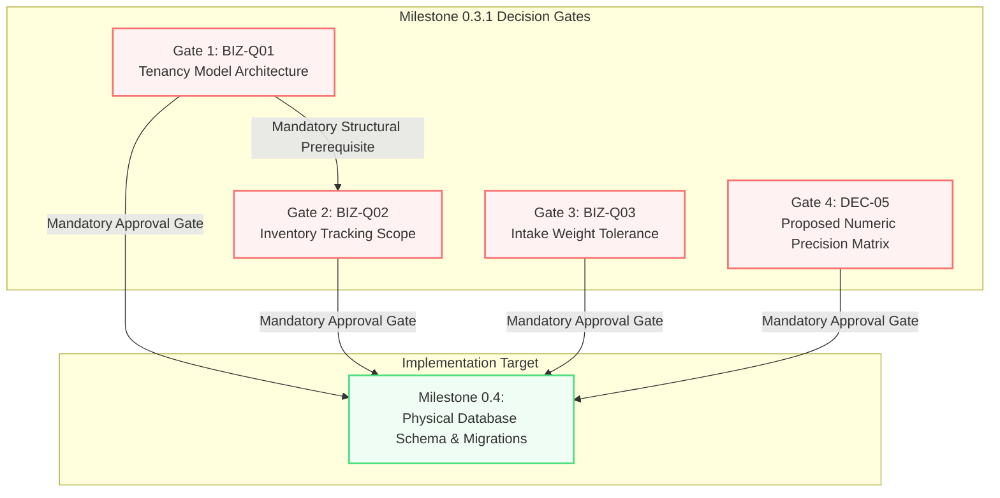

# Jewellery ERP Platform — Physical Schema Decision Gate Register & Milestone 0.4 Readiness Specification

**Document Version:** 1.2.2  
**Status:** Architectural Decision Specification — Milestone 0.3.1 Deliverable (Awaiting Stakeholder Sign-Off)  
**Date:** 2026-10-28  
**Author:** Principal Software Architect & PostgreSQL Database Architect  
**Project:** Jewellery ERP Platform  
**Repository:** `jewellery-erp-platform`  
**Target Stack:** Next.js (Web) + Express 5 & TypeScript (API/Worker) + PostgreSQL 18 + Redis/BullMQ  
**Milestone Context:** Milestone 0.3.1 (Decision Gate Resolution & Entry Preparation for Milestone 0.4 Physical Database Schema & Migration Specification)  
**Authoritative Architectural Baselines:**

- [`docs/architecture/DOMAIN_MODEL_REVIEW.md`](DOMAIN_MODEL_REVIEW.md) (v1.6, `READY_FOR_LOGICAL_ERD`)
- [`docs/architecture/LOGICAL_DATA_MODEL.md`](LOGICAL_DATA_MODEL.md) (v0.3.3, `READY_FOR_LOGICAL_ERD`)
- [`docs/JEWELLERY_ERP_PHASE_0_BASELINE_v0.2.md`](../JEWELLERY_ERP_PHASE_0_BASELINE_v0.2.md)
- [`docs/JEWELLERY_ERP_DOMAIN_MODEL_v0.2.md`](../JEWELLERY_ERP_DOMAIN_MODEL_v0.2.md)
- [`JEWELLERY_ERP_PROJECT_OVERVIEW.md`](../../JEWELLERY_ERP_PROJECT_OVERVIEW.md)

---

## Document Revision History

| Version    | Date       | Author                             | Significant Changes                                                                                                                                                                                                                                                                                                                                                                                                                                                                                                                                                                                                                                                                                                                                                                                                                                                                                                                                                                                                                                                                                                                                                                                                                                                                                                                                                                                                                                                                                                                                                                                                                                                                                                                                                                                                                                         |
| ---------- | ---------- | ---------------------------------- | ----------------------------------------------------------------------------------------------------------------------------------------------------------------------------------------------------------------------------------------------------------------------------------------------------------------------------------------------------------------------------------------------------------------------------------------------------------------------------------------------------------------------------------------------------------------------------------------------------------------------------------------------------------------------------------------------------------------------------------------------------------------------------------------------------------------------------------------------------------------------------------------------------------------------------------------------------------------------------------------------------------------------------------------------------------------------------------------------------------------------------------------------------------------------------------------------------------------------------------------------------------------------------------------------------------------------------------------------------------------------------------------------------------------------------------------------------------------------------------------------------------------------------------------------------------------------------------------------------------------------------------------------------------------------------------------------------------------------------------------------------------------------------------------------------------------------------------------------------------- |
| **v1.2.2** | 2026-10-28 | Principal Architect & DB Architect | Reconciled decision gate dependencies and implementation sequencing: (1) Reconciled Section 9.1 Mermaid dependency map by removing the erroneous `G3 (BIZ-Q03) --> G4 (DEC-05)` prerequisite edge and establishing direct blocking links from all four gates (`BIZ-Q01`, `BIZ-Q02`, `BIZ-Q03`, `DEC-05`) to `Milestone 0.4`; (2) Clarified dependency classification: identified `BIZ-Q01 --> BIZ-Q02` as the sole intra-gate mandatory technical prerequisite (governing table key composition and indexing), while establishing `DEC-05` (Finance/Accounting) and `BIZ-Q03` (QC/Operations) as independent stakeholder review tracks that do not depend on each other or on `BIZ-Q01`; (3) Reconciled Section 9.2 implementation ranking with Section 9.1: affirmed that Rank 1 (`BIZ-Q01`), Rank 2 (`DEC-05`), Rank 3 (`BIZ-Q02`), and Rank 4 (`BIZ-Q03`) defines the recommended DDL authoring sequence based on downstream architectural blast radius, while preserving concurrent stakeholder evaluation; (4) Aligned inventory key examples with documented inventory dimensions `(store_id, product_sku_id, compartment_id)` per logical model Entity 29, distinguishing candidate business keys from surrogate UUIDv7 primary keys and multi-tenant scoping; (5) Fully aligned with `docs/architecture/PHYSICAL_SCHEMA_PO_DECISION_WORKSHEET.md` Section F.                                                                                                                                                                                                                                                                                                                                                                                                                                                                                        |
| **v1.2.1** | 2026-10-27 | Principal Architect & DB Architect | Targeted v1.2.1 technical alignment pass: (1) Separated weight-tolerance waivers from damage waivers in Gate `BIZ-Q03` and Gap 3: reserved `DAMAGE_WAIVER` exclusively for physical/structural defects; clarified that missing declared shipment weight is fail-closed unless amended on the manifest or resolved via an approved business exception; documented weight-tolerance waiver as an open business decision requiring PO approval without inventing schema enums; (2) Strengthened concurrency recommendation in `BIZ-Q03`: clarified that row locking (`SELECT ... FOR SHARE` / `FOR UPDATE`) protects weight comparison during QC approval transactions but does not prevent subsequent retroactive alterations to declared shipment weights; required Milestone 0.4 to address both concurrent approval mutations and post-approval manifest weight integrity (via declared-weight immutability or mandatory revalidation); (3) Corrected quantity matrix wording in Gate `DEC-05`: applied exact declared field names `quantity_on_hand` and `quantity_reserved` across Section 6 and Checklist Item 6; removed unsupported `32,767` gemstone count cap, establishing PostgreSQL standard `INTEGER` range (1 to 2,147,483,647) with domain-specific caps subject to PO sign-off; (4) Validated QC constraints via corrected 17-case SQLite 3VL simulation script verifying draft nullability, non-null net without gross rejection, non-positive weight rejection, net > gross rejection, approval prerequisites, and undamaged vs damaged waiver approval paths.                                                                                                                                                                                                                                                                             |
| **v1.2**   | 2026-10-27 | Principal Architect & DB Architect | Targeted v1.2 technical validation and consistency pass: (1) Corrected QC weight constraints in Gate `BIZ-Q03`: implemented 3VL-safe row-local constraint `chk_qc_items_weight_physics` ensuring non-null net weight cannot pass validation when gross weight is NULL, enforcing positive weights when present, allowing nullable weights in draft/incomplete records, and preserving pre-approval completeness constraint `chk_qc_items_approval_prerequisites`; (2) Removed undeclared lifecycle states: eliminated `PENDING_ESCALATION` and `SUPERVISOR_REVIEW` references, replacing them with the approved non-approved status `PENDING` and documented review workflow; clarified that rejection records in `quality_decisions` accurately reflect the actual outcome with `reason_code = 'WEIGHT_DISCREPANCY_EXCEEDED'`; (3) Clarified missing-weight and concurrency handling in Gate `BIZ-Q03`: stated that missing declared shipment weight cannot silently pass; recommended fail-closed handling pending PO approval; documented requirement for explicit row locking (`SELECT ... FOR UPDATE`) or value-immutability strategy in Milestone 0.4; defined comprehensive requirements for trigger-based alternative (direct approved inserts, status updates, declared weight changes, missing declared weight, deterministic lock ordering); (4) Separated inventory quantity rules in Gate `DEC-05` and precision matrix: replaced universal `CHECK qty > 0` with distinct specifications for inventory movements (strictly positive $N \ge 1$, direction by movement type), stock balances (non-negative on-hand/reserved with 0 valid for depleted stock, `on_hand >= reserved`, open decision on zero-balance retention), serialized pieces (exactly 1 piece per row), and gemstone counts (strictly positive integer $N \ge 1$, mandatory). |
| **v1.1**   | 2026-10-27 | Principal Architect & DB Architect | Targeted correction pass on decision register: (1) Corrected weight-tolerance validation in Gate `BIZ-Q03`: eliminated invalid cross-table `CHECK` constraint; specified transactional enforcement in Express 5 `QcService` using `shipment_items` and `quality_check_items`; defined row-local valid-range constraints; articulated optional trigger-based alternative with validation requirements; formulated 6 explicit policy questions for Product-Owner confirmation; affirmed that ±0.02g and 0.1% are non-binding proposals; (2) Corrected precision matrix terminology in Gate `DEC-05`: renamed to `Proposed Physical Numeric Precision Matrix — Awaiting Approval`; partitioned into source-supported requirements, recommended physical types/scales, unresolved business/accounting rules, and decisions requiring approval; clarified that rounding policies are recommended proposals awaiting accounting sign-off; preserved deferral of commercial retail rounding; (3) Refined architectural claims in Gate `BIZ-Q01`: clarified that retaining `Organization` as corporate root provides a foundational hierarchy but does not guarantee a straightforward SaaS transition, requiring a separate assessment of tenant scoping, child tables, uniqueness, referential integrity, authorization, and isolation; (4) Refined Milestone 0.4 readiness checklist: removed fixed 10-migration constraint in favor of dependency-graph derivation; refined audit-field and version specifications (`created_at` immutability, `updated_at` strategy, `version` for OCC where appropriate); verified and aligned milestone nomenclature.                                                                                                                                                                                                        |
| **v1.0**   | 2026-10-27 | Principal Architect & DB Architect | Initial authoritative physical-schema decision register for Milestone 0.3.1: (1) Systematically reviewed the 5 repository baseline documents and verified file paths; (2) Formalized the 4 outstanding physical-schema gates (`BIZ-Q01`, `BIZ-Q02`, `BIZ-Q03`, `DEC-05`) with exhaustive architectural trade-off assessments, technical options, and evidence-based recommendations; (3) Formulated the comprehensive Physical Numeric Precision Matrix across 12+ metrological and financial attribute categories; (4) Carried forward the 3 documented architectural design gaps (vault audit QC reassessment, inter-store transfer orders, supervisor damage-waiver schema representation) and metrological constraints (`INV-15`, 3VL `IS TRUE`, atomic outbox); (5) Established the 16-point Milestone 0.4 physical database design readiness checklist and formal sign-off protocol.                                                                                                                                                                                                                                                                                                                                                                                                                                                                                                                                                                                                                                                                                                                                                                                                                                                                                                                                                                  |

---

## 1. Executive Summary & Decision Gate Dashboard

### 1.1 Purpose

This document establishes the authoritative **Physical Schema Decision Gate Register** for the **Jewellery ERP Platform** (`jewellery-erp-platform`). Milestone 0.3 delivered a fully normalized, verified, and internally consistent 43-entity Logical Data Model ([`docs/architecture/LOGICAL_DATA_MODEL.md`](LOGICAL_DATA_MODEL.md) v0.3.3). However, physical PostgreSQL DDL generation, column scale definitions, index strategies, and database migration authoring remain paused at the Milestone 0.3.1 gate pending business decisions on four critical architectural parameters:

1. **`BIZ-Q01`**: Tenancy Model Architecture (Single-Enterprise Multi-Branch vs. Multi-Tenant SaaS).
2. **`BIZ-Q02`**: Inventory Tracking Scope (100% Serialized vs. Quantity-Batch vs. Dual Hybrid Architecture).
3. **`BIZ-Q03`**: Intake Weight Discrepancy Tolerance Threshold ($\pm 0.01\,\text{g}$ vs. $\pm 0.05\,\text{g}$ vs. Configurable Policy).
4. **`DEC-05`**: Proposed Physical Numeric Precision Matrix (`NUMERIC(p, s)` definitions & inventory quantity rules).

This register provides the definitive trade-off analysis, architectural evidence, concrete recommendations, and downstream impact models for each gate, establishing the entry criteria for **Milestone 0.4: Physical Database Schema & Migration Specification**.

### 1.2 Decision Gate Dashboard

```
+----------+-----------------------------------+--------------------+------------------+-----------------------------------------------+
| Gate ID  | Decision Gate Title               | Current Status     | Downstream Risk  | Exact Decision Needed to Unblock Milestone 0.4|
+----------+-----------------------------------+--------------------+------------------+-----------------------------------------------+
| BIZ-Q01  | Tenancy Model Architecture        | RECOMMENDED (OPEN) | HIGH (BLOCKING)  | Select Single-Enterprise Multi-Branch (Opt A) |
|          |                                   |                    |                  | or Multi-Tenant SaaS (Opt B).                 |
+----------+-----------------------------------+--------------------+------------------+-----------------------------------------------+
| BIZ-Q02  | Inventory Tracking Scope          | RECOMMENDED (OPEN) | MEDIUM (BLOCKING)| Confirm Phase 0 Hybrid Tracking DDL (Opt 3)   |
|          |                                   |                    |                  | or Defer Batch DDL to Phase 1 (Opt 1).        |
+----------+-----------------------------------+--------------------+------------------+-----------------------------------------------+
| BIZ-Q03  | Intake Weight Tolerance Threshold | RECOMMENDED (OPEN) | MEDIUM (BLOCKING)| Approve Configurable Tolerance Strategy with  |
|          |                                   |                    |                  | confirmed operational threshold parameters.   |
+----------+-----------------------------------+--------------------+------------------+-----------------------------------------------+
| DEC-05   | Proposed Numeric Precision Matrix | RECOMMENDED (OPEN) | HIGH (BLOCKING)  | Sign off on PostgreSQL NUMERIC scales for     |
|          |                                   |                    |                  | weights, carats, purities, and quantities.    |
+----------+-----------------------------------+--------------------+------------------+-----------------------------------------------+
```

> [!IMPORTANT]
> **A Recommendation Is Not An Approval.**  
> In accordance with architectural governance, all four gates are classified as `RECOMMENDED (OPEN)`. No gate is marked `APPROVED` because the repository contains no executive sign-off record. Physical DDL authoring remains strictly paused until the Product Owner formally signs off on the recommendations or selects an alternative option.

---

## 2. Authoritative Project Source Review & Baseline Alignment

### 2.1 Workspace Documentation Audit

Before formulating recommendations, all repository documentation and historical decision records were systematically inspected:

1. **`JEWELLERY_ERP_PROJECT_OVERVIEW.md` (75,802 bytes):**
   - _Findings:_ Section 15 ("Multi-Branch / Multi-Tenant Architecture") specifies an active store named `Jewellery ERP Platform — Platinum Division / Store (STORE001)` alongside other visible divisions (`Silver Division`, `Canada Region`). Stores contain a `Head Office System GUID`. Sections 4, 5, and 6 establish a Modular Monolith architecture in a single monorepo (`apps/web`, `apps/api`, `apps/worker`). Sections 29, 32, and 61 formalize the asset hierarchy: master styles (`Product`) $\rightarrow$ commercial variants (`ProductSku`) $\rightarrow$ serialized pieces (`InventoryItem`) $\rightarrow$ hardware tags (`RFIDTag`).
   - _Tenancy Clue:_ Refers to divisions and regions of a single enterprise under a common Head Office rather than independent commercial SaaS subscribers.
2. **`docs/JEWELLERY_ERP_PHASE_0_BASELINE_v0.2.md` (20,584 bytes):**
   - _Findings:_ Section 16 ("Open Decisions Before Finalizing the Schema") documents:
     - `D-01`: "One organization or true multi-tenant platform? Model Organization and Store separately; confirm isolation requirements. Status: Open."
     - `D-02`: "Is each jewellery piece individually serialized? Assume item-level tracking for high-value items, but confirm batch/quantity cases. Status: Open."
     - `D-12`: "Retain TypeORM provisionally; verify developer experience, query needs, transaction handling, and migration workflow."
3. **`docs/JEWELLERY_ERP_DOMAIN_MODEL_v0.2.md` (17,776 bytes):**
   - _Findings:_ Section 8 classifies P0 blockers: Item 1 (`Physical item vs SKU`), Item 2 (`Organization and store ownership`), Item 4 (`QC rules & tolerances`), and P1 dependencies: Item 7 (`Weight precision & tolerances`), Item 8 (`Currency model & precision`).
4. **`docs/architecture/DOMAIN_MODEL_REVIEW.md` (v1.6, 160,025 bytes):**
   - _Findings:_ Confirmed 0 blockers for logical ERD modeling (`READY_FOR_LOGICAL_ERD`). Synthesized the 4 physical DDL blockers: `BIZ-Q01`, `BIZ-Q02`, `BIZ-Q03`, and `DEC-05`. Designated TypeORM as provisional subject to migration/transaction validation (`TECH-DEC-01`). Confirmed Express 5 + PostgreSQL 18 stack.
5. **`docs/architecture/LOGICAL_DATA_MODEL.md` (v0.3.3, 208,242 bytes):**
   - _Findings:_ Formalized all 43 entities across 8 domains. Reconciled candidate keys without referencing non-declared attributes under unresolved `BIZ-Q01`. Modeled both serialized items (`inventory_items`) and batch balances (`inventory_stock_balances`) linked via unified movements (`inventory_movements`). Corrected PostgreSQL 3VL semantics using `IS TRUE` predicates on `quality_check_items`. Disclosed 3 architectural design gaps (vault audit QC, inter-store transfer orders, supervisor waiver representation).

### 2.2 Traceability and Contradiction Audit

- **Terminology Alignment:** Earlier baseline notes loosely used "store" and "tenant" interchangeably (e.g. `PROJECT_OVERVIEW.md` Section 15: "Other visible stores/tenants include..."). The approved logical model strictly resolved this ambiguity: `Organization` is the corporate tenant root; `Store` is a physical or operational branch location within an organization.
- **Physical Precision Consistency:** Baseline v0.2 mentioned binary float prohibitions (`DOC-01` Rule 12). `DOMAIN_MODEL_REVIEW.md` v1.6 and `LOGICAL_DATA_MODEL.md` v0.3.3 strictly unified weight columns to `NUMERIC(10, 4)` grams, carats to `NUMERIC(8, 4)`, and purity to `NUMERIC(7, 4)` percentage / `NUMERIC(5, 4)` ratio, eliminating conflicting historical scales.

---

## 3. Gate 1: BIZ-Q01 — Tenancy Model Architecture

### 3.1 Context & Problem Statement

The logical data model declares `organizations` as the root corporate entity and `stores` as branch locations. However, business stakeholders have not formally confirmed whether the platform is intended as:

- **Option A:** An internal, enterprise-wide management system for **one jewellery corporate brand** operating multiple retail branches, vault hubs, and divisions; or
- **Option B:** A commercial **multi-tenant SaaS platform** serving multiple, completely independent jewellery companies/brands from a shared application deployment.

### 3.2 Detailed Architectural Comparison

```
+--------------------------------+----------------------------------------------------+----------------------------------------------------+
| Architectural Dimension        | Option A: Single-Enterprise Multi-Branch           | Option B: Multi-Tenant Commercial SaaS             |
+--------------------------------+----------------------------------------------------+----------------------------------------------------+
| 1. Tenant & Branch Identity    | Exactly 1 primary Organization (Enterprise).       | N independent Organizations (separate clients).    |
|                                | Multiple Stores (showrooms, vaults, divisions).    | Stores scoped strictly within each client Org.     |
+--------------------------------+----------------------------------------------------+----------------------------------------------------+
| 2. Master Data Ownership       | Catalog (Products, SKUs, Materials, Purities) is   | Every Catalog record is strictly owned by one Org; |
|                                | shared enterprise-wide across all stores.          | completely partitioned between client tenants.     |
+--------------------------------+----------------------------------------------------+----------------------------------------------------+
| 3. Primary & Foreign Keys      | Surrogate UUIDv7 PKs. Foreign keys directly link   | Surrogate UUIDv7 PKs. Requires composite foreign   |
|                                | child entities to immediate parent PK.             | keys `(organization_id, id)` or RLS tenant checks.|
+--------------------------------+----------------------------------------------------+----------------------------------------------------+
| 4. Tenant-Scoped Uniqueness    | Natural keys are globally unique (`sku_code`,      | Natural keys (`sku_code`, `serial_number`,         |
|                                | `serial_number`) or scoped to Org (`product_code`).| `order_number`) MUST be scoped per Org.            |
+--------------------------------+----------------------------------------------------+----------------------------------------------------+
| 5. Isolation & Authorization   | Store-level RBAC custody boundary. Cross-branch    | Absolute corporate data partitioning. Cross-tenant |
|                                | visibility managed via user store memberships.     | read/write is a critical security vulnerability.   |
+--------------------------------+----------------------------------------------------+----------------------------------------------------+
| 6. Index Design & Queries      | B-Tree indexes on search keys: `(product_sku_id)`, | B-Tree indexes MUST prefix `organization_id`:      |
|                                | `(store_id, custody_state)`. Compact indexes.      | `(organization_id, product_sku_id)`. Bloat risk.  |
+--------------------------------+----------------------------------------------------+----------------------------------------------------+
| 7. Security Enforcement        | Application middleware and store-context filtering.| PostgreSQL Row-Level Security (RLS) + mandatory    |
|                                | Database RLS optional.                             | query filtering + security audit testing.          |
+--------------------------------+----------------------------------------------------+----------------------------------------------------+
| 8. Cross-Branch Operations     | Native inter-store transfers (`Store A -> B`)      | Completely prohibited between different Orgs.      |
|                                | under common corporate inventory balance sheet.    | Inter-org operations require B2B commercial APIs.  |
+--------------------------------+----------------------------------------------------+----------------------------------------------------+
| 9. Migration & Scale           | Single database schema. Zero tenant routing or     | Shared-schema (RLS), schema-per-tenant, or         |
|                                | database-per-tenant migration complexity.          | db-per-tenant. High operational migration cost.    |
+--------------------------------+----------------------------------------------------+----------------------------------------------------+
```

### 3.3 Downstream Schema Impact Analysis

If **Option B (Multi-Tenant SaaS)** is selected, the physical schema must introduce significant structural modifications:

1. **Mandatory Tenant Denormalization:** Tables currently lacking `organization_id` (`product_skus`, `shipments`, `shipment_items`, `quality_checks`, `quality_check_items`, `inventory_movements`, `rfid_tags`, `rfid_tag_assignments`) must denormalize `organization_id` to enforce composite tenant foreign keys `(organization_id, id)` or support PostgreSQL Row-Level Security.
2. **Composite Unique Indexes:** Unique constraints on `product_skus.sku_code`, `inventory_items.serial_number`, and `rfid_tags.epc_code` must become composite: `UNIQUE (organization_id, sku_code)` and `UNIQUE (organization_id, serial_number)`.
3. **Database RLS Policies:** Every table must execute `ALTER TABLE <table> ENABLE ROW LEVEL SECURITY` with tenant session policies (`current_setting('app.current_organization_id')`).

If **Option A (Single-Enterprise Multi-Branch)** is selected:

1. Normalized logical boundaries in [`docs/architecture/LOGICAL_DATA_MODEL.md`](LOGICAL_DATA_MODEL.md) v0.3.3 are preserved intact without denormalizing `organization_id`.
2. Indexes remain compact and optimized for operational throughput (`store_id`, `product_sku_id`, `status`).

### 3.4 Recommendation & Actionable Entry Decision

- **Architectural Recommendation:** **Option A (Single-Enterprise Multi-Branch Architecture with Provisioned Tenant Isolation Hooks)**.
  - _Supporting Evidence:_ All baseline documentation describes a unified corporate entity with regional divisions (`Platinum Division`, `Silver Division`, `Canada Region`) sharing a `Head Office System GUID`. The Phase 0/1 roadmap contains no commercial SaaS subscription management, billing, self-service tenant registration, or multi-tenant metering.
  - _Foundational Scoping vs. Future SaaS Realism:_ Retaining `organization_id` on top-level root tables (`organizations`, `stores`, `users`, `products`, `categories`, `materials`, `purities`, `suppliers`, `goods_receipt_notes`, `inventory_items`) establishes a clean enterprise boundary and provides a useful structural foundation for future evolution. However, **this does not guarantee a straightforward or trivial SaaS transition**. Converting the platform to commercial multi-tenant SaaS in a future phase would require a separate, comprehensive architectural initiative to evaluate:
    1. _Tenant Scoping across Child Entities:_ Denormalizing `organization_id` onto operational tables currently lacking it (e.g., `product_skus`, `shipments`, `shipment_items`, `quality_checks`, `quality_check_items`, `inventory_movements`, `rfid_tags`, `rfid_job_items`).
    2. _Tenant-Scoped Uniqueness:_ Converting global business keys (`sku_code`, `serial_number`, `order_number`) into composite unique constraints scoped by tenant (`UNIQUE (organization_id, sku_code)`).
    3. _Cross-Tenant Referential Integrity:_ Ensuring foreign keys cannot inadvertently bind records across different tenant boundaries.
    4. _Authorization & Context Propagation:_ Implementing robust tenant context resolution in Express 5 middleware and passing tenant context securely through BullMQ background jobs.
    5. _Physical Isolation Enforcement:_ Selecting and validating database-level isolation mechanisms, such as PostgreSQL Row-Level Security (RLS) policies, session-variable connection pooling, or tenant schema partitioning.
- **Current Gate Status:** `RECOMMENDED (OPEN)`
- **Product-Owner Action Required:** Formally approve Option A (Single-Enterprise Multi-Branch) to unblock Milestone 0.4 index and foreign-key design.

---

## 4. Gate 2: BIZ-Q02 — Inventory Tracking Scope

### 4.1 Context & Problem Statement

High-value jewellery items (diamond solitaires, gold necklaces, platinum bangles) require item-level serial numbers, RFID tags, analytical scale history, and individual custody tracking. However, retail jewellery operations also handle non-serialized items (earring backings, loose pearls, findings, silver beads, packaging materials) where piece-level serialization is commercially impractical.

Stakeholders must confirm whether Phase 0 physical database design should support:

- **Option 1:** 100% Serialized Pieces Only.
- **Option 2:** Quantity-Based Batch Inventory Only (Unviable for luxury jewellery).
- **Option 3:** Dual Hybrid Tracking Architecture (Serialized + Quantity-Batch in Phase 0 DDL).

### 4.2 Entity & Workflow Evaluation

```
+-----------------------------------+---------------------------------------------------+----------------------------------------------------+
| Inventory Domain Entity           | Serialized Tracking (`SERIALIZED`)                | Quantity-Batch Tracking (`QUANTITY_BATCH`)         |
+-----------------------------------+---------------------------------------------------+----------------------------------------------------+
| `products`                        | Master style / design template.                   | Master style / component template.                 |
| `product_skus`                    | Commercial SKU (`tracking_type = 'SERIALIZED'`).  | Commercial SKU (`tracking_type = 'QUANTITY_BATCH'`).|
| `inventory_items`                 | One row represents one serialized physical piece.  | NOT USED (No `inventory_items` row created).       |
| `rfid_tags` & `assignments`       | Exactly 1 active RFID tag bound to the piece.     | NOT USED (Batch containers/bins tagged externally).|
| `inventory_stock_balances`        | Optional / Computed rollup of serialized rows.    | MANDATORY: Canonical on-hand/allocated balance.   |
| `inventory_movements`             | `inventory_item_id IS NOT NULL`, `quantity = 1`.  | `inventory_item_id IS NULL`, `quantity >= 1`.      |
| Stock Reconciliation              | Physical RFID scan matches exact serial number.   | Physical weigh-in / hand count vs balance table.   |
+-----------------------------------+---------------------------------------------------+----------------------------------------------------+
```

### 4.3 Technical Constraint vs. Product Scope

- **Technical Capability:** The logical model ([`docs/architecture/LOGICAL_DATA_MODEL.md`](LOGICAL_DATA_MODEL.md) v0.3.3) has already fully resolved the technical architecture for both tracking models. Entity 28 (`inventory_items`) models serialized pieces; Entity 29 (`inventory_stock_balances`) models batch balances; Entity 30 (`inventory_movements`) models the unified ledger.
- **Product Scope Decision:** The only question is whether the physical migration scripts in Milestone 0.4 should generate the DDL for `inventory_stock_balances` and quantity-batch movement triggers now, or defer table creation to Phase 1.

### 4.4 Recommendation & Actionable Entry Decision

- **Architectural Recommendation:** **Option 3 (Hybrid Dual Tracking Architecture scaffolded in Phase 0 DDL)**.
  - _Supporting Evidence:_ Omitting Entity 29 from Milestone 0.4 DDL would reduce the approved 43-entity schema to 42 entities, creating migration debt and requiring disruptive DDL alterations when bulk findings or gemstone parcels are introduced. Scaffolding `inventory_stock_balances` in Phase 0 incurs negligible storage overhead while immediately supporting non-serialized jewellery components.
- **Current Gate Status:** `RECOMMENDED (OPEN)`
- **Product-Owner Action Required:** Formally confirm Option 3 to authorize scaffolding both `inventory_items` and `inventory_stock_balances` in Milestone 0.4 DDL.

---

## 5. Gate 3: BIZ-Q03 — Intake Weight Tolerance

### 5.1 Context & Problem Statement

During inbound procurement, suppliers manifest shipments with declared weights on shipment line items (`shipment_items.declared_gross_weight_grams`). Upon arrival at a store or vault intake laboratory, technicians weigh the unboxed pieces on analytical balances, recording observed gross weight on `quality_check_items.gross_weight_grams` and logging raw metrological readings in `weight_measurements.measured_weight`.

Analytical laboratory balances have milligram or sub-milligram readability ($0.001\,\text{g}$ or $0.0001\,\text{g}$), but minor physical variances occur between supplier scales and receiver scales due to differing calibration standards, atmospheric humidity, handling residue, and tare variances. Stakeholders must establish the operational discrepancy tolerance threshold and its enforcement mechanism.

### 5.2 Architectural Analysis of Enforcement Boundaries

#### 5.2.1 Invalidation of Cross-Table Row-Local CHECK Constraints

In relational database architecture, PostgreSQL row-local `CHECK` constraints evaluate expressions **exclusively on columns belonging to the same row of the same table**. PostgreSQL explicitly prohibits subqueries, foreign-table queries, and cross-table joins inside declarative `CHECK` constraints.

Because declared weight (`declared_gross_weight_grams`) resides on `shipment_items` (Entity 20) while measured gross weight (`gross_weight_grams`) and inspection status (`status`) reside on `quality_check_items` (Entity 22), **any proposed row-local `CHECK` constraint on `quality_check_items` referencing `declared_gross_weight_grams` is invalid SQL** and will be rejected by the PostgreSQL DDL parser (`ERROR: column "declared_gross_weight_grams" does not exist`).

Furthermore, denormalizing `declared_gross_weight_grams` onto `quality_check_items` solely to enable a database `CHECK` constraint is rejected: it violates Third Normal Form (3NF), duplicates procurement state onto inspection lines, and creates synchronization hazards. No new column, table, foreign key, or logical entity shall be introduced to resolve this boundary.

#### 5.2.2 Valid PostgreSQL Row-Local Constraints on QC Items Handling SQL Three-Valued Logic

Row-local `CHECK` constraints on `quality_check_items` are preserved strictly for rules that depend entirely on columns within that individual table row. Under PostgreSQL Three-Valued Logic (3VL), a `CHECK` constraint passes if the boolean expression evaluates to `TRUE` or `UNKNOWN` (NULL), and fails **only** if it evaluates to `FALSE`.

To prevent invalid physical states while permitting draft/incomplete QC records to hold nullable measurements where authorized by the logical model, the row-local constraint must be formulated with rigorous boolean predicates:

```sql
-- Valid row-local constraints on quality_check_items enforcing 3VL and physical weight integrity
ALTER TABLE quality_check_items
    ADD CONSTRAINT chk_qc_items_weight_physics CHECK (
        -- 1. A non-null net weight strictly requires gross weight to be non-null (fails if net is present but gross is NULL)
        (net_weight_grams IS NULL OR gross_weight_grams IS NOT NULL) AND
        -- 2. Positive gross weight when present
        (gross_weight_grams IS NULL OR gross_weight_grams > 0) AND
        -- 3. Positive net weight when present
        (net_weight_grams IS NULL OR net_weight_grams > 0) AND
        -- 4. Net weight must not exceed gross weight when both are present
        (net_weight_grams IS NULL OR gross_weight_grams IS NULL OR net_weight_grams <= gross_weight_grams)
    );
```

**Verification of 3VL Behavior Across QC Lifecycles:**

- _Draft Records Before Weighing (`gross = NULL, net = NULL`):_ Permitted. Each clause evaluates to `TRUE`, yielding `TRUE AND TRUE AND TRUE AND TRUE` $\rightarrow$ `TRUE`.
- _Gross Weighed, Net Pending (`gross = 10.0, net = NULL`):_ Permitted. All four clauses evaluate to `TRUE`.
- _Net Present Without Gross (`gross = NULL, net = 5.0`):_ **Strictly Rejected.** Clause 1 evaluates to `(FALSE OR FALSE)` $\rightarrow$ `FALSE`. Because `FALSE AND ...` evaluates to `FALSE`, PostgreSQL rejects the row, eliminating the 3VL NULL trap where net weight could otherwise pass without an observed gross weight.
- _Non-Positive Weights (`gross <= 0` or `net <= 0`):_ **Strictly Rejected.** Clause 2 or Clause 3 evaluates to `(FALSE OR FALSE)` $\rightarrow$ `FALSE`.
- _Net Exceeds Gross (`gross = 10.0, net = 12.0`):_ **Strictly Rejected.** Clause 4 evaluates to `(FALSE OR FALSE OR FALSE)` $\rightarrow$ `FALSE`.

**Pre-Approval Completeness Gate Preserved:**  
The row-local physical physics constraint above does **not** weaken the existing approval prerequisites established in [`docs/architecture/LOGICAL_DATA_MODEL.md`](LOGICAL_DATA_MODEL.md) v0.3.3 Section 5.3 (Entity 22). When `status = 'APPROVED'`, all measurements, hallmark checks, and visual inspections must be non-null and passing:

```sql
-- Existing approved completeness gate: cannot commit status = 'APPROVED' with missing or failed inspections
ALTER TABLE quality_check_items
    ADD CONSTRAINT chk_qc_items_approval_prerequisites CHECK (
        status != 'APPROVED' OR (
            verified_material_id IS NOT NULL AND
            verified_purity_id IS NOT NULL AND
            gross_weight_grams IS NOT NULL AND
            net_weight_grams IS NOT NULL AND
            gross_weight_grams > 0 AND
            net_weight_grams > 0 AND
            gross_weight_grams >= net_weight_grams AND
            hallmark_verified IS TRUE AND
            visual_inspection_passed IS TRUE AND
            damage_detected IS NOT NULL AND
            (damage_detected IS FALSE OR (damage_detected IS TRUE AND damage_notes IS NOT NULL))
        )
    );
```

#### 5.2.3 Primary Recommended Enforcement: Transactional Application Gate in Express 5 `QcService`

The authoritative comparison of declared shipment weight against measured QC gross weight must be performed **transactionally in the application service layer** (`Express 5` `QcService`):

1. **Transactional Record Retrieval & Comprehensive Concurrency Strategy:** When a QC technician submits weight measurements or requests item approval (`QcService.approveItem` or `QcService.submitInspection`), the operation executes within an explicit database transaction. Crucially, Milestone 0.4 must address two distinct concurrency and mutation risks:
   - **Protection During QC Approval (Concurrent Race Conditions):** Row-level locking protects the weight comparison during the execution of the approval transaction. Specifically, the transaction must acquire row locks (`SELECT ... FOR SHARE` on the parent `shipment_items` row and `SELECT ... FOR UPDATE` on the `quality_check_items` row) to ensure neither record is modified concurrently while variance is calculated and validated.
   - **Protection After QC Approval (Subsequent Manifest Weight Alterations):** Row locking only holds for the lifetime of the active transaction. By itself, it does _not_ prevent a subsequent modification to `shipment_items.declared_gross_weight_grams` after the QC item has already been committed as `'APPROVED'`. If a declared weight were modified retroactively, the audit baseline and tolerance validity of the already-approved item would be invalidated without detection. Therefore, Milestone 0.4 must specify an appropriate enforcement policy for subsequent changes, such as:
     - _Strict Declared-Weight Immutability:_ Enforcing database-level immutability on `shipment_items.declared_gross_weight_grams` once the parent `goods_receipt_notes` reaches status `'RECEIVED'` or once any associated QC item is approved; OR
     - _Mandatory Revalidation Workflow:_ Requiring an automated revalidation and revocation policy that flags or invalidates approved QC decisions if a subsequent shipment manifest amendment alters the declared piece weight.
2. **Missing Declared Weight & Strict Fail-Closed Policy:** A missing declared shipment weight (`shipment_items.declared_gross_weight_grams IS NULL`) **cannot silently pass or be treated as a successful tolerance verification**. In the absence of a supplier-declared baseline weight, automated tolerance calculation is impossible. The architecture establishes a **strict fail-closed recommendation**: in the absence of a declared gross weight, automated approval is blocked and the piece remains in `status = 'PENDING'`. The item cannot transition to `'APPROVED'` unless the supplier's declared weight is formally amended/corrected on the manifest, or an explicitly approved business exception workflow resolves it. Under no circumstances may the documented damage-waiver mechanism (`reason_code = 'DAMAGE_WAIVER'`) be repurposed to authorize missing or discrepant weights; `DAMAGE_WAIVER` is strictly reserved for physical damage and structural defects (Gap 3). If a separate administrative weight-tolerance waiver is required (e.g. an operational override recorded in `quality_decisions` with a distinct code such as `WEIGHT_TOLERANCE_WAIVER`), that constitutes a business/design decision requiring formal Product-Owner approval.
3. **Discrepancy Evaluation:** When `declared_gross_weight_grams` is present, the service computes the absolute variance:
   $$\Delta_{\text{gross}} = |\text{quality\_check\_items.gross\_weight\_grams} - \text{shipment\_items.declared\_gross\_weight\_grams}|$$
4. **Policy Evaluation & Preventing Unauthorized QC Approval:**
   - If the calculated discrepancy exceeds the approved tolerance policy:
     - The transaction actively **blocks** the transition of `quality_check_items.status` to `'APPROVED'`.
     - The item either remains in its existing non-approved state `status = 'PENDING'` while supervisor or vendor review is underway (an operational review workflow in the application layer where the inspection remains incomplete/blocked), OR transitions to `status = 'REJECTED'`.
     - When marked rejected, an immutable decision record is created in `quality_decisions` recording `decision = 'REJECTED'`, `reason_code = 'WEIGHT_DISCREPANCY_EXCEEDED'`, capturing the measured vs declared weight, variance delta, technician ID, and rejection timestamp, accurately reflecting the actual workflow outcome.
     - _Lifecycle Integrity:_ No undeclared enum status (such as `PENDING_ESCALATION` or `SUPERVISOR_REVIEW`) is introduced on `quality_check_items`. Any future addition of dedicated escalation statuses would constitute a formal logical-model change requiring explicit stakeholder approval.
     - **Inventory Creation Prevention:** Because physical inventory creation strictly requires `quality_check_items.status = 'APPROVED'` (as established in [`docs/architecture/LOGICAL_DATA_MODEL.md`](LOGICAL_DATA_MODEL.md) v0.3.3 Section 6.2 with cardinality `1:0..1`), an out-of-tolerance piece **can never produce an `inventory_items` record** or enter warehouse/store custody without formal resolution.

#### 5.2.4 Alternative Consideration: Trigger-Based Database Enforcement (Not Recommended for Phase 0)

If secondary database-level enforcement is desired as defense-in-depth in a future phase, it cannot be done via a `CHECK` constraint; it must be implemented via PostgreSQL triggers. To be robust and complete, a trigger-based design must account for all edge cases:

1. **Direct Inserts in Approved State:** A `BEFORE INSERT ON quality_check_items` trigger must fire when `NEW.status = 'APPROVED'` to prevent inserting pre-approved records that bypass variance checks.
2. **Approval Updates:** A `BEFORE UPDATE OF status ON quality_check_items` trigger must fire when `NEW.status = 'APPROVED'` to evaluate variance against `shipment_items`.
3. **Subsequent Changes to Declared Shipment Weights:** A `BEFORE UPDATE OF declared_gross_weight_grams ON shipment_items` trigger must enforce post-approval integrity by preventing retroactive alteration of declared weights if linked QC items are already marked `'APPROVED'`, or triggering an automated revalidation exception requiring manifest re-approval.
4. **Missing Declared Weights:** The trigger function must enforce the fail-closed policy by rejecting any transition to `'APPROVED'` if `declared_gross_weight_grams IS NULL`, unless a business-approved weight exception decision is recorded. (It must not accept `reason_code = 'DAMAGE_WAIVER'`, which is reserved exclusively for structural defects).
5. **Concurrent Transactions & Deterministic Lock Ordering:** To prevent deadlocks between concurrent inspection threads, the trigger and application layer must enforce deterministic lock acquisition order (e.g. acquiring row locks on `shipment_items` first, followed by `quality_check_items`).

**Architectural Recommendation on Triggers:**  
While technically feasible, the trigger approach tightly couples database schema logic to operational business tolerance thresholds that may vary by vendor contract or product type, increases DML latency, and complicates test fixture setup. Phase 0 recommends keeping cross-table tolerance validation in `QcService` (Tier C application logic), preserving database DDL simplicity while guaranteeing strict transactional integrity.

### 5.3 Policy Parameter Clarification & Questions for Product-Owner Confirmation

The threshold values cited in preliminary architecture discussions ($\pm 0.02\,\text{g}$ absolute variance and $0.1\%$ relative variance) are **purely non-binding architectural proposals**, not approved business rules or legal/regulatory standards. No regulatory or business threshold has been invented.

To establish the production business policy, the Product Owner must formally review and answer the following six operational questions:

1. **Absolute Tolerance Threshold:** What is the maximum allowable absolute variance in grams (e.g., $\pm 0.01\,\text{g}$, $\pm 0.02\,\text{g}$, or $\pm 0.05\,\text{g}$) for precious metal intake verification?
2. **Relative Tolerance & Reference Base:** Is a percentage-based relative tolerance applied (e.g., $0.1\%$), and is it calculated strictly against the supplier's declared gross weight (`shipment_items.declared_gross_weight_grams`)?
3. **Asset & Material Differentiation:** Should tolerance thresholds vary across asset categories, materials, or measurement stages? (For example: high-density plain gold bullion vs intricate gemstone-studded filigree; casting raw materials vs finished hallmarked jewellery; initial intake vs periodic vault audits).
4. **Maximum Tolerance Cap:** Should there be an absolute upper cap on allowable variance for heavy pieces? (For example, $0.1\%$ of a 500g gold chain is 0.50g, which represents an unacceptably large monetary discrepancy for precious metal).
5. **Missing Declared Weight Protocol:** Confirm the recommended fail-closed policy when a supplier manifests a line item without declaring individual piece gross weight (automated approval blocked, piece remains in existing non-approved `PENDING` state until the manifest is amended or an approved administrative exception workflow is executed).
6. **Approval, Rejection & Weight Waiver Decision:** When an intake piece exceeds tolerance, what exact operational workflow ensues? (e.g. piece remains in existing non-approved `PENDING` state while supervisor investigates, or transitions to `REJECTED` with an immutable `quality_decisions` entry recording `reason_code = 'WEIGHT_DISCREPANCY_EXCEEDED'` and vendor debit-note generation). Furthermore, the Product Owner must decide whether a dedicated weight-tolerance waiver workflow should be authorized (e.g. recorded in `quality_decisions` under a distinct code such as `WEIGHT_TOLERANCE_WAIVER`), strictly maintaining `DAMAGE_WAIVER` as reserved for physical damage.

### 5.4 Recommendation & Actionable Entry Decision

- **Architectural Recommendation:** **Option B (Configurable Policy with Application-Enforced Dual-Tier Gate)**.
  - Tier B: Row-local PostgreSQL `CHECK` constraints enforce 3VL-compliant weight physics (`chk_qc_items_weight_physics`) and pre-approval completeness (`chk_qc_items_approval_prerequisites`) on `quality_check_items`.
  - Tier C: Express 5 `QcService` transactionally enforces cross-table discrepancy checks against configurable business parameters during item approval with fail-closed missing-weight handling and concurrency locking.
- **Current Gate Status:** `RECOMMENDED (OPEN)`
- **Product-Owner Action Required:** Formally approve the Configurable Policy enforcement strategy and provide approved parameters for the six policy questions detailed in Section 5.3.

---

## 6. Gate 4: DEC-05 — Proposed Physical Numeric Precision Matrix — Awaiting Approval

### 6.1 Principles for PostgreSQL Numeric Types

In high-value luxury jewellery manufacturing and retail, binary floating-point types (`REAL`, `DOUBLE PRECISION`, `FLOAT`) are strictly prohibited (`DOC-01` Rule 12). All physical measurements, purities, currency rates, and financial totals must use PostgreSQL arbitrary-precision `NUMERIC(precision, scale)`.

- **Precision ($p$):** Total count of significant decimal digits (both sides of the decimal point).
- **Scale ($s$):** Count of decimal digits to the right of the decimal point.
- **Storage & Performance:** PostgreSQL stores `NUMERIC` values in variable-length chunks of 4 decimal digits per 2 bytes. Explicit precision constraints prevent arithmetic overflow while safeguarding database index efficiency.

### 6.2 Classification of Precision & Rounding Rules

To establish clean architectural boundaries, numeric specifications are classified into four distinct categories:

#### A. Authoritative Requirements Supported by Source Baseline Documents

- **Binary Floating-Point Prohibition:** Absolute ban on binary floats (`DOC-01` Rule 12 in `BASELINE_v0.2.md`).
- **Precious Metal Gram Weights:** 4 decimal places ($0.0001\,\text{g} = 0.1\,\text{mg}$) required per `DOMAIN_MODEL_REVIEW.md` FIND-04 and `LOGICAL_DATA_MODEL.md` v0.3.3.
- **Gemstone Carat Weights:** 4 decimal places ($0.0001\,\text{ct}$) required per `LOGICAL_DATA_MODEL.md` v0.3.3.
- **Metal Purity Percentage:** 4 decimal places ($0.0000\%$ to $100.0000\%$, `NUMERIC(7, 4)`) required per `DOMAIN_MODEL_REVIEW.md` FIND-04 to prevent 100% overflow.
- **Metal Purity Ratio:** 4 decimal places ($0.0000$ to $1.0000$, `NUMERIC(5, 4)`).
- **Attribute-Specific Quantity & Count Rules:** Derived strictly from the approved logical model without imposing a single universal positive-quantity rule:
  1. _Inventory Movement Quantities (`inventory_movements.quantity`):_ Must be strictly positive integers (`CHECK (quantity > 0)`). For serialized items, `quantity` is strictly 1. Direction is never represented as a negative integer; custody flow is determined by `movement_type` and compartment references.
  2. _Stock Balance Quantities (`inventory_stock_balances`):_ The exact declared attributes `quantity_on_hand` and `quantity_reserved` are non-negative integers (`CHECK (quantity_on_hand >= 0)`, `CHECK (quantity_reserved >= 0)`). A zero balance is physically and operationally valid when bulk stock is depleted. Invariant `CHECK (quantity_on_hand >= quantity_reserved)` guarantees non-negative available stock (`quantity_available = quantity_on_hand - quantity_reserved`).
  3. _Serialized Item Quantities (`inventory_items`):_ One row in `inventory_items` intrinsically represents exactly ONE physical piece (`quantity = 1`). Piece counts are evaluated via `COUNT(*)`.
  4. _Gemstone & Component Counts (`item_gemstones.stone_count`, `product_gemstone_specs.stone_count`):_ Discrete piece counts mounted on a setting; must be strictly positive integers (`CHECK (stone_count > 0)`), mandatory `NOT NULL`. Standard PostgreSQL `INTEGER` range (1 to 2,147,483,647); any smaller upper limit is an unapproved proposal requiring Product Owner confirmation.

#### B. Proposed Physical Numeric Precision Matrix — Awaiting Approval

The following matrix defines the recommended PostgreSQL physical types, precision, scale, and operational ranges for Milestone 0.4 DDL:

```
+----------------------------------+-----------------------------+-----------------------+---------------------+-------------------+---------------------+-------------------------+---------------------+
| Measurement / Attribute Category | Domain Context / Entities   | Unit of Measure       | Proposed PostgreSQL | Precision & Scale | Operational Range   | Proposed Rounding       | Approval Status     |
|                                  |                             |                       | Data Type           | Rationale         |                     | Strategy (Proposal)     |                     |
+----------------------------------+-----------------------------+-----------------------+---------------------+-------------------+---------------------+-------------------------+---------------------+
| 1. Precious Metal Gross Weight   | QC, Inventory, Movements    | Grams (GM)            | NUMERIC(10, 4)      | 4 decimals = 0.1mg| 0.0001g to          | Exact Balance Capture;  | RECOMMENDED         |
|    (`gross_weight_grams`)        | (`quality_check_items`,     |                       |                     | analytical balance| 999,999.9999g       | No round on raw capture.| (Awaiting PO Sign)  |
|                                  |  `inventory_items`)         |                       |                     | readability.      | (Up to 1,000 kg).   |                         |                     |
+----------------------------------+-----------------------------+-----------------------+---------------------+-------------------+---------------------+-------------------------+---------------------+
| 2. Precious Metal Net Weight     | QC, Inventory, Valuation    | Grams (GM)            | NUMERIC(10, 4)      | Pure alloy weight | 0.0001g to          | Exact Derived:          | RECOMMENDED         |
|    (`net_weight_grams`)          | (`quality_check_items`,     |                       |                     | after stone/tare  | 999,999.9999g.      | Net = Gross - Tare -    | (Awaiting PO Sign)  |
|                                  |  `inventory_items`)         |                       |                     | deduction.        |                     | Stones (Exact subtract).|                     |
+----------------------------------+-----------------------------+-----------------------+---------------------+-------------------+---------------------+-------------------------+---------------------+
| 3. Gemstone Carat Weight         | Gemstones, QC Items, Specs  | Carats (CT)           | NUMERIC(8, 4)       | 1 carat = 0.200g. | 0.0001 ct to        | Exact Metrology Capture;| RECOMMENDED         |
|    (`carat_weight`,              | (`item_gemstones`,          |                       |                     | 4 decimals allows | 9,999.9999 ct.      | Point scale (0.01 pt).  | (Awaiting PO Sign)  |
|     `stone_weight_carats`)       |  `product_gemstone_specs`)  |                       |                     | micro-carat assay.| (Up to 2 kg gem).   | No truncation.          |                     |
+----------------------------------+-----------------------------+-----------------------+---------------------+-------------------+---------------------+-------------------------+---------------------+
| 4. Metal Purity Percentage       | Master Data (`purities`)    | Percentage (%)        | NUMERIC(7, 4)       | Allows 100.0000%  | 0.0000% to          | Exact Assay Fineness;   | RECOMMENDED         |
|    (`purity_percentage`)         | Canonical source of truth   |                       |                     | without overflow; | 100.0000%.          | Derived:                | (Awaiting PO Sign)  |
|                                  | for alloy purity.           |                       |                     | 4 decimal places. | (e.g. 91.6000% 22K).| ratio = pct / 100.      |                     |
+----------------------------------+-----------------------------+-----------------------+---------------------+-------------------+---------------------+-------------------------+---------------------+
| 5. Metal Purity Ratio            | Master Data, Computations   | Dimensionless Ratio   | NUMERIC(5, 4)       | Decimal fineness  | 0.0000 to 1.0000.   | Exact mathematical      | RECOMMENDED         |
|    (`purity_ratio`)              | (`purities.purity_ratio`)   | (Millièmes / 1000)    |                     | (e.g. 0.9160,     |                     | derivation from         | (Awaiting PO Sign)  |
|                                  |                             |                       |                     | 0.9999 fine gold).|                     | purity_percentage.      |                     |
+----------------------------------+-----------------------------+-----------------------+---------------------+-------------------+---------------------+-------------------------+---------------------+
| 6. Raw Laboratory Measurement    | Metrology Audit Log         | Generic Unit          | NUMERIC(12, 4)      | Accommodates large| 0.0001 to           | Immutable raw scale     | RECOMMENDED         |
|    (`measured_weight`,           | (`weight_measurements`)     | (GRAMS, CARATS,       |                     | batch containers  | 99,999,999.9999.    | observation. Zero       | (Awaiting PO Sign)  |
|     `tare_weight`)               |                             |  TROY_OUNCES)         |                     | and micro-weights.|                     | rounding applied.       |                     |
+----------------------------------+-----------------------------+-----------------------+---------------------+-------------------+---------------------+-------------------------+---------------------+
| 7. Unit Labour / Making Rate     | Procurement, Costing        | Currency per gram     | NUMERIC(12, 4)      | High precision for| $0.0001 to          | Proposal: Half-Even     | RECOMMENDED         |
|    (`unit_cost_labour`)          | (`shipment_items`)          | or per piece (CAD/USD)|                     | per-gram making   | $99,999,999.9999.   | on rate multiplication  | (Awaiting PO Sign)  |
|                                  |                             |                       |                     | rate contracts.   |                     | (Awaiting Accounting).  |                     |
+----------------------------------+-----------------------------+-----------------------+---------------------+-------------------+---------------------+-------------------------+---------------------+
| 8. Metal Spot Purchase Rate      | Procurement, Valuation      | Currency per gram     | NUMERIC(14, 4)      | International gold| $0.0001 to          | Market feed snapshot;   | RECOMMENDED         |
|    (`unit_cost_metal`)           | (`shipment_items`)          | (CAD/USD per gram)    |                     | spot rates with   | $999,999,999.9999.  | 4 decimal standard.     | (Awaiting PO Sign)  |
|                                  |                             |                       |                     | market feed tick. |                     |                         |                     |
+----------------------------------+-----------------------------+-----------------------+---------------------+-------------------+---------------------+-------------------------+---------------------+
| 9. Procurement Settlement Total  | Procurement Financials      | Major Currency Units  | NUMERIC(14, 2)      | Standard currency | $0.01 to            | Proposal: Banker's      | RECOMMENDED         |
|    (`line_total`)                | (`shipment_items`)          | (CAD/USD Cents)       |                     | settlement scale; | $999,999,999,999.99.| Rounding (Half-Even) on | (Awaiting PO Sign)  |
|                                  |                             |                       |                     | 2 decimals.       |                     | line extension.         |                     |
+----------------------------------+-----------------------------+-----------------------+---------------------+-------------------+---------------------+-------------------------+---------------------+
| 10a. Movement Ledger Quantity    | Movement Ledger             | Discrete Units Moved  | INTEGER             | Piece-level (1) or| 1 to                | Exact integer counting. | RECOMMENDED         |
|      (`quantity`)                | (`inventory_movements`)     |                       |                     | batch count (>=1).| 2,147,483,647.      | CHECK (quantity > 0).   | (Awaiting PO Sign)  |
|                                  |                             |                       |                     | Direction by type.|                     | Direction by type/state.|                     |
+----------------------------------+-----------------------------+-----------------------+---------------------+-------------------+---------------------+-------------------------+---------------------+
| 10b. Stock Balance On-Hand/Resvd | Batch Stock Balances        | Discrete Bulk Pieces  | INTEGER             | Depleted stock = 0| 0 to                | Exact integer counting. | RECOMMENDED         |
|      (`quantity_on_hand`,        | (`inventory_stock_balances`)|                       |                     | on hand. Reserved | 2,147,483,647.      | CHECK (quantity_on_hand | (Awaiting PO Sign)  |
|       `quantity_reserved`)       |                             |                       |                     | cannot exceed on-h|                     | >= 0), CHECK (quantity_ |                     |
|                                  |                             |                       |                     |                   |                     | on_hand >= reserved).   |                     |
+----------------------------------+-----------------------------+-----------------------+---------------------+-------------------+---------------------+-------------------------+---------------------+
| 10c. Serialized Item Quantity    | Serialized Asset Tracking   | Individual Piece      | N/A (Intrinsically  | 1 row = 1 piece.  | Exactly 1.          | Exact physical entity   | RECOMMENDED         |
|      (Intrinsic piece count)     | (`inventory_items`)         |                       | 1 piece per row)    | Evaluated via SQL |                     | identity; derived via   | (Awaiting PO Sign)  |
|                                  |                             |                       |                     | COUNT(*).         |                     | COUNT(*).               |                     |
+----------------------------------+-----------------------------+-----------------------+---------------------+-------------------+---------------------+-------------------------+---------------------+
| 10d. Mounted Gemstone Count      | Gemstone Specs & Pieces     | Discrete Stone Count  | INTEGER             | Solitaire (1) to  | 1 to                | Exact integer counting. | RECOMMENDED         |
|      (`stone_count`)             | (`item_gemstones`,          |                       |                     | pavé parcel (N).  | 2,147,483,647.      | CHECK (stone_count > 0).| (Awaiting PO Sign)  |
|                                  |  `product_gemstone_specs`)  |                       |                     | Mandatory NOT NULL| (PostgreSQL INT).   | Mandatory NOT NULL.     |                     |
+----------------------------------+-----------------------------+-----------------------+---------------------+-------------------+---------------------+-------------------------+---------------------+
| 11. Physical Item Dimensions     | Catalog Variant Specs       | Millimeters (MM)      | NUMERIC(6, 2)       | 2 decimals = 10µm | 0.01 mm to          | Proposal: Half-Up       | RECOMMENDED         |
|     (`length`, `width`, `height`)| (`product_skus`)            |                       |                     | caliper precision.| 9,999.99 mm.        | to 0.01 mm.             | (Awaiting PO Sign)  |
+----------------------------------+-----------------------------+-----------------------+---------------------+-------------------+---------------------+-------------------------+---------------------+
| 12. Ring Size / Gauge            | Catalog Variant Specs       | Standard Metric Scale | NUMERIC(4, 2)       | Standard metric & | 0.00 to 99.99.      | Quarter-size increments | RECOMMENDED         |
|     (`ring_size`)                | (`product_skus`)            | (e.g. US/India scale) |                     | half/quarter sizes| (0.25).             | (Awaiting PO Sign)  |
+----------------------------------+-----------------------------+-----------------------+---------------------+-------------------+---------------------+-------------------------+---------------------+
```

#### C. Unresolved Business & Accounting Rules (Requiring Explicit Sign-Off)

- **Financial Line Extension Rounding:** The proposed Banker's Rounding (Half-Even) on `line_total` is an architectural best-practice recommendation; it is **not an approved corporate accounting policy**. Formal sign-off from corporate accounting is required.
- **Zero-Balance Stock Record Retention:** Whether depleted bulk stock balance records (`quantity_on_hand = 0` and `quantity_reserved = 0`) are retained indefinitely in `inventory_stock_balances` to preserve historical SKU-compartment pairings or pruned/archived via a scheduled job remains an open business decision for Milestone 0.4.
- **Multi-Currency Conversion Precision:** Scale and rounding rules for converting foreign vendor invoices (USD to CAD) remain unresolved pending enterprise treasury policy.
- **Tax Calculation & Rounding:** Procurement sales tax and customs duty rounding algorithms are subject to provincial/federal fiscal rules and remain open for confirmation.

#### D. Preserved Deferral of Commercial Retail Rounding

In accordance with [`docs/architecture/LOGICAL_DATA_MODEL.md`](LOGICAL_DATA_MODEL.md) Section 15.2 and [`docs/architecture/DOMAIN_MODEL_REVIEW.md`](DOMAIN_MODEL_REVIEW.md) Section 17.5, commercial retail pricing and rounding policies (e.g., POS cash truncation, 5-cent cash rounding, consumer psychological charm pricing) remain **formally deferred to Phase 1 / POS retail milestones**. They do not block Milestone 0.4 procurement and inventory DDL.

### 6.3 Recommendation & Actionable Entry Decision

- **Architectural Recommendation:** Formally approve the **Proposed Physical Numeric Precision Matrix** for all DDL definitions in Milestone 0.4.
- **Current Gate Status:** `RECOMMENDED (OPEN)`
- **Product-Owner Action Required:** Sign off on the proposed `NUMERIC` scales and confirm corporate accounting rounding and zero-balance retention policies.

---

## 7. Architectural Gaps & Technical Constraints Carry-Forward

To protect architectural integrity, the three explicit architectural design gaps and critical metrology constraints approved in [`docs/architecture/LOGICAL_DATA_MODEL.md`](LOGICAL_DATA_MODEL.md) v0.3.3 are carried forward into physical schema planning:

### 7.1 Explicit Architectural Design Gaps (Phase 0 Boundaries)

1. **Gap 1: Post-Birth QC Reassessment & Vault Audits:**
   - _Status:_ Unresolved downstream design gap.
   - _Schema Rule:_ All `quality_checks` sessions require `shipment_id` (manifested intake). Periodic vault-audit re-assay of existing items is tracked via orthogonal state `quality_state = 'RE_INSPECTION'` on `inventory_items`, but standalone non-shipment QC sessions and post-birth foreign keys (`quality_check_items.inventory_item_id`) are NOT modeled in the Phase 0 43-entity baseline.
   - _Lineage Invariant:_ Under no circumstances may an existing item's intake birth certificate (`inventory_items.quality_check_item_id`) be mutated or overwritten to record a later audit measurement.
2. **Gap 2: Inter-Store Transfer Orders & Manifests:**
   - _Status:_ Unresolved downstream design gap.
   - _Schema Rule:_ Multi-branch custody transfers are recorded via single-store book-end ledger movements on `inventory_movements` (`from_compartment_id`, `to_compartment_id`, `IN_TRANSIT`, `TRANSFER_MANIFEST`). First-class business entities for transfer requests, transit manifests, and transit loss dispute claims (`InventoryTransferRequest` / `InventoryTransferItem`) are deferred pending enterprise logistics requirements.
3. **Gap 3: Supervisor Damage-Waiver Representation & Authorization:**
   - _Status:_ Disclosed operational/schema modeling gap.
   - _Schema Rule:_ Pieces with detected physical defects (`damage_detected IS TRUE`) may be approved only under an authorized supervisor waiver override. The Phase 0 schema records this in `quality_decisions` (`decision = 'APPROVED'`, `reason_code = 'DAMAGE_WAIVER'`, `notes = <justification>`). The schema does NOT include a dedicated `waiver_decision_id` FK on `quality_check_items` or a distinct `WAIVED` enum value; supervisor credential verification is enforced via application-level RBAC (Tier D) in Express 5 rather than declarative database constraints.
   - _Separation of Waivers:_ `reason_code = 'DAMAGE_WAIVER'` is strictly reserved for physical damage and structural defect authorization. It must **not** be repurposed to authorize weight-tolerance variances or missing manifest weights. If an administrative exception workflow is required for weight discrepancies, it must be established as a separate approved business policy.

### 7.2 Technical & Metrological Integrity Invariants

- **`INV-15` QC Same-Shipment Integrity:** `quality_check_items` intentionally omits `shipment_id` to maintain normalized entity boundaries. Cross-parent shipment validation (`quality_checks.shipment_id == shipment_items.shipment_id`) must NOT propose composite foreign keys referencing undeclared columns. It is enforced as a Tier A logical rule, a Tier C transactional application invariant in Express 5, and an optional PostgreSQL `BEFORE INSERT OR UPDATE` trigger.
- **PostgreSQL 3VL Boolean Integrity:** All status-dependent boolean checks in PostgreSQL DDL must use SQL truth predicates (`IS TRUE` / `IS FALSE`), never raw equality comparisons against `TRUE` (e.g. `hallmark_verified IS TRUE`, `visual_inspection_passed IS TRUE`), preventing PostgreSQL CHECK constraints from accepting `UNKNOWN` (NULL) outcomes.
- **Deferred Metrology Stages:** Measurement stages `VAULT_AUDIT` and `TRANSFER_VERIFICATION` in `weight_measurements.measurement_stage` are forward-looking reserved enums. They must remain classified as proposed/deferred stages until supporting entities are designed.
- **Transactional Outbox Boundary:** `outbox_events` rows must be inserted within the identical database transaction that commits the core business mutation, guaranteeing atomicity without distributed two-phase commit (2PC).

---

## 8. Milestone 0.4 Physical Database Design Readiness Checklist

Upon receiving formal stakeholder sign-off on the four physical-schema decision gates, the database architecture team will author **`docs/architecture/PHYSICAL_SCHEMA_AND_MIGRATIONS.md`** satisfying the following 16-point specification checklist:

```
[ ] 1.  Entity-to-Table Mapping: Map all 43 logical entities directly to snake_case PostgreSQL 18 tables.
[ ] 2.  Column Specifications: Define exact PostgreSQL types, nullability (NOT NULL), default expressions, and check constraints for every attribute.
[ ] 3.  Primary Keys & UUIDv7 Strategy: Standardize all primary keys on native `uuid` columns, populated via application-level UUIDv7 generators.
[ ] 4.  Tenant & Branch Isolation: Implement store custody boundaries and organization scoping in accordance with approved BIZ-Q01.
[ ] 5.  Composite Uniqueness & Indexing: Author physical unique constraints and covering B-Tree indexes matching approved BIZ-Q01 scoping.
[ ] 6.  Inventory Tracking DDL: Scaffold physical tables for serialized inventory and, if approved under BIZ-Q02, `inventory_stock_balances` with distinct non-negative constraints (quantity_on_hand >= 0, quantity_reserved >= 0, quantity_on_hand >= quantity_reserved) and movement quantity positive constraints (quantity > 0).
[ ] 7.  Weight & Monetary Precision: Apply confirmed NUMERIC(p, s) types from the approved DEC-05 Precision Matrix across all tables.
[ ] 8.  Lifecycle & State Transitions: Author PostgreSQL table-local CHECK constraints enforcing valid state enumerations and 3VL boolean predicates (including chk_qc_items_weight_physics and chk_qc_items_approval_prerequisites).
[ ] 9.  Audit Fields & Concurrency: Define immutable `created_at` where required, maintain `updated_at` according to the chosen update strategy, and apply integer `version` fields for optimistic concurrency control (OCC) on mutable operational root tables.
[ ] 10. Transaction Boundaries & Locking: Document explicit `SELECT ... FOR UPDATE` / `SELECT ... FOR SHARE` row-locking protocols for inventory state changes, QC approval verification, and post-approval declared manifest weight immutability/revalidation.
[ ] 11. Transactional Outbox DDL: Define `outbox_events` table schema, index on `(status, created_at)`, and atomicity guarantees for BullMQ dispatch.
[ ] 12. Query-Critical Indexes: Define specialized indexes for high-throughput paths (e.g. EPC tag lookups, store inventory scans, GRN tracking).
[ ] 13. Migration Ordering & Reversibility: Establish strict dependency-ordered migration sequence derived from the approved physical schema and dependency graph, with verified rollback (`down`) scripts.
[ ] 14. Database Automated Assertions: Author pgTAP / automated SQL assertion scripts verifying all table constraints and foreign keys.
[ ] 15. PostgreSQL Integration Test Suite: Define repository-level integration test harnesses executing real transactional mutations.
[ ] 16. Disaster Recovery & Rollback Protocols: Document WAL archiving, Point-In-Time Recovery (PITR), and migration failure containment strategies.
```

---

## 9. Gate Dependencies, Implementation Ranking & Approval Workflow

### 9.1 Decision Gate Dependency Model & Map

To establish absolute technical consistency and eliminate ambiguity across architectural design and stakeholder governance, dependencies are classified into three distinct categories:

1. **Mandatory Technical Prerequisites (Hard Structural Dependencies Between Gates):**
   - **`BIZ-Q01` $\rightarrow$ `BIZ-Q02`:** Gate 2 (`BIZ-Q02`: Inventory Tracking Scope) has a mandatory structural dependency on Gate 1 (`BIZ-Q01`: Tenancy Model Architecture). The physical DDL schema, candidate uniqueness constraints, and tenant-scoping strategies for bulk stock balances (`inventory_stock_balances`) and movements (`inventory_movements`) cannot be authored until the tenancy architecture is confirmed. Specifically:
     - In the approved logical model ([`docs/architecture/LOGICAL_DATA_MODEL.md`](LOGICAL_DATA_MODEL.md) Entity 29), bulk stock balances are defined across three documented inventory dimensions: `store_id`, `product_sku_id`, and `compartment_id` (forming the candidate business key `(store_id, product_sku_id, compartment_id)`), with primary key identity provided by a surrogate UUIDv7 `id`.
     - The example tuple `(store_id, product_sku_id, compartment_id)` represents these operational inventory dimensions and candidate business key—it is not an approved composite primary key.
     - Under Option A (Single-Enterprise Multi-Branch), physical candidate uniqueness is enforced directly on the documented inventory dimensions `(store_id, product_sku_id, compartment_id)` with standard surrogate foreign keys to immediate parent entities.
     - Under Option B (Commercial Multi-Tenant SaaS), tenant partitioning requires evaluating tenant-scoped uniqueness indexes `(organization_id, store_id, product_sku_id, compartment_id)`, composite tenant foreign keys, and PostgreSQL Row-Level Security (RLS) policies to guarantee absolute data isolation.
       Because these physical indexing and referential structures depend directly on the tenancy model, `BIZ-Q01` must be formally resolved before `BIZ-Q02` physical DDL can be authored.
   - **No other hard technical prerequisites exist among the four gates.** Specifically:
     - `DEC-05` (Numeric Precision Matrix) does _not_ technically depend on `BIZ-Q01`. Physical measurement scales (grams, carats, purities) and statutory/financial currency rounding rules are intrinsic to jewellery metrology and accounting standards, completely invariant to single-enterprise versus multi-tenant SaaS architecture.
     - `DEC-05` does _not_ depend on `BIZ-Q03`. Intake discrepancy tolerance thresholds do not define or alter PostgreSQL column data types or precision scales.
     - `BIZ-Q03` (Intake Weight Tolerance) does _not_ depend on `DEC-05` or `BIZ-Q01` as a business policy decision.

2. **Independent Stakeholder Review Tracks (Governance Boundaries):**
   - **Executive Track (`BIZ-Q01`):** Tenancy Model Architecture — Owned by Product Owner / Executive Stakeholder.
   - **Corporate Finance Track (`DEC-05`):** Physical Numeric Precision Matrix & Accounting Policies — Owned by Corporate Accounting & Finance Authority. This review proceeds independently of `BIZ-Q01` and `BIZ-Q03`.
   - **Operations & QC Track (`BIZ-Q03`):** Intake Weight Tolerance Policy & Parameters — Owned by Head of Quality / Warehouse Operations / PO. This review proceeds independently of `BIZ-Q01` and `DEC-05`.
   - **Supply Chain Track (`BIZ-Q02`):** Inventory Tracking Scope — Owned by Supply Chain / Inventory Stakeholder. Requires alignment with the `BIZ-Q01` tenancy decision.

3. **Mandatory Approval Gates for Milestone 0.4 (Hard Governance Blockers):**
   - Every one of the four gates (`BIZ-Q01`, `BIZ-Q02`, `BIZ-Q03`, and `DEC-05`) is a mandatory approval gate directly blocking Milestone 0.4.
   - Physical DDL authoring, migration script scaffolding, and physical schema specifications cannot begin until all four gates receive formal written stakeholder sign-off and the decisions are recorded in this register.

#### Reconciled Gate Dependency Map



### 9.2 Deterministic Implementation Ranking by Downstream Impact

While stakeholder evaluation of independent gates (`BIZ-Q01`, `DEC-05`, and `BIZ-Q03`) may proceed concurrently across parallel organizational tracks, the **physical authoring and implementation sequence** for Milestone 0.4 DDL follows a deterministic order dictated by downstream architectural blast radius:

1. **Rank 1 — Gate 1 (`BIZ-Q01`): Highest Structural Impact (Foundational Architecture).**  
   _Authoring Scope:_ Scaffold tenant boundaries, base entity schemas, and primary/foreign key strategies across all 43 tables. Governs whether `organization_id` must be denormalized across 15+ child tables and whether unique constraints are globally unique or composite. Must be established first in physical schema authoring.
2. **Rank 2 — Gate 4 (`DEC-05`): Highest Column Definition Impact (Data Types & Constraints).**  
   _Authoring Scope:_ Apply confirmed PostgreSQL `NUMERIC(p, s)` data types, scales, check constraints, and rounding mechanics to all measurement, purity, quantity, and currency columns across tables. Altering column scales post-DDL requires table locks and potential data truncation. (Follows Rank 1 in authoring sequence; technically independent stakeholder decision).
3. **Rank 3 — Gate 2 (`BIZ-Q02`): Table Inventory Impact (Table Scaffolding & Triggers).**  
   _Authoring Scope:_ Scaffold `inventory_stock_balances` table, composite uniqueness indexes, and batch ledger triggers, adhering to the tenancy architecture chosen in `BIZ-Q01`. (Directly blocked by `BIZ-Q01` technical prerequisite).
4. **Rank 4 — Gate 3 (`BIZ-Q03`): Validation Boundary Impact (Localized QC Logic).**  
   _Authoring Scope:_ Scaffold table-local 3VL QC check constraints (`chk_qc_items_weight_physics`, `chk_qc_items_approval_prerequisites`) and parameterize Express 5 application-layer discrepancy checks. (Technically independent stakeholder decision; localized implementation impact).

---

## 10. Entry Criteria & Sign-Off Protocol for Milestone 0.4

### 10.1 Entry Criteria for Milestone 0.4

Milestone 0.4 physical database design will commence immediately when the following criteria are met:

1. Product Owner or Authorized Business Stakeholder provides written approval for:
   - `BIZ-Q01`: Single-Enterprise Multi-Branch (Option A) vs. Multi-Tenant SaaS (Option B).
   - `BIZ-Q02`: Hybrid Serialized + Batch (Option 3) vs. Serialized Only (Option 1).
   - `BIZ-Q03`: Configurable Tolerance Strategy with confirmed policy parameters (answering the 6 questions in Section 5.3).
   - `DEC-05`: Proposed Physical Numeric Precision Matrix, corporate accounting rounding policy, and zero-balance retention policy.
2. The decision register is updated to record the formal approvals, timestamps, and authorized stakeholder identity.

### 10.2 Formal Sign-Off Table

```
+-----------------------------------------------------------------------------------------------------------------------+
| Milestone 0.3.1 Stakeholder Decision Sign-Off                                                                         |
+-----------------------------------------------------------------------------------------------------------------------+
| Decision Gate                     | Selected Option & Approved Value               | Stakeholder Sign-Off | Date      |
+-----------------------------------------------------------------------------------------------------------------------+
| BIZ-Q01: Tenancy Model            | [ ] Option A (Single-Enterprise Multi-Branch)  |                      |           |
|                                   | [ ] Option B (Multi-Tenant Commercial SaaS)    | ____________________ | _________ |
+-----------------------------------------------------------------------------------------------------------------------+
| BIZ-Q02: Inventory Tracking Scope | [ ] Option 3 (Hybrid Dual Tracking in DDL)     |                      |           |
|                                   | [ ] Option 1 (Serialized Only in Phase 0 DDL)  | ____________________ | _________ |
+-----------------------------------------------------------------------------------------------------------------------+
| BIZ-Q03: Intake Weight Tolerance  | [ ] Configurable Policy (Confirmed Parameters) | ____________________ | _________ |
+-----------------------------------------------------------------------------------------------------------------------+
| DEC-05: Numeric Precision Matrix  | [ ] Approved Proposed NUMERIC Matrix           | ____________________ | _________ |
+-----------------------------------------------------------------------------------------------------------------------+
| Lead Architect Approval:          | ______________________________________________ | Date: ______________             |
+-----------------------------------------------------------------------------------------------------------------------+
```

---

_End of Physical Schema Decision Gate Register & Milestone 0.4 Readiness Specification (v1.2.2)._
