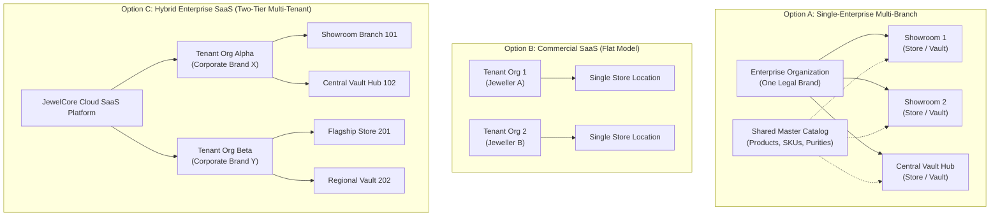
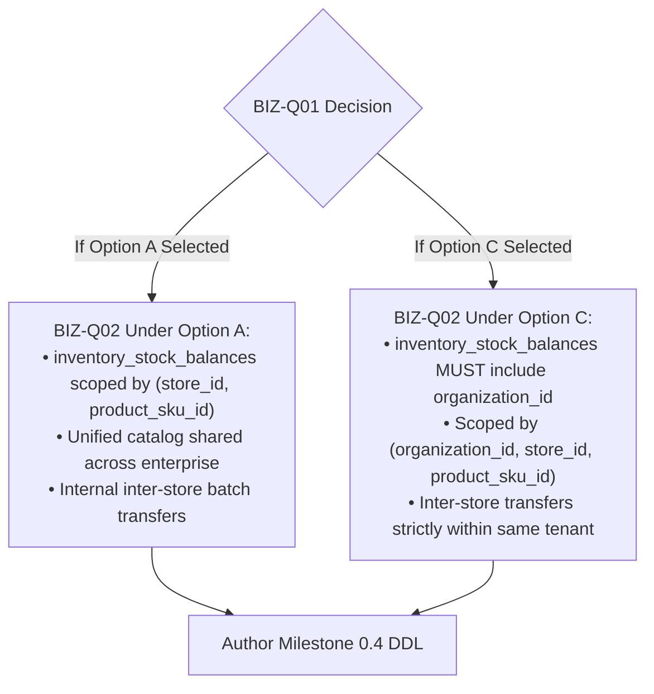

# Decision Brief: BIZ-Q01 — Organization and Tenant Architecture

**Document Identifier:** `BIZ-Q01`  
**Document Version:** 1.0  
**Status:** `RECOMMENDED (OPEN)` — Awaiting Product Owner Sign-Off  
**Date:** 2026-11-03  
**Authors:** Principal Enterprise Architect, SaaS Architect, PostgreSQL Database Architect, Business Systems Analyst  
**Project:** Jewellery ERP Platform (`jewelcore-erp`)  
**Workspace:** `/home/prasanta/Documents/projects/JewelCore-ERP`  
**Target Stack:** Next.js 15 (Web) + Express 5 & TypeScript (API/Worker) + PostgreSQL 18 + Redis 7.2 / BullMQ

---

## 1. Decision Statement

**Which organization and tenant architecture must JewelCore ERP adopt to govern corporate tenancy, multi-branch store operations, data isolation boundaries, and the physical database schema for Milestone 0.4?**

This decision package evaluates three distinct architectural models:

- **Option A:** Single-Enterprise Multi-Branch Architecture
- **Option B:** Commercial Multi-Tenant SaaS (Flat / Single-Location Tenant Model)
- **Option C:** Hybrid Enterprise and Commercial Multi-Tenant SaaS (Two-Tier Tenant $\rightarrow$ Multi-Branch Model)

---

## 2. Business Context & Problem Statement

Milestone 0.3 delivered an internally consistent, fully normalized 43-entity Logical Relational Data Model ([`docs/architecture/LOGICAL_DATA_MODEL.md`](file:///home/prasanta/Documents/projects/JewelCore-ERP/docs/architecture/LOGICAL_DATA_MODEL.md) v0.3.3). In this model, [`organizations`](file:///home/prasanta/Documents/projects/JewelCore-ERP/docs/architecture/LOGICAL_DATA_MODEL.md#L45) (Entity 1) is defined as the root corporate entity, and [`stores`](file:///home/prasanta/Documents/projects/JewelCore-ERP/docs/architecture/LOGICAL_DATA_MODEL.md#L83) (Entity 2) is defined as a branch location (e.g. retail showroom, vault hub, regional division).

However, **physical PostgreSQL 18 DDL generation, index authoring, foreign key structuring, and database migration authoring remain strictly paused** under Milestone 0.3.1 governance. Physical schema design cannot proceed without answering a foundational business question:

> **Is JewelCore ERP being developed as an internal enterprise operating system for a single corporate jewellery company operating multiple branches, or as a commercial multi-tenant SaaS platform marketed to multiple independent jewellery businesses?**

### The Critical Distinction: Data-Model Structure vs. Business Tenancy

A frequent architectural misconception is assuming that because the logical data model contains an `organizations` table with a 1-to-many relationship to `stores`, the system is automatically a "multi-tenant SaaS platform."

- **Data-Model Structure:** Represents relational containment. An organization contains stores; stores contain vaults; vaults contain lockers; lockers contain compartments. This hierarchy is equally required by a single corporate enterprise managing multiple showroom branches and regional divisions.
- **Business Tenancy:** Dictates corporate legal boundaries, cross-entity trust, subscription lifecycle, billing, and absolute cryptographic/logical data partitioning. In commercial SaaS, "Organization A" and "Organization B" are competitors; data leakage between them constitutes a catastrophic regulatory, legal, and commercial disaster. In a single enterprise, "Store A" and "Store B" are internal branches of the same legal entity sharing a balance sheet, executive leadership, and product catalog.

---

## 3. Existing Documented Requirements & Source Audit

A systematic review of all baseline repository documents reveals specific facts, design tensions, and ambiguities:

1. **[`JEWELLERY_ERP_PROJECT_OVERVIEW.md`](file:///home/prasanta/Documents/projects/JewelCore-ERP/JEWELLERY_ERP_PROJECT_OVERVIEW.md) (Section 15):**
   - Describes an operational store named `Jewellery ERP Platform — Platinum Division / Store (STORE001)` alongside `Silver Division` and `Canada Region`.
   - References an organizational `Head Office System GUID`.
   - Establishes a Modular Monolith in a single monorepo (`apps/web`, `apps/api`, `apps/worker`).
   - _Inference:_ The existing narrative describes regional business divisions and branch stores of a **single enterprise corporate brand**, not independent competing retail subscribers.
2. **[`docs/JEWELLERY_ERP_PHASE_0_BASELINE_v0.2.md`](file:///home/prasanta/Documents/projects/JewelCore-ERP/docs/JEWELLERY_ERP_PHASE_0_BASELINE_v0.2.md) (Section 16, Decision D-01):**
   - Explicitly records: _"One organization or true multi-tenant platform? Model Organization and Store separately; confirm isolation requirements. Status: Open."_
   - Acknowledges that tenancy was left unresolved at the baseline phase.
3. **[`docs/architecture/DOMAIN_MODEL_REVIEW.md`](file:///home/prasanta/Documents/projects/JewelCore-ERP/docs/architecture/DOMAIN_MODEL_REVIEW.md) (v1.6):**
   - Reconciled all 43 entities. Flags `BIZ-Q01` as a P0 physical DDL blocker that dictates whether composite unique keys `(organization_id, sku_code)` and PostgreSQL Row-Level Security (RLS) must be introduced into physical DDL.
4. **[`docs/architecture/LOGICAL_DATA_MODEL.md`](file:///home/prasanta/Documents/projects/JewelCore-ERP/docs/architecture/LOGICAL_DATA_MODEL.md) (v0.3.3):**
   - Root entities [`organizations`](file:///home/prasanta/Documents/projects/JewelCore-ERP/docs/architecture/LOGICAL_DATA_MODEL.md#L45) (1), [`stores`](file:///home/prasanta/Documents/projects/JewelCore-ERP/docs/architecture/LOGICAL_DATA_MODEL.md#L83) (2), [`users`](file:///home/prasanta/Documents/projects/JewelCore-ERP/docs/architecture/LOGICAL_DATA_MODEL.md#L118) (3), [`categories`](file:///home/prasanta/Documents/projects/JewelCore-ERP/docs/architecture/LOGICAL_DATA_MODEL.md#L416) (10), [`materials`](file:///home/prasanta/Documents/projects/JewelCore-ERP/docs/architecture/LOGICAL_DATA_MODEL.md#L490) (12), [`purities`](file:///home/prasanta/Documents/projects/JewelCore-ERP/docs/architecture/LOGICAL_DATA_MODEL.md#L526) (13), [`gemstones`](file:///home/prasanta/Documents/projects/JewelCore-ERP/docs/architecture/LOGICAL_DATA_MODEL.md#L568) (14), [`products`](file:///home/prasanta/Documents/projects/JewelCore-ERP/docs/architecture/LOGICAL_DATA_MODEL.md#L605) (15), [`suppliers`](file:///home/prasanta/Documents/projects/JewelCore-ERP/docs/architecture/LOGICAL_DATA_MODEL.md#L738) (18), and [`goods_receipt_notes`](file:///home/prasanta/Documents/projects/JewelCore-ERP/docs/architecture/LOGICAL_DATA_MODEL.md#L782) (19) contain `organization_id`.
   - **Critical Architectural Observation:** Deep operational child entities ([`product_skus`](file:///home/prasanta/Documents/projects/JewelCore-ERP/docs/architecture/LOGICAL_DATA_MODEL.md#L644) [16], [`shipment_items`](file:///home/prasanta/Documents/projects/JewelCore-ERP/docs/architecture/LOGICAL_DATA_MODEL.md#L862) [21], [`quality_checks`](file:///home/prasanta/Documents/projects/JewelCore-ERP/docs/architecture/LOGICAL_DATA_MODEL.md#L947) [23], [`quality_check_items`](file:///home/prasanta/Documents/projects/JewelCore-ERP/docs/architecture/LOGICAL_DATA_MODEL.md#L983) [24], [`inventory_movements`](file:///home/prasanta/Documents/projects/JewelCore-ERP/docs/architecture/LOGICAL_DATA_MODEL.md#L1278) [30], [`rfid_tags`](file:///home/prasanta/Documents/projects/JewelCore-ERP/docs/architecture/LOGICAL_DATA_MODEL.md#L1516) [35], [`rfid_tag_assignments`](file:///home/prasanta/Documents/projects/JewelCore-ERP/docs/architecture/LOGICAL_DATA_MODEL.md#L1553) [36]) intentionally **omit `organization_id`**, relying on relational normalization through their parent entities.

---

## 4. Options Considered



### Option A: Single-Enterprise Multi-Branch Architecture

- **Description:** JewelCore ERP is deployed as a dedicated operational enterprise platform for a single jewellery business entity. The entity operates multiple stores, retail showrooms, regional divisions, and secure vault distribution hubs.
- **Tenancy Boundary:** Exactly one active `Organization` row. All branch locations are modeled as `Stores` associated with that organization.
- **Catalog & Inventory:** The product master catalog, purities, metals, gemstone definitions, and supplier registry are shared across all stores. Inventory custody is partitioned at the `Store` / `Vault` level. Physical stock transfers between stores are internal movements (`inventory_movements`) on a unified balance sheet.

### Option B: Commercial Multi-Tenant SaaS (Flat / Single-Location Tenant Model)

- **Description:** A commercial cloud platform where each subscriber is an independent jewellery merchant. In this simplified model, an `Organization` represents a tenant, and each tenant operates a single location (effectively equating Tenant with Store).
- **Evaluation:** In luxury jewellery, this model is **commercially unviable**. Even independent jewellers separate retail showroom display stock from high-security night vaults or back-office intake workshops. Flattening organization and store eliminates custody boundaries and fails core industry requirements. Option B is therefore recognized as an inadequate oversimplification.

### Option C: Hybrid Enterprise and Commercial Multi-Tenant SaaS (Two-Tier Hierarchy)

- **Description:** A true commercial B2B SaaS platform that supports $N$ independent jewellery client companies (`Organizations`). Within each client organization, the enterprise operates $M$ branch locations, showrooms, and vault hubs (`Stores`).
- **Nature of Option C:** Option C is the **only genuine, production-grade model for commercial SaaS in the luxury jewellery industry**. It combines commercial multi-tenancy at Tier 1 (`Organization`) with enterprise multi-branch custody at Tier 2 (`Store`).
- **Isolation Boundary:** Total logical and physical data partitioning between organizations. Zero sharing of catalogs, suppliers, customers, prices, inventory, or audit logs between Tenant Alpha and Tenant Beta.

---

## 5. Comprehensive 25-Dimension Business and Technical Comparison

The following matrix rigorously evaluates Option A and Option C across all 25 operational, technical, security, and governance dimensions:

| #      | Dimension                            | Option A: Single-Enterprise Multi-Branch                                                          | Option C: Hybrid Enterprise Multi-Tenant SaaS                                                                   | Architectural Impact & Maintenance Consequence                                                                            |
| :----- | :----------------------------------- | :------------------------------------------------------------------------------------------------ | :-------------------------------------------------------------------------------------------------------------- | :------------------------------------------------------------------------------------------------------------------------ |
| **1**  | **Business Ownership Model**         | Single corporate enterprise. One legal owner, consolidated financial entity.                      | Multiple independent B2B subscribers. Competing jewellery companies on shared infrastructure.                   | Option C requires strict legal data segregation, SLA management, and tenant liability boundaries.                         |
| **2**  | **Organization Hierarchy**           | Exactly 1 root Organization record per database deployment.                                       | $N$ independent Organization records representing separate client accounts.                                     | Option C requires tenant lifecycle management (provisioning, suspension, deactivation).                                   |
| **3**  | **Store Hierarchy**                  | Multiple Stores (showrooms, vaults, regional divisions) under the enterprise.                     | Multiple Stores scoped strictly within each parent Organization.                                                | Identical physical entity model (`stores.organization_id`), but Option C forbids cross-tenant store queries.              |
| **4**  | **User Ownership**                   | Users are employees of the enterprise. Global employee directory.                                 | Users belong strictly to one Organization (or multi-membership SaaS identity).                                  | Option C requires tenant-scoped user authentication or global identity provider with tenant routing.                      |
| **5**  | **Authentication Boundaries**        | Single corporate IdP (SAML/SSO or local Argon2id). Session carries `userId` and `storeId`.        | Global authentication service. JWT claims must contain validated `orgId` + `userId` + active `storeId`.         | Option C mandates strict cryptographic token binding to prevent cross-tenant impersonation.                               |
| **6**  | **RBAC Architecture**                | Global enterprise role catalog (`Admin`, `QC Inspector`, `Vault Custodian`, `Cashier`).           | Tenant-isolated role catalog or system-template roles cloned per Organization.                                  | Option C requires preventing Tenant A from modifying or viewing Tenant B's custom roles/permissions.                      |
| **7**  | **ABAC Architecture**                | Attribute-based rules enforce branch context (`user.store_id == resource.store_id`).              | Rules enforce tenant boundary FIRST (`user.org_id == resource.org_id`), then store context.                     | Mandatory two-tier attribute evaluation in Express 5 middleware on every request in Option C.                             |
| **8**  | **Organization-Level Isolation**     | Implicit. All rows belong to the same enterprise. Organization ID is a structural root.           | Absolute and mandatory. Cross-tenant read or write is a critical P0 security breach.                            | Option C requires defense-in-depth: Application scoping + DB session context + PostgreSQL RLS.                            |
| **9**  | **Store-Level Isolation**            | Custody boundary (`INV-11`). Staff restricted to assigned store; managers view all.               | Operational custody boundary within the tenant. Cross-store access permitted only within same Org.              | Both options enforce store context switching via `x-store-id` header and `store_memberships`.                             |
| **10** | **Database Isolation Strategy**      | Single shared PostgreSQL schema. Normalized relational tables.                                    | Shared database, shared schema with PostgreSQL Row-Level Security (RLS) OR schema-per-tenant.                   | Shared schema requires `organization_id` on all tables or composite RLS joins. Schema-per-tenant creates migration bloat. |
| **11** | **PostgreSQL RLS Implications**      | Optional. Can use standard application `WHERE store_id = :storeId` filters.                       | Mandatory. Every table must execute `ENABLE ROW LEVEL SECURITY` with `current_setting('app.org_id')`.           | Option C adds 5–15% CPU overhead on query execution and complex connection pool session handling.                         |
| **12** | **Unique Constraints**               | Globally unique natural keys: `UNIQUE(sku_code)`, `UNIQUE(serial_number)`, `UNIQUE(epc_code)`.    | Composite unique keys mandatory: `UNIQUE(organization_id, sku_code)`, `UNIQUE(organization_id, serial_number)`. | Option C prevents global indexes; requires denormalizing `organization_id` onto child tables.                             |
| **13** | **Foreign-Key Design**               | Clean surrogate keys: child tables reference immediate parent (`product_skus -> products`).       | Composite foreign keys `(organization_id, id)` needed to guarantee strict tenant referential integrity.         | Option C significantly increases foreign key index sizes and DDL complexity.                                              |
| **14** | **Organization-Scoped Identifiers**  | Sequential document codes can be enterprise-wide (e.g. `GRN-2026-0001`).                          | Document numbering sequences must partition per tenant: `UNIQUE(organization_id, grn_number)`.                  | Option C requires tenant-isolated sequence counters in PostgreSQL.                                                        |
| **15** | **Cross-Store Transfers**            | Internal physical transfer (`from_store -> to_store`) under shared corporate balance sheet.       | Permitted between stores of the SAME Org. Strictly PROHIBITED between different Orgs.                           | Inter-tenant transfers in Option C require B2B commercial sales/purchase transactions, not movements.                     |
| **16** | **Centralized Inventory Visibility** | Head office executives view consolidated global inventory across all showrooms and vaults.        | Consolidated visibility strictly confined to the owning Organization.                                           | Option C requires verifying that corporate reporting queries never omit the `organization_id` clause.                     |
| **17** | **Reporting & Analytics**            | Enterprise BI aggregates data across all stores, regions, and product categories.                 | Analytics completely segregated per tenant. Platform-level cross-tenant metrics must be anonymized.             | Option C requires separate reporting data marts or strict tenant filters in analytics pipelines.                          |
| **18** | **Audit Trail Boundaries**           | Single enterprise audit log (`audit_events`). Security team audits all company actions.           | Multi-tenant audit trail. Tenant admins can only inspect their own audit logs.                                  | Option C requires immutable `organization_id` on all audit records; strict export boundaries.                             |
| **19** | **Configuration Inheritance**        | Enterprise policies (weight tolerances, markup, currency) inherit to all branches.                | Tenant-level configurations override system defaults; store-level overrides tenant defaults.                    | Option C requires a hierarchical configuration engine: `System Default -> Tenant Config -> Store Config`.                 |
| **20** | **Tax & Accounting Isolation**       | Single corporate general ledger, tax registration (HST/GST/VAT), and fiscal year.                 | Multi-jurisdiction, multi-currency accounting. Each tenant has independent fiscal rules.                        | Option C requires tenant-specific currency, chart of accounts, and tax engine integrations.                               |
| **21** | **Data Export & Deletion**           | Enterprise-wide database backup and point-in-time recovery (PITR).                                | GDPR / SOC2 tenant offboarding: must purge or export 100% of a single tenant's data on demand.                  | In shared-schema Option C, selective single-tenant deletion requires cascading `DELETE WHERE org_id = :id`.               |
| **22** | **SaaS Onboarding & Billing**        | No billing or automated tenant onboarding needed. Provisioned via devops/admin scripts.           | Automated tenant registration, credit card/Stripe billing, seat licensing, tier limits.                         | Option C requires building billing, metered usage, plan enforcement, and subscription management.                         |
| **23** | **Backup & Recovery**                | Standard PostgreSQL database-level backup (pg_dump, WAL archiving, pgBackRest).                   | Highly complex in shared-schema: restoring one tenant requires selective data extraction from WAL.              | Database-level restore in Option C rolls back ALL tenants; requires sophisticated selective restore tooling.              |
| **24** | **Operational Complexity**           | Low to Medium. Standard modular monolith operations, single database, straightforward monitoring. | High. Multi-tenant monitoring, tenant noisy-neighbor mitigation, tenant connection management.                  | Option C significantly increases devops overhead, performance testing, and production support burden.                     |
| **25** | **Future Scalability**               | Vertical DB scaling + read replicas easily support 100+ stores and millions of items.             | Requires multi-region deployments, sharding by tenant, or database-per-tenant clusters at scale.                | Option C scales to thousands of tenants, but requires substantial ongoing infrastructure investment.                      |

---

## 6. Security Analysis & Failure Modes

### 6.1 Multi-Tenant Security Failure Scenarios (Option C Specific)

```
+-----------------------------------------------------------------------------------------------------------------------+
| Threat Scenario 1: Cross-Tenant Data Access via Insecure Direct Object Reference (IDOR)                              |
+-------------------+---------------------------------------------------------------------------------------------------+
| Failure Mechanism | Client modifies API request UUID (e.g. GET /api/v1/inventory/items/:id). API queries by item PK   |
|                   | without validating that item.organization_id matches req.user.orgId.                              |
| Impact            | Catastrophic. Competitor views high-value jewellery stock, cost prices, purities, and vault locations.|
| Preventive Control| 1. Mandatory PostgreSQL Row-Level Security (RLS) enforcing tenant session setting.                |
|                   | 2. Base Repository abstraction enforcing AND organization_id = :orgId on EVERY query.             |
| Verification Test | Automated cross-tenant security test suite attempting cross-org reads across 100% of endpoints.    |
+-----------------------------------------------------------------------------------------------------------------------+
| Threat Scenario 2: Background Worker Processing Cross-Tenant Events                                                   |
+-------------------+---------------------------------------------------------------------------------------------------+
| Failure Mechanism | BullMQ worker dequeues domain event or RFID batch job but executes under system worker context   |
|                   | without establishing tenant database session context (current_setting('app.current_org_id')).     |
| Impact            | Severe. Worker queries return empty results (RLS block) or process jobs against wrong tenant data.|
| Preventive Control| 1. Event envelope MANDATES orgId attribute.                                                       |
|                   | 2. EventProcessor establishes RLS session variable before invoking DomainEventHandler.            |
| Verification Test | Unit & integration tests asserting EventProcessor sets and resets tenant session context per job. |
+-----------------------------------------------------------------------------------------------------------------------+
| Threat Scenario 3: Missing Organization Filters in Custom SQL / Reporting Queries                                     |
+-------------------+---------------------------------------------------------------------------------------------------+
| Failure Mechanism | Complex analytics or aggregation query omits organization_id join on un-denormalized child table.  |
| Impact            | High. Aggregated dashboard metrics leak competitor sales volumes, weights, or scrap rates.        |
| Preventive Control| PostgreSQL RLS policy on child tables OR mandatory tenant denormalization across child tables.    |
| Verification Test | pgTAP automated assertions verifying RLS policies exist and are enabled on 100% of tables.        |
+-----------------------------------------------------------------------------------------------------------------------+
| Threat Scenario 4: Cross-Store Unauthorized Access Within Tenant (Both Option A & C)                                  |
+-------------------+---------------------------------------------------------------------------------------------------+
| Failure Mechanism | User assigned to Store A supplies x-store-id: STORE_B header to execute vault movements.          |
| Impact            | High. Staff member conducts unauthorized physical custody transfers outside their store branch.   |
| Preventive Control| IAM store membership middleware validating active membership and role in target store (`INV-11`).  |
| Verification Test | Automated IAM test asserting 403 ERR_STORE_ACCESS_DENIED when x-store-id does not match user.     |
+-----------------------------------------------------------------------------------------------------------------------+
```

---

## 7. Database Design Impact on the 43-Entity Logical Data Model

Adopting **Option C** versus **Option A** has profound structural ramifications on the 43 logical entities:

### 7.1 Child Entity Tenant Denormalization Requirements (Option C)

In [`docs/architecture/LOGICAL_DATA_MODEL.md`](file:///home/prasanta/Documents/projects/JewelCore-ERP/docs/architecture/LOGICAL_DATA_MODEL.md) v0.3.3, 10 root entities contain `organization_id`. However, in a shared-schema multi-tenant database (Option C), relying on multi-hop joins to reach `organization_id` makes PostgreSQL RLS policies computationally prohibitive and breaks composite unique constraints.

To implement Option C safely, **at least 15 child tables must be denormalized to include `organization_id`**:

1. `subcategories` (11) — currently references `categories`
2. `product_skus` (16) — currently references `products`
3. `product_gemstone_specs` (17) — currently references `product_skus`
4. `shipments` (20) — currently references `goods_receipt_notes`
5. `shipment_items` (21) — currently references `shipments`
6. `staff_assignments` (22) — currently references `stores`
7. `quality_checks` (23) — currently references `shipments`
8. `quality_check_items` (24) — currently references `quality_checks`
9. `weight_measurements` (25) — currently references `quality_check_items`
10. `item_gemstones` (26) — currently references `quality_check_items`
11. `quality_decisions` (27) — currently references `quality_checks`
12. `inventory_movements` (30) — currently references `inventory_items`
13. `inventory_status_history` (31) — currently references `inventory_items`
14. `rfid_tags` (35) — currently references `stores`
15. `rfid_tag_assignments` (36) — currently references `inventory_items`

### 7.2 Composite Uniqueness Impact

- **Option A:** Natural keys are globally unique. Constraints are clean:
  `UNIQUE (sku_code)`, `UNIQUE (serial_number)`, `UNIQUE (epc_code)`.
- **Option C:** Natural keys must be scoped per tenant:
  `UNIQUE (organization_id, sku_code)`, `UNIQUE (organization_id, serial_number)`.
  _Exception:_ Physical EPC RFID transponders (`rfid_tags.epc_code`) are physically unique across the planet (GS1 SGTIN-96 standard); scoping them by tenant introduces dual-tagging physical corruption.

### 7.3 Index Bloat & Query Performance

- **Option A:** B-Tree indexes are compact and focused on query search predicates: `INDEX (product_sku_id)`, `INDEX (store_id, custody_state)`.
- **Option C:** All primary search indexes must prefix `organization_id`: `INDEX (organization_id, product_sku_id)`, `INDEX (organization_id, store_id, custody_state)`. This increases index storage requirements by approximately 25–35% across PostgreSQL buffer cache.

---

## 8. Cost, Complexity, and Product Strategy Comparison

| Strategic Dimension            | Option A: Single-Enterprise Multi-Branch | Option C: Hybrid Enterprise SaaS       | Analysis & Trade-off Assessment                                                                                                                                 |
| :----------------------------- | :--------------------------------------- | :------------------------------------- | :-------------------------------------------------------------------------------------------------------------------------------------------------------------- |
| **Initial Development Effort** | **Baseline (1.0x)**                      | **High (1.6x – 2.0x)**                 | Option C requires 15+ table denormalizations, RLS configuration, multi-tenant auth context, tenant routing, and extensive cross-tenant security testing.        |
| **Time-to-Market (Phase 0)**   | **Fastest (On Schedule)**                | **Substantial Delay (+6 to 10 weeks)** | Implementing and verifying bulletproof multi-tenant RLS and composite uniqueness across 43 tables will severely breach Sprint 1–6 delivery targets.             |
| **Ongoing Maintenance**        | **Low to Moderate**                      | **High**                               | Every new entity, query, and migration in Option C must be audited for tenant leakage and RLS policy compliance.                                                |
| **Security & Compliance Risk** | **Low**                                  | **Extremely High**                     | In Option A, an authorization bug leaks data between internal employees. In Option C, an authorization bug leaks proprietary diamond inventory to a competitor. |
| **Deployment Complexity**      | **Simple**                               | **High**                               | Option A uses standard Docker/PostgreSQL containers. Option C requires tenant routing proxies, multi-tenant monitoring, and tenant noisy-neighbor isolation.    |
| **Commercial Scalability**     | **Single Customer**                      | **Unlimited Commercial Market**        | Option A can only be sold as dedicated on-premise / single-tenant cloud deployments. Option C allows selling subscription SaaS to hundreds of jewellers.        |
| **Future Migration Cost**      | **High if delayed**                      | **Zero (Native from Day 1)**           | Converting Option A to Option C in Phase 2 would require an estimated 6–9 month data migration, schema refactor, and security re-architecture.                  |

---

## 9. Architectural Recommendation & Supporting Evidence

### 9.1 The Recommendation

The architectural review team **recommends Option A (Single-Enterprise Multi-Branch Architecture with Provisioned Tenant Isolation Hooks)** for Phase 0 delivery, while **challenging the Product Owner to confirm whether commercial SaaS is an explicit Year-1 business mandate**.

### 9.2 Supporting Evidence for Option A

1. **Documented Domain Reality:** All authoritative documents (`PROJECT_OVERVIEW.md`, `BASELINE_v0.2.md`) model a single corporate entity with divisions (`Platinum Division`, `Silver Division`) reporting to a common `Head Office System GUID`.
2. **Absence of SaaS Infrastructure:** The repository contains zero user stories, backlog items, or acceptance criteria for subscription billing, self-service tenant onboarding, credit card processing, usage tier metering, or plan enforcement.
3. **Execution Feasibility:** Phase 0 has 35 features across 7 sprints. Attempting to build a commercial multi-tenant SaaS platform while simultaneously solving analytical scale metrology (0.1mg precision), gemstone parcel grading, serialized custody movements, and RFID transponder encoding creates severe scope saturation and high delivery failure risk.
4. **Provisioned Tenant Hooks:** By preserving `organization_id` on the 10 root aggregates in the logical model, Option A avoids painting the architecture into a corner. The code retains an explicit tenant boundary at the top level, allowing dedicated single-tenant cloud deployments for enterprise clients today.

### 9.3 When Must Option C Be Chosen Instead?

The Product Owner must override this recommendation and select **Option C** IF AND ONLY IF:

- The fundamental business model of JewelCore ERP is a **commercial multi-tenant B2B SaaS startup** whose core revenue comes from selling subscriptions to independent jewellery stores starting on Day 1.
- Stakeholders accept a **6–10 week expansion of Milestone 0.4 and Sprint 1–6 timelines** to accommodate tenant denormalization, PostgreSQL RLS engineering, and multi-tenant security verification.

---

## 10. Documented Facts vs. Inferences vs. Assumptions

To maintain absolute intellectual honesty and governance rigor:

```
+---------------------------------------------------------------------------------------------------+
| Classification Breakdown                                                                          |
+--------------------------+------------------------------------------------------------------------+
| 1. Documented Facts      | • LOGICAL_DATA_MODEL.md v0.3.3 models 43 entities across 8 domains.    |
|                          | • 10 root tables contain organization_id; 15+ child tables do NOT.     |
|                          | • Baseline documents describe Platinum/Silver Divisions & Head Office. |
|                          | • There are NO SaaS billing, metering, or signup features in backlog.  |
+--------------------------+------------------------------------------------------------------------+
| 2. Architectural         | • Luxury jewellery retailers require multi-branch (stores/vaults).     |
|    Inferences            | • True SaaS in jewellery must be Option C (Two-Tier); Option B is dead.|
|                          | • Option C requires denormalizing organization_id onto child tables.   |
|                          | • Option C increases physical index size and query testing by ~30%.    |
+--------------------------+------------------------------------------------------------------------+
| 3. Business Assumptions  | • JewelCore ERP is being built for a single corporate enterprise or    |
|                          |   initial flagship enterprise client, not open self-signup SaaS.       |
|                          | • Speed-to-market for inventory and QC metrology takes priority over   |
|                          |   commercial multi-tenant subscription infrastructure in Phase 0.      |
+--------------------------+------------------------------------------------------------------------+
| 4. Product Owner         | • Formal selection of Option A vs. Option C.                           |
|    Decision Authority    | • Approval of timeline consequences if Option C is mandated.           |
+--------------------------+------------------------------------------------------------------------+
```

---

## 11. Impact on Gate BIZ-Q02 (Inventory Model Dependency)

Decision `BIZ-Q01` is a direct technical prerequisite for **`BIZ-Q02` (Serialized Only vs. Hybrid Tracking)**:



1. **Schema Scoping:** In Option A, bulk inventory balance table `inventory_stock_balances` (Entity 29) requires candidate key `(store_id, product_sku_id)`. In Option C, it MUST be scoped as `(organization_id, store_id, product_sku_id)`.
2. **Transfer Logic:** Under Option A, inter-store batch depletion and intake operate within a shared corporate general ledger. Under Option C, inter-store transfers require cross-checking that source and destination stores share identical `organization_id`.
3. **Execution Rule:** **`BIZ-Q02` remains PENDING and blocked until the Product Owner signs off on `BIZ-Q01`.**

---

## 12. Unanswered Business Questions for Stakeholder Clarification

Before signing Section 13, the Product Owner should consider:

1. **Commercial Model:** Will JewelCore ERP be sold as a multi-tenant cloud service where multiple jewellery companies log into `app.jewelcore.com`, or will each customer receive a dedicated cloud instance?
2. **Catalog Sharing:** Will independent jewellers ever share a centralized product catalog or precious metal pricing feed, or is catalog data 100% proprietary to each company?
3. **Cross-Company Handoffs:** Do regional divisions operate as separate legal entities with inter-company transfer pricing and tax invoicing, or as branch locations under a consolidated tax ID?

---

## 13. Product Owner Formal Decision Section

```
+-----------------------------------------------------------------------------------------------------------------------+
| PRODUCT OWNER FORMAL DECISION GATE — BIZ-Q01: TENANCY & ORGANIZATION ARCHITECTURE                                    |
+-----------------------------------------------------------------------------------------------------------------------+
| [ ] OPTION A: Single-Enterprise Multi-Branch Architecture (Recommended)                                              |
|     - One corporate Organization operating multiple Store branches and vault hubs under a shared catalog.             |
|     - Retain organization_id on 10 root entities; do not denormalize tenant keys onto child tables.                   |
|     - Author Milestone 0.4 DDL for clean enterprise deployment; defer commercial SaaS refactoring.                    |
|                                                                                                                       |
| [ ] OPTION C: Hybrid Enterprise and Commercial Multi-Tenant SaaS Architecture                                         |
|     - Commercial SaaS platform hosting N independent client Organizations, each with M branch Stores.                |
|     - Denormalize organization_id across 15+ child tables; implement PostgreSQL Row-Level Security (RLS).             |
|     - Accept 6–10 week schedule adjustment for Milestone 0.4 and Phase 0 delivery.                                   |
+-----------------------------------------------------------------------------------------------------------------------+
| Decision Status:         [ PENDING ]                                                                                  |
| Selected Option:         PENDING                                                                                      |
| Authorized Approver:     PENDING                                                                                      |
| Approval Date:           PENDING                                                                                      |
| Decision Rationale:      AWAITING PRODUCT OWNER DECISION                                                              |
| Technical Exceptions:    NONE RECORDED                                                                                |
+-----------------------------------------------------------------------------------------------------------------------+
```

---

_End of Decision Brief BIZ-Q01 (v1.0)._
