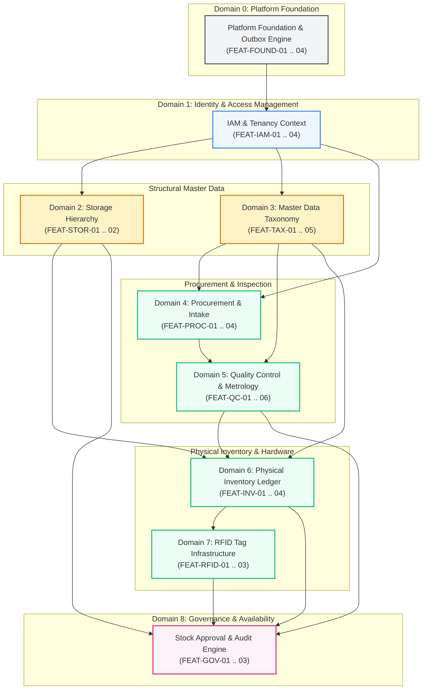
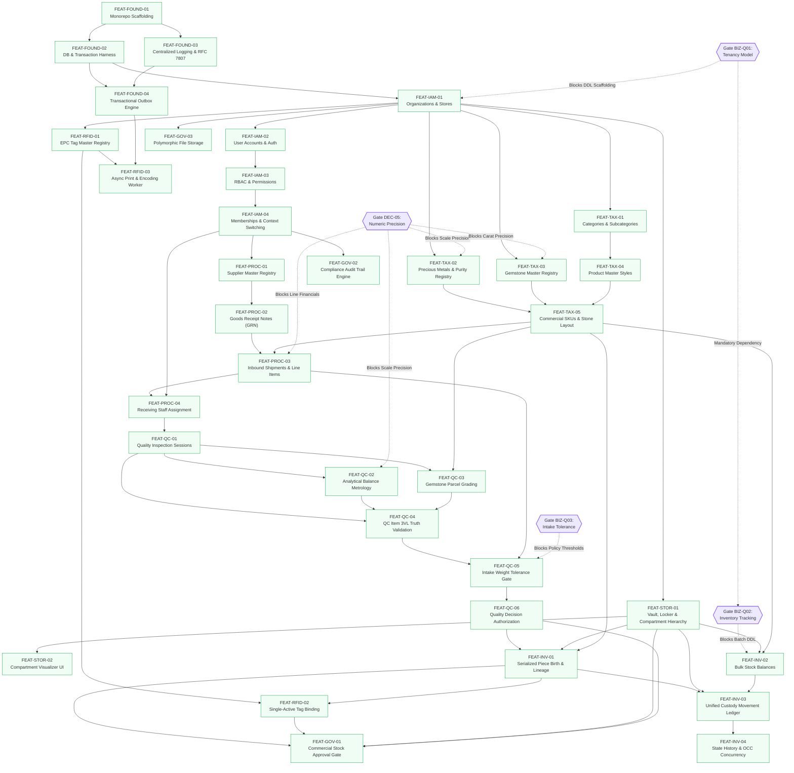

# Jewellery ERP Platform — Feature Dependency Map & Critical Path Analysis

**Document Version:** 1.1  
**Status:** Engineering Execution Baseline — Milestone 0.3.2 Deliverable  
**Date:** 2026-11-03  
**Authors:** Principal Software Architect, Senior Backend Engineer, Senior Frontend Engineer, Database Architect, QA Engineer  
**Project:** Jewellery ERP Platform (`jewellery-erp-platform`)  
**Repository:** `/home/prasanta/Documents/projects/JewelCore-ERP`

**Authoritative Baseline References:**

- [`docs/implementation/FEATURE_IMPLEMENTATION_MASTER_PLAN.md`](file:///home/prasanta/Documents/projects/JewelCore-ERP/docs/implementation/FEATURE_IMPLEMENTATION_MASTER_PLAN.md) (v1.1)
- [`docs/architecture/LOGICAL_DATA_MODEL.md`](file:///home/prasanta/Documents/projects/JewelCore-ERP/docs/architecture/LOGICAL_DATA_MODEL.md) (v0.3.3)
- [`docs/architecture/PHYSICAL_SCHEMA_DECISION_REGISTER.md`](file:///home/prasanta/Documents/projects/JewelCore-ERP/docs/architecture/PHYSICAL_SCHEMA_DECISION_REGISTER.md) (v1.2.2)
- [`docs/architecture/PHYSICAL_SCHEMA_PO_DECISION_WORKSHEET.md`](file:///home/prasanta/Documents/projects/JewelCore-ERP/docs/architecture/PHYSICAL_SCHEMA_PO_DECISION_WORKSHEET.md) (v1.0)

---

## 1. Domain-Level Architecture Dependency Model

To eliminate integration risk and guarantee architectural integrity, cross-domain dependencies in the Jewellery ERP Platform strictly follow a forward-flowing, non-circular hierarchy. Lower-level operational domains (IAM, Storage, Taxonomy) provide the foundational entities required by transactional domains (Procurement, Quality Control, Inventory, RFID, Governance).



---

## 2. Detailed Vertical Feature Dependency Map

The diagram below maps every specific feature in Phase 0, illustrating exact prerequisite edges, governance gate overlays, and the critical path to operational delivery.



---

## 3. Exhaustive Feature Dependency Matrix

The table below details every feature in Phase 0, listing its exact prerequisites, domain dependencies, governance gate blockers, and downstream dependents:

| Feature ID          | Feature Name                     | Immediate Hard Prerequisites            | Upstream Domain Dependencies | Governance Decision Gate Dependency                                                                                         | Downstream Dependents                         |
| ------------------- | -------------------------------- | --------------------------------------- | ---------------------------- | --------------------------------------------------------------------------------------------------------------------------- | --------------------------------------------- |
| **`FEAT-FOUND-01`** | Monorepo Scaffolding             | None (Initial setup)                    | None                         | **UNBLOCKED**                                                                                                               | `FEAT-FOUND-02`, `FEAT-FOUND-03`              |
| **`FEAT-FOUND-02`** | Database & Transaction Harness   | `FEAT-FOUND-01`                         | Foundation                   | **UNBLOCKED** (Design/Harness)                                                                                              | `FEAT-FOUND-04`, `FEAT-IAM-01`                |
| **`FEAT-FOUND-03`** | Centralized Logging & RFC 7807   | `FEAT-FOUND-01`                         | Foundation                   | **UNBLOCKED**                                                                                                               | All API Controllers                           |
| **`FEAT-FOUND-04`** | Transactional Outbox Engine      | `FEAT-FOUND-02`, `FEAT-FOUND-03`        | Foundation                   | **PARTIALLY UNBLOCKED** — Architectural preparation unblocked; physical `outbox_events` DDL requires Milestone 0.4 approval | `FEAT-RFID-03`, `FEAT-GOV-02`                 |
| **`FEAT-IAM-01`**   | Organizations & Stores           | `FEAT-FOUND-02`                         | Foundation                   | **Blocked DDL by `BIZ-Q01`**                                                                                                | `FEAT-IAM-02`, `FEAT-STOR-01`, `FEAT-TAX-01`  |
| **`FEAT-IAM-02`**   | User Accounts & Authentication   | `FEAT-IAM-01`                           | Foundation, IAM              | Requires `FEAT-IAM-01`                                                                                                      | `FEAT-IAM-03`                                 |
| **`FEAT-IAM-03`**   | RBAC Roles & Permissions         | `FEAT-IAM-02`                           | IAM                          | Requires `FEAT-IAM-02`                                                                                                      | `FEAT-IAM-04`                                 |
| **`FEAT-IAM-04`**   | Memberships & Store Context      | `FEAT-IAM-03`                           | IAM                          | Requires `FEAT-IAM-03`                                                                                                      | `FEAT-PROC-01`, `FEAT-PROC-04`, `FEAT-GOV-02` |
| **`FEAT-STOR-01`**  | Storage Tree Hierarchy           | `FEAT-IAM-01`                           | IAM                          | Requires `FEAT-IAM-01`                                                                                                      | `FEAT-STOR-02`, `FEAT-INV-01`, `FEAT-INV-03`  |
| **`FEAT-STOR-02`**  | Compartment Visualizer UI        | `FEAT-STOR-01`                          | Storage                      | Requires `FEAT-STOR-01`                                                                                                     | Operational Warehouse Screens                 |
| **`FEAT-TAX-01`**   | Categories & Subcategories       | `FEAT-IAM-01`                           | IAM                          | Requires `FEAT-IAM-01`                                                                                                      | `FEAT-TAX-04`                                 |
| **`FEAT-TAX-02`**   | Precious Metals & Purities       | `FEAT-IAM-01`                           | IAM                          | **Blocked scales by `DEC-05`**                                                                                              | `FEAT-TAX-05`, `FEAT-QC-04`                   |
| **`FEAT-TAX-03`**   | Gemstones Master Registry        | `FEAT-IAM-01`                           | IAM                          | **Blocked carats by `DEC-05`**                                                                                              | `FEAT-TAX-05`, `FEAT-QC-03`                   |
| **`FEAT-TAX-04`**   | Product Master Styles            | `FEAT-TAX-01`                           | Taxonomy                     | Requires `FEAT-TAX-01`                                                                                                      | `FEAT-TAX-05`                                 |
| **`FEAT-TAX-05`**   | Commercial SKUs & Gemstone Specs | `FEAT-TAX-02`, `03`, `04`               | Taxonomy                     | **Blocked scales by `DEC-05`**                                                                                              | `FEAT-PROC-03`, `FEAT-INV-01`, `FEAT-INV-02`  |
| **`FEAT-PROC-01`**  | Supplier Master Registry         | `FEAT-IAM-04`                           | IAM                          | Requires `FEAT-IAM-04`                                                                                                      | `FEAT-PROC-02`                                |
| **`FEAT-PROC-02`**  | Goods Receipt Notes (GRN)        | `FEAT-PROC-01`                          | Procurement                  | Requires `FEAT-PROC-01`                                                                                                     | `FEAT-PROC-03`                                |
| **`FEAT-PROC-03`**  | Inbound Shipments & Line Items   | `FEAT-PROC-02`, `TAX-05`                | Procurement, Taxonomy        | **Blocked totals by `DEC-05`**                                                                                              | `FEAT-PROC-04`, `FEAT-QC-05`                  |
| **`FEAT-PROC-04`**  | Receiving Staff Assignment       | `FEAT-PROC-03`, `IAM-04`                | Procurement, IAM             | Requires `FEAT-PROC-03`                                                                                                     | `FEAT-QC-01`                                  |
| **`FEAT-QC-01`**    | QC Inspection Sessions           | `FEAT-PROC-04`                          | Procurement                  | Requires `FEAT-PROC-04`                                                                                                     | `FEAT-QC-02`, `03`, `04`                      |
| **`FEAT-QC-02`**    | Analytical Balance Metrology     | `FEAT-QC-01`                            | QC                           | **Blocked weights by `DEC-05`**                                                                                             | `FEAT-QC-04`                                  |
| **`FEAT-QC-03`**    | Gemstone Parcel Grading          | `FEAT-QC-01`, `TAX-05`                  | QC, Taxonomy                 | **Blocked carats by `DEC-05`**                                                                                              | `FEAT-QC-04`                                  |
| **`FEAT-QC-04`**    | QC Item 3VL Truth Validation     | `FEAT-QC-01`, `02`, `03`                | QC                           | Requires `FEAT-QC-02`, `03`                                                                                                 | `FEAT-QC-05`                                  |
| **`FEAT-QC-05`**    | Intake Weight Tolerance Gate     | `FEAT-QC-04`, `PROC-03`                 | QC, Procurement              | **Blocked policy by `BIZ-Q03`**                                                                                             | `FEAT-QC-06`                                  |
| **`FEAT-QC-06`**    | Quality Decision Authorization   | `FEAT-QC-05`                            | QC                           | Requires `FEAT-QC-05`                                                                                                       | `FEAT-INV-01`, `FEAT-GOV-01`                  |
| **`FEAT-INV-01`**   | Serialized Piece Birth & Lineage | `FEAT-QC-06`, `STOR-01`, `TAX-05`       | QC, Storage, Taxonomy        | Requires `FEAT-QC-06`                                                                                                       | `FEAT-INV-03`, `FEAT-RFID-02`, `FEAT-GOV-01`  |
| **`FEAT-INV-02`**   | Bulk Stock Balances              | `FEAT-STOR-01`, `TAX-05`                | Storage, Taxonomy            | **Blocked by `BIZ-Q02` & `BIZ-Q01`**                                                                                        | `FEAT-INV-03`                                 |
| **`FEAT-INV-03`**   | Custody Movement Ledger          | `FEAT-INV-01`, `FEAT-INV-02`, `STOR-01` | Inventory, Storage           | Requires `FEAT-INV-01`, `FEAT-INV-02`                                                                                       | `FEAT-INV-04`                                 |
| **`FEAT-INV-04`**   | State History & OCC Concurrency  | `FEAT-INV-03`                           | Inventory                    | Requires `FEAT-INV-03`                                                                                                      | State mutation endpoints                      |
| **`FEAT-RFID-01`**  | EPC Tag Master Registry          | `FEAT-IAM-01`                           | IAM                          | Requires `FEAT-IAM-01`                                                                                                      | `FEAT-RFID-02`, `FEAT-RFID-03`                |
| **`FEAT-RFID-02`**  | Single-Active Tag Binding        | `FEAT-RFID-01`, `INV-01`                | RFID, Inventory              | Requires `FEAT-INV-01`                                                                                                      | `FEAT-GOV-01`                                 |
| **`FEAT-RFID-03`**  | Async Print & Encoding Worker    | `FEAT-RFID-01`, `FOUND-04`              | RFID, Foundation             | Requires `FEAT-FOUND-04`                                                                                                    | Warehouse RFID Hardware                       |
| **`FEAT-GOV-01`**   | Stock Approval & Availability    | `INV-01`, `RFID-02`, `STOR-01`, `QC-06` | Inventory, RFID, Storage, QC | Requires `FEAT-RFID-02`                                                                                                     | Commercial Availability                       |
| **`FEAT-GOV-02`**   | Compliance Audit Trail Engine    | `FEAT-IAM-04`                           | IAM, Governance              | Requires `FEAT-IAM-04`                                                                                                      | Enterprise Audit System                       |
| **`FEAT-GOV-03`**   | Polymorphic File Storage         | `FEAT-IAM-01`                           | Foundation, IAM              | Requires `FEAT-IAM-01`                                                                                                      | `FEAT-PROC-03`, `FEAT-QC-06`                  |

---

## 4. Longest Dependency Chain Analysis (Unweighted Topological Path)

The **Longest Dependency Chain** represents the longest topological sequence of dependent features from monorepo foundation to commercial stock approval in a showroom vault. Because work duration estimates (story points) are provisional and calendar durations have not been computed via a formal Critical Path Method (CPM) calculation, this analysis measures the unweighted structural path through the Directed Acyclic Graph (DAG): **18 feature nodes = 17 dependency edges**.

### 4.1 Tied Longest Dependency Paths

The graph contains two equally long topological chains of 18 feature nodes, differing only in the parallel QC inspection branch traversed prior to piece-level 3VL truth validation:

- **Path A (Analytical Balance Metrology Spine):**  
  `FEAT-FOUND-01` $\to$ `FEAT-FOUND-02` $\to$ `FEAT-IAM-01` $\to$ `FEAT-IAM-02` $\to$ `FEAT-IAM-03` $\to$ `FEAT-IAM-04` $\to$ `FEAT-PROC-01` $\to$ `FEAT-PROC-02` $\to$ `FEAT-PROC-03` $\to$ `FEAT-PROC-04` $\to$ `FEAT-QC-01` $\to$ **`FEAT-QC-02`** $\to$ `FEAT-QC-04` $\to$ `FEAT-QC-05` $\to$ `FEAT-QC-06` $\to$ `FEAT-INV-01` $\to$ `FEAT-RFID-02` $\to$ `FEAT-GOV-01`
- **Path B (Gemstone Parcel Grading Spine):**  
  `FEAT-FOUND-01` $\to$ `FEAT-FOUND-02` $\to$ `FEAT-IAM-01` $\to$ `FEAT-IAM-02` $\to$ `FEAT-IAM-03` $\to$ `FEAT-IAM-04` $\to$ `FEAT-PROC-01` $\to$ `FEAT-PROC-02` $\to$ `FEAT-PROC-03` $\to$ `FEAT-PROC-04` $\to$ `FEAT-QC-01` $\to$ **`FEAT-QC-03`** $\to$ `FEAT-QC-04` $\to$ `FEAT-QC-05` $\to$ `FEAT-QC-06` $\to$ `FEAT-INV-01` $\to$ `FEAT-RFID-02` $\to$ `FEAT-GOV-01`

The diagram below renders **Path A** as a representative longest path.

```text
================================================================================================================
REPRESENTATIVE LONGEST DEPENDENCY CHAIN (PATH A: METROLOGY SPINE)
================================================================================================================
[Step 1]  FEAT-FOUND-01 (Monorepo Scaffolding & Build Tools)
   |
   v
[Step 2]  FEAT-FOUND-02 (Database Connection & Transaction Engine)
   |
   v
[Step 3]  FEAT-IAM-01 (Organizations & Branch Stores)             <-- Unblocked upon Gate BIZ-Q01 Approval
   |
   v
[Step 4]  FEAT-IAM-02 (User Accounts & Authentication Engine)
   |
   v
[Step 5]  FEAT-IAM-03 (RBAC Roles & Granular Permission Matrix)
   |
   v
[Step 6]  FEAT-IAM-04 (User Memberships & Store-Context Isolation)
   |
   v
[Step 7]  FEAT-PROC-01 (Supplier Master & Commercial Profile)
   |
   v
[Step 8]  FEAT-PROC-02 (Goods Receipt Note Lifecycle)
   |
   v
[Step 9]  FEAT-PROC-03 (Inbound Shipments & Line Item Manifests)  <-- Unblocked upon Gate DEC-05 Approval
   |
   v
[Step 10] FEAT-PROC-04 (Receiving Staff Assignment & Custody Log)
   |
   v
[Step 11] FEAT-QC-01 (Quality Inspection Session Scaffolding)
   |
   v
[Step 12] FEAT-QC-02 (Analytical Balance Metrology)               <-- Tied with Path B: FEAT-QC-03
   |
   v
[Step 13] FEAT-QC-04 (QC Item 3VL Inspection & Analytical Metrology)
   |
   v
[Step 14] FEAT-QC-05 (Intake Weight Tolerance Gate)               <-- Unblocked upon Gate BIZ-Q03 Approval
   |
   v
[Step 15] FEAT-QC-06 (Quality Decision Authorization & Sign-Off)
   |
   v
[Step 16] FEAT-INV-01 (Serialized Piece Birth & Lineage Creation)  (Enforces INV-14)
   |
   v
[Step 17] FEAT-RFID-02 (Single-Active Tag Binding to Serialized Item) (Enforces INV-03, INV-04)
   |
   v
[Step 18] FEAT-GOV-01 (Commercial Stock Approval: AVAILABLE_FOR_SALE) (Enforces INV-01)
================================================================================================================
Total Longest Chain Length: 18 Feature Nodes = 17 Dependency Edges
Critical Path & Convergence Rules:
  1. QC-04 Prerequisite Synchronization: FEAT-QC-04 has three immediate hard prerequisites (FEAT-QC-01,
     FEAT-QC-02, and FEAT-QC-03). Development of QC-04 cannot proceed until BOTH QC-02 and QC-03 have
     completed, regardless of which single chain is traced.
  2. RFID-02 Multi-Branch Convergence: FEAT-RFID-02 has two immediate hard prerequisites: FEAT-INV-01
     and FEAT-RFID-01. Although FEAT-RFID-01 lies on a shorter branch (FEAT-IAM-01 -> FEAT-RFID-01, length 2),
     RFID-02 cannot execute until BOTH the 16-node inventory birth spine and RFID-01 have completed.
  3. Parallel Structural Branches: Parallel master data branches (FEAT-STOR-01, FEAT-TAX-01..05) converge into
     transactional nodes (PROC-03, QC-03, INV-01, INV-02) with shorter path lengths, preserving strict DAG flow.
Dependency Integrity: ZERO Circular Loops | 100% Deterministic Forward Flow (Validated DAG)
================================================================================================================
```

---

## 5. Blocked vs. Unblocked Work Analysis

In strict adherence to the project governance protocol, physical implementation must be clearly segmented based on active decision gate blockers:

### 5.1 Unblocked Work (Ready for Specification & Engineering Prep)

The following work streams do **not** depend on unresolved business policies and may be actively authored:

1. **Foundation Engineering:**
   - Monorepo structure, pnpm workspace, Docker Compose environment (PostgreSQL 18, Redis 7).
   - Express 5 base router, Pino structured logging, correlation ID middleware (`x-request-id`).
   - Standardized RFC 7807 problem details error handling framework.
   - Vitest test runner configuration and Supertest integration test fixtures.
2. **Abstract Contracts & Zod Validation Schemas:**
   - Defining TypeScript domain interfaces mirroring the 43 entities in [`docs/architecture/LOGICAL_DATA_MODEL.md`](file:///home/prasanta/Documents/projects/JewelCore-ERP/docs/architecture/LOGICAL_DATA_MODEL.md) v0.3.3.
   - Authoring strict Zod request/response validation schemas for IAM, Catalog, Storage, and Procurement routes.
3. **Frontend UI Wireframing & App Router Layouts:**
   - Next.js 15 App Router shell, navigation sidebar, theme provider, and store-context switcher UI.
   - Reusable UI component library (Data tables, status badges, forms, modal dialogs, loading skeletons).
4. **Mock Repositories & In-Memory Service Logic:**
   - Unit testing business rules (e.g. Net Weight calculation: $\text{Net} = \text{Gross} - \text{Tare} - \text{Stones}$) with in-memory fixtures.

### 5.2 Blocked Work (Strictly Paused Under Milestone 0.3.1 Governance)

The following implementation work streams **require formal stakeholder sign-off** before executable code is produced:

1. **Blocked by `BIZ-Q01` (Tenancy Model):**
   - Authoring physical PostgreSQL DDL migration scripts (composite keys vs surrogate keys).
   - Creating table schemas with or without `organization_id` denormalization.
   - Enforcing database-level Row-Level Security (RLS) policies.
2. **Blocked by `BIZ-Q02` (Inventory Tracking Scope):**
   - Authoring DDL for `inventory_stock_balances` (Entity 29).
   - Scaffolding non-serialized quantity movement database triggers.
3. **Blocked by `BIZ-Q03` (Intake Weight Tolerance):**
   - Implementing operational tolerance comparison parameters in `QcService`.
   - Configuring the weight discrepancy exception and waiver workflow.
4. **Blocked by `DEC-05` (Numeric Precision Matrix & Accounting):**
   - Defining exact PostgreSQL column scales: `NUMERIC(10, 4)` vs alternative scales.
   - Implementing financial line-total rounding logic in procurement.
   - Finalizing zero-balance stock retention purge jobs.

---

_End of Feature Dependency Map & Critical Path Analysis (v1.1)._
